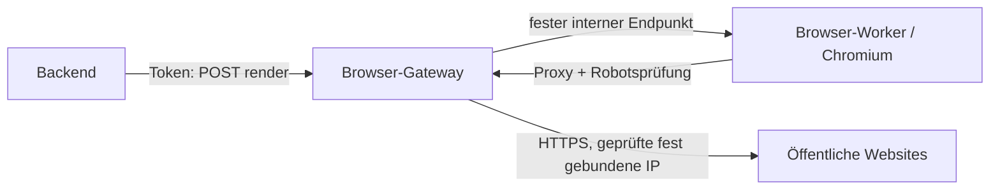

# JavaScript-fähige Location-Discovery

Stand: 06.11.2026. Implementiert und lokal isoliert prüfbar; nicht ausgeliefert.
Der Browser ist standardmäßig deaktiviert. Die genehmigte Ausführung erfolgt im
Worktree `feat/javascript-location-crawler`, nicht auf der Produktionsdatenbank.

## Ablauf und Datenvertrag

`VenueSourceDiscoveryService` verwendet weiterhin `EventPageFetcher`,
`EventExtractor` und die bestehende Bewertungs-/Import-/Änderungspipeline. Zuerst
laufen sichere HTTP-Abrufe und die vorhandene Suche nach Programm-/Kalenderlinks.
Auswertbare statische HTML-, JSON-LD- und ICS-Daten brauchen keinen Browser.
Bleibt bei Client-Rendering-Indizien keine brauchbare Veranstaltung mit vollem
Datum übrig, kann `BrowserPageRenderer` DOM-Snapshots aus Chromium anfordern.
Derselbe Extraktor verarbeitet diese Snapshots. Keine Clubnamen, alternativen
Portale oder Location-Selektoren sind für den Fallback eingebaut.

Die Bewertung trennt drei Achsen: `recognition` (bekannte Reihen/Aliasse),
`verification` (Titel, Tag, Widersprüche, spekulative Angaben) und `lifecycle`
(aktiv, Absage, unsichere Absage, Verschiebung, Line-up). Ein technisches
`UNCONFIRMED` einer Detailseite verhindert allein keine automatische Übernahme
von sonst eindeutig belegten bekannten Reihen aus freigegebenen Quellen.
Explizite Absagen/Verschiebungen durchlaufen die vorhandenen Änderungs- und
Cancellation-Dienste; der Browser erzeugt keine eigene Absagestatusmaschine.

Normalisierte ganze Wortfolgen können innerhalb längerer Titel stehen. Explizite
VS-/Meets-/Presents-Verbindungen können mehrere bekannte Reihen erkennen. Da der
Kalender weiterhin genau eine PartySeries-ID führt, bleibt deren Zuordnung
manuell; die API zeigt alle erkannten Reihen. Keine Migration zu mehreren
Kalenderreihen, kein blindes Fuzzy-Matching. Unbekannte relevante Partys bleiben
Vorschläge. Manuelle Ablehnungen, Korrekturen und Kalenderverknüpfungen bleiben
geschützt. Rohdaten/Entscheidungen werden nicht zurückgesetzt.

## Isolation und Netzverkehr



Der Worker hat ausschließlich ein internes Browsernetz. Er hat keine Verbindung
zum Backend-/Datenbanknetz und keinen direkten Internetweg. Das Gateway verbindet
Kontrollnetz, Browsernetz und Egress; IP-Forwarding ist deaktiviert. Die Dienste
haben keine veröffentlichten Ports. `/render` verlangt mindestens 32 Zeichen
Zufallstoken. Proxy-/Robotszugang verwendet ein daraus per HMAC abgeleitetes
separates Geheimnis; dieses berechtigt nicht zum Start weiterer Renderjobs.

Jede Website-URL und jede Unteranfrage muss öffentliches HTTPS auf Port 443 sein.
IP-Literale, private/reservierte/link-lokale Ziele und gemischte öffentliche/private
DNS-Antworten werden abgelehnt. Das Gateway bindet den tatsächlich geöffneten
Socket an eine geprüfte IP; es gibt keine zweite unkontrollierte DNS-Auflösung.
TLS-Zertifikate bleiben geprüft. Browser-Redirects werden vor dem Folgen
abgewiesen und als prüfpflichtig gemeldet. Der vorhandene HTTP-Fetcher behält
seinen eigenen Redirect-/SafeUrls-Schutz.

Robotsregeln gelten für Dokumente und Browser-Unteranfragen; fehlende sichere
Robotsantwort, Crawl-delay oder Sperren erlauben keinen Umgehungsabruf. Chromium
läuft als `pwuser`, mit aktivierter Namespace-/Seccomp-Sandbox, ohne Host-Caps,
mit `no-new-privileges`, schreibgeschütztem Dateisystem und begrenztem tmpfs.
Das mitgelieferte aktuelle Moby-Profil ergänzt die für diese Sandbox benötigten
Syscalls; Herkunft/Lizenz stehen in `browser-worker/NOTICE` und `LICENSE.seccomp`.
Kein `--no-sandbox`, kein privilegierter Container, kein Docker-Socket.

Service Worker, WebSockets, Downloads und Popups sind gesperrt. Bilder, Fonts und
Medien werden nicht geladen. Nur GET/HEAD sind erlaubt; POST-basierte Kalender
bleiben deshalb möglicherweise unauswertbar. Login-/Captcha-/401-/403-/429-Sperren
werden nicht umgangen. Öffentliche iframe-DOMs behalten ihre eigene Quellen-URL;
externe Quellen werden dadurch nicht automatisch offiziell oder freigegeben.

## Budgets und Fehler

- Bestehender Crawl: höchstens acht Seiten, Tiefe zwei, 200 untersuchte Links pro
  Seite; 60-Sekunden-Budget zwischen Abrufen, höchstens zwei Browserjobs pro Crawl.
- Ein Browserjob zur Zeit; keine unbeschränkte Jobqueue. Busy wird explizit gemeldet.
- Renderbudget standardmäßig 20 Sekunden, maximal 30; Prozessgruppen-Watchdog
  beendet hängende Renderer. Bei Watchdog oder abnormalem Kindprozessende
  nimmt der Worker keine weiteren Jobs an und beendet sich nach der Fehlerantwort.
  Docker zerstört damit auch eigene Chromium-Prozessgruppen im PID-Namensraum
  und startet den Worker gemäß `restart: unless-stopped` neu. Gateway und Backend
  haben zusätzliche Timeouts.
- Höchstens zwei Scrollschritte und zwei generische Mehr-/Weiter-Aktionen,
  fünf Frames pro Snapshot, 1,5 MB DOM insgesamt, 160 Requests/24 MB Antwortdaten.
- Gateway zusätzlich höchstens 32 Tunnel, 200 Verbindungen und 64 MB pro Minute;
  pro Tunnel 12 MB/25 Sekunden. Große Antworten werden abgebrochen.

Timeouts, fehlgeschlagenes JavaScript, Robots-/Netzsperren und Paginationlimits
sind Diagnosen, keine Meldung „keine Events“. Teilweise verwertbare Daten bleiben
sichtbar. Browserlisten gelten **immer als unvollständig**; ein verschwundenes
Event oder Renderingfehler beweist keine Absage. Vollständigkeit ist weiterhin
nur für vollständig interpretierte ICS-Kalender belastbar. Ein erreichbares DOM
ist kein Beweis für erfolgreiche Eventextraktion.

Migration V15 ergänzt Quellen um `fetch_method`, `scan_complete`, begrenzte
`fetch_diagnostics` und `last_success_at`. Altzeilen erhalten keinen erfundenen
Erfolgszeitpunkt. „Vorgeschlagene → Location-Quellen“ zeigt Methode, Status,
Versuch, letzten Erfolg und Vollständigkeit. Ein technischer erfolgreicher Abruf
bestätigt nicht automatisch jede Party oder Vollständigkeit.

## Location anlegen

Im Location-Modal die offizielle Website eintragen und **Website automatisch
prüfen** wählen. Name, gefundene Veranstaltungen, relevante Partys und bekannte
Reihen sowie Quellen und Einschränkungen werden vorgeschlagen. Der Name wird nur
in ein noch leeres Feld übernommen und bleibt bearbeitbar. Keine Pflicht zu
Selektoren oder zusätzlichen Eventlinks.

Die Vorschau speichert noch keine Location/Quellen und importiert keine Termine.
Erst Speichern legt die Location an/aktualisiert sie und übernimmt die geprüften
Quellen mittels kurzlebigem Vorschautoken (fünf Minuten, maximal 32 Vorschauen).
Geänderte Website, abgelaufene/gefälschte Tokens werden abgelehnt. Wiederholung
bleibt idempotent; bestehende entzogene Freigaben bleiben bestehen. Externe
Quellen brauchen manuelle Freigabe. Schlägt das Speichern der Quellen fehl, kann
es ohne doppelte Location erneut versucht werden. Es werden keine DMs versandt.

## Konfiguration und spätere Auslieferung

```properties
DISCOVERY_BROWSER_ENABLED=false
DISCOVERY_BROWSER_URL=http://browser-gateway:3128/render
BROWSER_WORKER_TOKEN=<eigenes zufälliges Geheimnis, mindestens 32 Zeichen>
```

Die Browseroption ist vom bestehenden `DISCOVERY_ENABLED` und
`DISCOVERY_MONITOR_ENABLED` unabhängig. DiscoveryController und -Scheduler sind
nicht mehr ausschließlich an `local`/`staging` gebunden. Deshalb müssen vor
Übernahme in andere Profile deren Authentifizierung und Schedulerflags bewusst
geprüft werden. Wöchentliche Suche Dienstag 09:00 und täglicher Änderungscheck
09:00 in `Europe/Berlin` bleiben unverändert. Bestehende Caddy-/Sessionabsicherung
ist weiterhin erforderlich; diese Änderung führt keine Teamrollen ein.

`deploy/server/compose.browser.yaml` ist ein **optionales** Overlay und gehört
nicht zum automatischen Deployment. Für eine spätere geprüfte Aktivierung müssen
passende Worker-/Gateway-Images aus demselben geprüften Stand gebaut und in die
Registry aufgenommen werden. Die bestehende GHCR-Pipeline veröffentlicht diese
zusätzlichen Images noch nicht. `BROWSER_SECCOMP_PROFILE` muss auf die absolute,
auf dem Dockerhost vorhandene `browser-worker/seccomp_profile.json` zeigen;
die gewöhnlichen Deploymentdateien allein reichen nicht.

Overlay-Syntax lässt sich ohne Starten prüfen (aus Repositorywurzel, eigene
Testwerte und zur Basis passende Variablen verwenden):

```sh
docker compose -f deploy/server/compose.yaml -f deploy/server/compose.browser.yaml config --quiet
```

Geplant begrenzt: Worker 768 MiB RAM/1 CPU/256 PIDs, Gateway 128 MiB/0,25 CPU/64
PIDs, Chromium shm 256 MiB und tmpfs 128 MiB. Dies sind Limits, keine gemessene
VPS-Kapazitätszusage. Rund 1 GiB zusätzliche freie RAM-Reserve plus Image-/Docker-
Speicher ist ein Ausgangspunkt; Lastspitzen, OOM, DNS/TLS und Namespace-Sandbox
müssen auf dem Zielhost mit dessen Kernel/AppArmor und realistischen Websites
geprüft werden. Bei Sandboxfehlern bleibt das Feature aus; Schutz nicht abschalten.

## Reproduzierbare lokale/Cloud-Prüfung

Benötigt: Git, Bash, Python 3, JDK 21+, Maven-Wrapper, Node 24+, npm, Docker mit
Netzwerk-/Seccomp-/Usernamespace-Unterstützung und Zugriff auf gepinnte
Playwright-/Node-/PostgreSQL-Images und Maven-/npm-Quellen. Frontend einmal per
`npm ci` installieren. `scripts/check-quality.sh --full` startet eigene kurzlebige
PostgreSQL- und Chromium-Testcontainer. Keine Bestandsdatenbank oder -Volumes.

```sh
scripts/check-browser.sh --unit  # Offline-Node: Policy/Auth/DNS/Robots/Single-job
scripts/check-browser.sh --full  # zusätzlich ESLint und echter Sandbox-Chromium
scripts/check-quality.sh --full # Backend, Frontend, Gate, Browser, Builds
```

Chromium-Fixtures haben `--network none`: verzögerte JS-Karten, ein anders
aufgebautes Widget mit Lazy Loading/Pagination, iframe, JS-Fehler und verweigerte/
zeitüberschrittene Abrufe. Ein weiterer separater Container prüft den
Watchdog mit einem tatsächlich abgetrennten Nachfahren: Der Worker beendet
seinen PID-Namensraum, statt einen vermeintlich bereinigten Job fortzusetzen.
Diese Tests benötigen keine erreichbare Clubwebsite. Java-
Regressionen prüfen HTTP-vor-Browser, gemeinsame Extraktion, Datenqualität,
Fehler ohne falsche Abwesenheit und Quelle/Token/Import-Schutz. Datenbanktests
prüfen den vollständigen Weg bis API, Kalender und bestehendem Cancellation-Prozess.
QUICK wählt bei Workeränderungen Syntax und Node-Tests; FULL enthält echten Browser
und Worker-ESLint. Fehlende Docker-/Sandbox-Voraussetzungen sind Fehler, kein Skip.

Ein ausdrücklich gewünschter rein lesender Live-Test ist separat möglich, nach
`test-compile` und `dependency:build-classpath` mit Ausgabe
`backend/target/quality-classpath.txt`:

```sh
scripts/probe-discovery-website.sh https://www.mtc-cologne.de/
```

Er startet eigene Gateway-/Worker-Netze und Container mit zufälligem Token, bindet
nur einen zufälligen Loopback-Kontrollport und entfernt sie anschließend. Kein
Spring-/Datenbankkontext, kein SSH, kein Kalenderimport. Der Probe-Genrebestand
ist ausdrücklich Testkonfiguration und kein Abbild des produktiven Katalogs.
Die Ausgabe enthält extrahierte Titel/Datumswerte und Diagnosen, kein HTML-Archiv.

## Live-Referenz MTC und Grenzen

Der isolierte reale Abruf am 06.11.2026 folgt von der Startseite dem öffentlichen
PARTY-Link nach `/about`. Die Startseite liefert `HTTP / SOURCE_LINKS_FOUND`.
Auf `/about` startet tatsächlich Chromium; das Resultat ist `BROWSER_PARTIAL`,
kein bestätigter leerer Kalender. Öffentliche Website-Unteranfragen werden durch
Robots-/Zugriffssperren, unzulässige URLs und die GET/HEAD-Policy abgewiesen;
JavaScriptfehler und nicht beruhigte asynchrone Inhalte bleiben erkennbar.
Es wurden **null auswertbare Veranstaltungen** extrahiert. Das ist kein
Crawling-Erfolg für MTC und kein Beweis, dass dort keine Partys stattfinden.
Schutzregeln werden zur Verbesserung dieser Zahl nicht gelockert. Suchmaschinen
oder alternative Portale wurden nicht als Extraktionserfolg verwendet.

Generische DOM-Extraktion garantiert keine beliebige Website: POST-APIs,
Login/Consent, geschützte Widgets, Bilder ohne Text, sprachliche Mehrdeutigkeit,
unbekannte Datumsformate, endlose Kalender und spät gestartete Skripte können
manuelle Quellenprofile/Rückfragen oder eine gesondert geprüfte Erweiterung
benötigen. Keine Jahreszahlen raten. Vor Produktion sind reale Zielhost-Sandbox,
beide neuen Image-Releases, Netzwerkisolation, Limits und visuelle Desktop-/Mobil-
Abnahme zu prüfen. In dieser Sitzung wurde lokal im ausdrücklich erlaubten
Worktree gearbeitet; ein Codex-Cloud-Lauf und ein VPS-Test wurden nicht ausgeführt.
