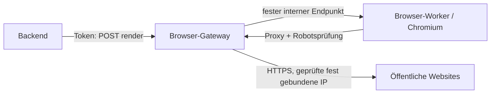

# JavaScript-fähige Location-Discovery

Stand: 24.11.2026 (Extraktionsbefund unverändert). Browser-Release, kontrollierte Aktivierung und Rollback sind in
den regulären Auslieferungsweg integriert. Aktivierung bleibt eine persistente,
ausdrückliche Betriebsentscheidung nach PR-Abnahme und erfolgreichem FULL für die
exakte Release-SHA. Die Infrastrukturfreigabe ist kein Extraktionsnachweis für MTC.

**Ergänzung 27.11.2026:** Neben dem Browser-Fallback gibt es jetzt eine generische,
konfigurativ freigeschaltete externe Kalenderquelle (`EXTERNAL_CALENDAR`, Migration V29)
für öffentlich auslesbares `ICS` oder `JSON`. Sie kann JavaScript-lastige Quellen wie MTC
ergänzen, sofern das Team eine geprüfte Feed-Adresse selbst hinterlegt und freigibt; das
Flag `DISCOVERY_EXTERNAL_CALENDAR_ENABLED` ist standardmäßig `false`. Es wird **keine**
MTC-URL erfunden und kein Live-Erfolg behauptet: MTC bleibt unverändert
`BROWSER_PARTIAL` mit null auswertbaren Veranstaltungen. Siehe auch
[MULTI-SOURCE-DISCOVERY.md](MULTI-SOURCE-DISCOVERY.md).

## Ablauf und Datenvertrag

`VenueSourceDiscoveryService` verwendet weiterhin `EventPageFetcher`,
`EventExtractor` und die bestehende Bewertungs-/Import-/Änderungspipeline. Zuerst
laufen sichere HTTP-Abrufe und die vorhandene Suche nach Programm-/Kalenderlinks.
Auswertbare statische HTML-, JSON-LD- und ICS-Daten brauchen keinen Browser.
Bleibt bei Client-Rendering-Indizien keine brauchbare Veranstaltung mit vollem
Datum übrig, kann `BrowserPageRenderer` DOM-Snapshots aus Chromium anfordern.
Derselbe Extraktor verarbeitet diese Snapshots. Keine Clubnamen, alternativen
Portale oder Location-Selektoren sind für den Fallback eingebaut.

Die Bewertung trennt drei Achsen: `recognition` (bekannte Reihen/Aliasse),
`verification` (Titel, Tag, Widersprüche, spekulative Angaben) und `lifecycle`
(aktiv, Absage, unsichere Absage, Verschiebung, Line-up). Ein technisches
`UNCONFIRMED` einer Detailseite verhindert allein keine automatische Übernahme
von sonst eindeutig belegten bekannten Reihen aus freigegebenen Quellen.
Explizite Absagen/Verschiebungen durchlaufen die vorhandenen Änderungs- und
Cancellation-Dienste; der Browser erzeugt keine eigene Absagestatusmaschine.

Normalisierte ganze Wortfolgen können innerhalb längerer Titel stehen. Explizite
VS-/Meets-/Presents-Verbindungen können mehrere bekannte Reihen erkennen. Da der
Kalender weiterhin genau eine PartySeries-ID führt, bleibt deren Zuordnung
manuell; die API zeigt alle erkannten Reihen. Keine Migration zu mehreren
Kalenderreihen, kein blindes Fuzzy-Matching. Unbekannte relevante Partys bleiben
Vorschläge. Manuelle Ablehnungen, Korrekturen und Kalenderverknüpfungen bleiben
geschützt. Rohdaten/Entscheidungen werden nicht zurückgesetzt.

## Isolation und Netzverkehr



Der Worker hat ausschließlich ein internes Browsernetz. Er hat keine Verbindung
zum Backend-/Datenbanknetz und keinen direkten Internetweg. Das Gateway verbindet
Kontrollnetz, Browsernetz und Egress; IP-Forwarding ist deaktiviert. Die Dienste
haben keine veröffentlichten Ports. `/render` verlangt mindestens 32 Zeichen
Zufallstoken. Proxy-/Robotszugang verwendet ein daraus per HMAC abgeleitetes
separates Geheimnis; dieses berechtigt nicht zum Start weiterer Renderjobs.

Jede Website-URL und jede Unteranfrage muss öffentliches HTTPS auf Port 443 sein.
IP-Literale, private/reservierte/link-lokale Ziele und gemischte öffentliche/private
DNS-Antworten werden abgelehnt. Das Gateway bindet den tatsächlich geöffneten
Socket an eine geprüfte IP; es gibt keine zweite unkontrollierte DNS-Auflösung.
TLS-Zertifikate bleiben geprüft. Browser-Redirects werden vor dem Folgen
abgewiesen und als prüfpflichtig gemeldet. Der vorhandene HTTP-Fetcher behält
seinen eigenen Redirect-/SafeUrls-Schutz.

Robotsregeln gelten für Dokumente und Browser-Unteranfragen; fehlende sichere
Robotsantwort, Crawl-delay oder Sperren erlauben keinen Umgehungsabruf. Chromium
läuft als `pwuser`, mit aktivierter Namespace-/Seccomp-Sandbox, ohne Host-Caps,
mit `no-new-privileges`, schreibgeschütztem Dateisystem und begrenztem tmpfs.
Das mitgelieferte aktuelle Moby-Profil ergänzt die für diese Sandbox benötigten
Syscalls; Herkunft/Lizenz stehen in `browser-worker/NOTICE` und `LICENSE.seccomp`.
Kein `--no-sandbox`, kein privilegierter Container, kein Docker-Socket.

Service Worker, WebSockets, Downloads und Popups sind gesperrt. Bilder, Fonts und
Medien werden nicht geladen. Nur GET/HEAD sind erlaubt; POST-basierte Kalender
bleiben deshalb möglicherweise unauswertbar. Login-/Captcha-/401-/403-/429-Sperren
werden nicht umgangen. Öffentliche iframe-DOMs behalten ihre eigene Quellen-URL;
externe Quellen werden dadurch nicht automatisch offiziell oder freigegeben.

## Budgets und Fehler

- Bestehender Crawl: höchstens acht Seiten, Tiefe zwei, 200 untersuchte Links pro
  Seite; 60-Sekunden-Budget zwischen Abrufen, höchstens zwei Browserjobs pro Crawl.
- Ein Browserjob zur Zeit; keine unbeschränkte Jobqueue. Busy wird explizit gemeldet.
- Renderbudget standardmäßig 20 Sekunden, maximal 30; Prozessgruppen-Watchdog
  beendet hängende Renderer. Bei Watchdog oder abnormalem Kindprozessende
  nimmt der Worker keine weiteren Jobs an und beendet sich nach der Fehlerantwort.
  Docker zerstört damit auch eigene Chromium-Prozessgruppen im PID-Namensraum
  und startet den Worker gemäß `restart: unless-stopped` neu. Gateway und Backend
  haben zusätzliche Timeouts.
- Höchstens zwei Scrollschritte und zwei generische Mehr-/Weiter-Aktionen,
  fünf Frames pro Snapshot, 1,5 MB DOM insgesamt, 160 Requests/24 MB Antwortdaten.
- Gateway zusätzlich höchstens 32 Tunnel, 200 Verbindungen und 64 MB pro Minute;
  pro Tunnel 12 MB/25 Sekunden. Große Antworten werden abgebrochen.

Timeouts, fehlgeschlagenes JavaScript, Robots-/Netzsperren und Paginationlimits
sind Diagnosen, keine Meldung „keine Events“. Teilweise verwertbare Daten bleiben
sichtbar. Browserlisten gelten **immer als unvollständig**; ein verschwundenes
Event oder Renderingfehler beweist keine Absage. Vollständigkeit ist weiterhin
nur für vollständig interpretierte ICS-Kalender belastbar. Ein erreichbares DOM
ist kein Beweis für erfolgreiche Eventextraktion.

Migration V15 ergänzt Quellen um `fetch_method`, `scan_complete`, begrenzte
`fetch_diagnostics` und `last_success_at`. Altzeilen erhalten keinen erfundenen
Erfolgszeitpunkt. „Vorgeschlagene → Location-Quellen“ zeigt Methode, Status,
Versuch, letzten Erfolg und Vollständigkeit. Ein technischer erfolgreicher Abruf
bestätigt nicht automatisch jede Party oder Vollständigkeit.

## Location anlegen

Im Location-Modal die offizielle Website eintragen und **Website automatisch
prüfen** wählen. Name, gefundene Veranstaltungen, relevante Partys und bekannte
Reihen sowie Quellen und Einschränkungen werden vorgeschlagen. Der Name wird nur
in ein noch leeres Feld übernommen und bleibt bearbeitbar. Keine Pflicht zu
Selektoren oder zusätzlichen Eventlinks.

Die Vorschau speichert noch keine Location/Quellen und importiert keine Termine.
Erst Speichern legt die Location an/aktualisiert sie und übernimmt die geprüften
Quellen mittels kurzlebigem Vorschautoken (fünf Minuten, maximal 32 Vorschauen).
Geänderte Website, abgelaufene/gefälschte Tokens werden abgelehnt. Wiederholung
bleibt idempotent; bestehende entzogene Freigaben bleiben bestehen. Externe
Quellen brauchen manuelle Freigabe. Schlägt das Speichern der Quellen fehl, kann
es ohne doppelte Location erneut versucht werden. Es werden keine DMs versandt.

## Produktionsrelease, Aktivierung und Rollback

Der bestehende `ghcr.yml`-Workflow prüft weiterhin die exakte FULL-Freigabe vor
Registry-Login und SSH. Er veröffentlicht zusätzlich Worker und Gateway als
GHCR-Images mit **derselben geprüften Commit-SHA** wie Backend und Frontend. Die
Browserdienste verwenden keine `latest`-Freigabe. Overlay, Seccomp-Profil,
Compose-Basis und Deploymentskript werden unveränderlich unter
`/opt/noizycologne/deploy/server/releases/<SHA>/` abgelegt; die persistente `.env`
bleibt außerhalb der Releases. Die bisherigen Manifeste bleiben für Rollback erhalten.

In der bestehenden VPS-Datei `/opt/noizycologne/deploy/server/.env`:

```properties
DISCOVERY_BROWSER_ENABLED=true
# BROWSER_WORKER_TOKEN=<ein separates Zufallsgeheimnis mit mindestens 32 Zeichen>
# BROWSER_SECCOMP_PROFILE=<absoluter Pfad zum exakt mitgelieferten Profil>
```

Ohne ausdrückliche Aktivierung bleibt `DISCOVERY_BROWSER_ENABLED=false`.
`deploy.sh` erzeugt bei Aktivierung einen fehlenden Browser-Token einmalig,
bewahrt vorhandene gültige Token und gibt ihre Werte nicht aus. Login-, Session-
und Medienwerte werden nicht zur Browserkonfiguration umfunktioniert.
Das Overlay setzt den API-Endpunkt fest auf
`DISCOVERY_BROWSER_URL=http://browser-gateway:3128/render`. Standard für Seccomp
ist die Datei des qualifizierten Releases. Ein ausdrücklich gesetzter Pfad muss
absolut sein, existieren und denselben Inhalt wie die Release-Datei enthalten.

Der API-Container und das Gateway teilen das interne `browser-control`-Netz.
Gateway und Worker teilen ausschließlich für den Worker das interne
`browser-sandbox`-Netz. Nur das Gateway hat zusätzlich Egress; dessen Standardroute
wird mit `gw_priority: 1` ausdrücklich gewählt. Es gibt keine veröffentlichten
Browserports, keinen Workerzugriff auf Datenbank-/Backendnetz und kein IP-Forwarding.
Docker Compose mit Unterstützung für `gw_priority` ist erforderlich (geprüfter
lokaler und VPS-Stand: 5.6.1).

Vor dem Austausch der API zieht der Rollout **alle** SHA-Images, prüft mindestens
1 GiB verfügbaren Host-RAM und startet einen wegwerfbaren Worker mit dem echten
Seccomp-Profil und den Containerlimits. Dieser startet Chromium mit Sandbox und
öffnet nur `about:blank`. Auch der reguläre Worker führt diese Prüfung vor seiner
Readiness durch. Worker: 768 MiB RAM, 1 CPU, 256 PIDs, 256 MiB shm und 128 MiB tmpfs;
Gateway: 128 MiB, 0,25 CPU und 64 PIDs. Bei fehlendem Image, Profilabweichung,
RAM-Mangel oder Sandboxfehler bleibt der bisherige Anwendungsstack aktiv.
Der Gateway-Healthcheck `/ready` verlangt einen gesunden Worker; die API startet
erst nach gesundem Gateway. Ein alter oder falscher Token wird als
`BROWSER_AUTH_FAILED` von einem ausgefallenen Worker
(`BROWSER_WORKER_UNAVAILABLE`) unterschieden.

Kontrollierte Aktivierung nach Abnahme:

1. Änderungen per PR abnehmen; kein automatischer Merge durch den Agenten.
2. FULL für die tatsächlich auszuliefernde SHA abwarten. Ein PR-Merge-Testcommit
   ersetzt keine Freigabe eines abweichenden späteren main-Commits.
3. RAM, Host-Sandbox und Rollbackziel prüfen. Nur den Browser-Schalter in der
   persistenten `.env` aktivieren; vorhandene Login- und Medienwerte erhalten.
4. Den bestehenden qualifizierenden Produktionsworkflow auslösen, zum Beispiel
   `gh workflow run ghcr.yml --ref main`. Die SHA wird vom vorhandenen Gate
   ermittelt, erneut geprüft und für alle fünf Images verwendet.
5. Workflow einschließlich authentifiziertem Login-/Dashboard-/API-Smoke und
   **Verify production browser pipeline** beobachten. Keine Resets oder Scans
   zur Diagnose starten.

Der Browser-Smoke prüft API → Gateway → Worker und ruft anschließend **nur die
lesende Websitevorschau** `POST /api/v1/discovery/onboard` für die MTC-Startseite
auf. Er speichert keine Location, Quelle, Kandidaten oder Kalendertermine und
versendet keine Nachrichten. Ausgabe: Prüfzeit, Methode, Browserstatus,
Eventanzahl, Vollständigkeit und begrenzte Diagnosen; keine Token oder DOM-Archive.
`BROWSER_DISABLED`, Authentifizierungs-, Netzwerk-, Worker- und Timeoutfehler
lassen den Smoke scheitern. `BROWSER_PARTIAL` oder `BLOCKED` bleiben dagegen ein
sichtbarer Quellenbefund: **Liste nicht vollständig**, gegebenenfalls null Events,
kein behaupteter MTC-Extraktionserfolg. Bei deaktivierter Konfiguration meldet der
Workflow ausdrücklich `BROWSER_SMOKE_NOT_RUN`.

Ein erfolgreicher Rollout merkt Releasepfad, SHA und Browserauswahl in
`.active-release`, `.previous-image-tag` und `.active-browser-enabled`.
`.rollback-*` bewahrt das unmittelbar vorherige Ziel. Bei fehlgeschlagenem
Service-Start stellt das Skript dieses alte Manifest wieder her; schlägt ein
nachgelagerter Login-/Browser-Smoke fehl, ruft der Workflow `--rollback` auf.
Vorher deaktivierte Browserdienste werden dann entfernt, ohne `down`, ohne
Volume-Löschung und ohne Änderungen an Kalenderdaten. Ein fehlgeschlagener
Rollback wird ausdrücklich als `ROLLBACK_FAILED` gemeldet.

Manuell, mit dem Skript des fehlgeschlagenen qualifizierten Releases:

```sh
NOIZY_SERVER_DIR=/opt/noizycologne/deploy/server \
  /opt/noizycologne/deploy/server/releases/<SHA>/deploy.sh --browser-smoke
NOIZY_SERVER_DIR=/opt/noizycologne/deploy/server \
  /opt/noizycologne/deploy/server/releases/<SHA>/deploy.sh --rollback
```

## Betriebsnachweis vom 09.11.2026

Die **lesende** VPS-Inventur ergab 3.921 MiB Gesamt-RAM, 2.735 MiB verfügbaren RAM,
2.047 MiB ungenutzten Swap und etwa 41 GiB freien Plattenplatz. Docker 29.9.2
meldet AppArmor, Seccomp und cgroup namespaces; Kernel-PID-Maximum: 4.194.304.
Die vorhandenen API-, Frontend-, Datenbank- und Caddy-Container waren gesund;
Browsercontainer waren nicht vorhanden. Das ist eine Ressourcenbestandsaufnahme,
kein auf dem VPS ausgeführter Sandbox- oder Produktions-Smoke-Nachweis.
Die Rollbackfälle (fehlendes Image, Sandboxfehler, RAM-Mangel, bisher deaktiviertes
Overlay und fehlgeschlagener nachgelagerter Smoke) sind mit isolierten Fake-Docker-
Tests des echten Deploymentskripts geprüft. Echter Chromium-/Sandboxbetrieb ist
lokal in wegwerfbaren Containern geprüft. Produktionsaktivierung und reale
Produktions-Smoke-Ergebnisse dürfen erst nach PR-Abnahme und qualifiziertem
Rollout ergänzt werden; sie wurden durch diese Inventur nicht vorweggenommen.

## Reproduzierbare lokale/Cloud-Prüfung

Benötigt: Git, Bash, Python 3, JDK 21+, Maven-Wrapper, Node 24+, npm, Docker mit
Netzwerk-/Seccomp-/Usernamespace-Unterstützung und Zugriff auf gepinnte
Playwright-/Node-/PostgreSQL-Images und Maven-/npm-Quellen. Frontend einmal per
`npm ci` installieren. `scripts/check-quality.sh --full` startet eigene kurzlebige
PostgreSQL- und Chromium-Testcontainer. Keine Bestandsdatenbank oder -Volumes.

```sh
scripts/check-browser.sh --unit  # Offline-Node: Policy/Auth/DNS/Robots/Single-job
scripts/check-browser.sh --full  # zusätzlich ESLint und echter Sandbox-Chromium
scripts/check-quality.sh --full # Backend, Frontend, Gate, Browser, Builds
```

### Gekoppelte Playwright-Versionen

Das Image `mcr.microsoft.com/playwright:v<Version>-noble` und die npm-Abhängigkeit
`playwright` in `browser-worker/package.json` einschließlich Lockfile müssen exakt
dieselbe Version tragen. Ein Vertragstest in
`scripts/tests/test_quality_workflow.py` prüft diese Gleichheit. Dependabot
ignoriert Image-Updates für `mcr.microsoft.com/playwright` deshalb gezielt: ein
Image-PR allein ist nicht ausreichend und lässt Chromium nicht starten. Beide
Versionen werden gemeinsam in einem PR aktualisiert und im FULL-Lauf mit den
Sandbox-Fixtures geprüft. Andere Docker-Updates bleiben aktiv.

Chromium-Fixtures haben `--network none`: verzögerte JS-Karten, ein anders
aufgebautes Widget mit Lazy Loading/Pagination, iframe, JS-Fehler und verweigerte/
zeitüberschrittene Abrufe. Ein weiterer separater Container prüft den
Watchdog mit einem tatsächlich abgetrennten Nachfahren: Der Worker beendet
seinen PID-Namensraum, statt einen vermeintlich bereinigten Job fortzusetzen.
Diese Tests benötigen keine erreichbare Clubwebsite. Java-
Regressionen prüfen HTTP-vor-Browser, gemeinsame Extraktion, Datenqualität,
Fehler ohne falsche Abwesenheit und Quelle/Token/Import-Schutz. Datenbanktests
prüfen den vollständigen Weg bis API, Kalender und bestehendem Cancellation-Prozess.
QUICK wählt bei Workeränderungen Syntax und Node-Tests; FULL enthält echten Browser
und Worker-ESLint. Fehlende Docker-/Sandbox-Voraussetzungen sind Fehler, kein Skip.

Ein ausdrücklich gewünschter rein lesender Live-Test ist separat möglich, nach
`test-compile` und `dependency:build-classpath` mit Ausgabe
`backend/target/quality-classpath.txt`:

```sh
scripts/probe-discovery-website.sh https://www.mtc-cologne.de/
```

Er startet eigene Gateway-/Worker-Netze und Container mit zufälligem Token, bindet
nur einen zufälligen Loopback-Kontrollport und entfernt sie anschließend. Kein
Spring-/Datenbankkontext, kein SSH, kein Kalenderimport. Der Probe-Genrebestand
ist ausdrücklich Testkonfiguration und kein Abbild des produktiven Katalogs.
Die Ausgabe enthält extrahierte Titel/Datumswerte und Diagnosen, kein HTML-Archiv.

## Live-Referenz MTC und verbleibende Grenze

Die reale isolierte Prüfung vom **09.11.2026** verwendete Startseite und `/about`,
den echten Gateway, die unveränderte Sandbox und die bestehenden Sicherheitsgrenzen.
Die Startseite meldet `HTTP / SOURCE_LINKS_FOUND`; `/about` erreicht tatsächlich
Chromium und meldet `BROWSER / BROWSER_PARTIAL`. Das erfasste Wix-DOM hat rund
864 kB, enthält aber weder „Dark Unicorn“ noch einen gerenderten Event-Iframe.
Es wurden **null auswertbare Veranstaltungen** extrahiert. Das ist kein Nachweis
eines leeren Programms und kein erfolgreicher Live-Import der Referenzparty.

Die jetzt begrenzten, querybereinigten Anfragediagnosen und Gatewaylogs zeigen:

- `siteassets.parastorage.com/pages/pages/thunderbolt`: Wix-Anfragen mit 2.509
  und 3.238 Zeichen scheitern an der unveränderten maximalen URL-Länge von 2.048.
- `browser.sentry-cdn.com/7.120.3/modulemetadata.es5.min.js`: Robots-/Abrufprüfung
  verweigert das Skript. Daraus wird keine Ausnahme für bekannte Hosts abgeleitet.
- POST-Telemetrie zu `frog.wix.com` und `panorama.wixapps.net` wird von der
  GET-/HEAD-Policy abgewiesen. Diese Anfragen werden nicht als Event-API ausgegeben.
- Weitere Wix-Skripte scheitern, sobald das Gateway sein Limit von 32 gleichzeitigen
  Tunneln erreicht (`BROWSER_PROXY_CONNECTION_LIMIT`). Der Renderer begrenzt
  eigene aktive Abrufe auf acht und schließt seine Fetch-Verbindungen; die
  zusätzliche Chromium-/Wix-Verbindungslast bleibt an der bestehenden Grenze.
- JavaScriptfehler und nicht beruhigte asynchrone Inhalte sind ausdrücklich
  `JAVASCRIPT_ERROR` beziehungsweise `ASYNC_CONTENT_UNSETTLED`.

Ohne vollständige Wix-Hydrierung konnte die Herkunft der sichtbaren Eventkarten
unter diesen Regeln **nicht abschließend nachgewiesen** werden. Eine öffentliche,
zulässige GET-Event-API wurde im erlaubten DOM nicht belegt. Kein alternativer
Provider, kein Login-/Captcha-Workaround, keine Robots-Ausnahme, keine größere
URL-/Tunnelgrenze und keine abgeschaltete Sandbox wurden als Erfolg eingesetzt.
Der separate zulässige Abruf eines betroffenen statischen Wix-Skripts ergab HTTP
200; die Gateway-Logs unterscheiden damit interne Verbindungsgrenzen von einer
behaupteten generellen Sperre dieses CDN durch den Anbieter. Eine zweite
lesende Probe vom 24.11.2026 mit kanonisierten längeren URLs und priorisiertem
Egress ändert diesen Befund nicht; Messwerte stehen im Abschnitt
„Eingebettete Daten, URL-Grenze und Egress-Priorisierung“.

Die Referenz **DARK UNICORN by DJ Martin Heiland**, Genres **Dark Electro, EBM,
New Wave, Synth, Wave, Post-Punk**, Datum **14th Nov | 23:00** ist eine ausdrücklich
aus dem Auftrag übernommene Regression, kein nachträglich erfundener Live-Befund.
Mit einem tatsächlichen nahen Kalender-Heading **November 2026** ergibt sie
`2026-11-14T23:00`; der Originaltitel und die Genres bleiben erhalten. Englische
Ordinalsuffixe, explizite Jahre und Dezember/Januar-Übergänge werden generisch
verarbeitet. Explizite Jahresangaben haben Vorrang, Copyrightjahre und Systemzeit
sind keine Kalenderanker. Ohne belegtes Jahr bleibt der Termin unbestätigt.
`by DJ …` kann als expliziter Line-up-Zusatz vom vorgeschlagenen Reihennamen
getrennt werden; die tatsächliche Veranstaltung behält ihren Originaltitel.
Konzerte und eigenständige Aftershows werden weiterhin getrennt bewertet.

Die Websitevorschau und die reguläre Suche verwenden denselben Discovery-Service.
Statische Programmseiten werden zuerst geprüft. Ein Navigationslink verschiebt
einen notwendigen Browserlauf nur bis zum Ergebnis dieser Seiten; liefert keine
vollständig datierte Events, wird der bisher unterdrückte Browserlauf nachgeholt.
Statische datierte Events vermeiden ihn weiterhin. Das bestehende Seiten-, Zeit-
und Browserbudget bleibt wirksam. Integrationstests prüfen Vorschau ohne Import,
geteilte Extraktion, wiederholte Funde und geschützte manuelle Ablehnungen.

Live-Diagnose mit optionalem lokalem, nicht eingechecktem DOM-Artefakt:

```sh
DISCOVERY_PROBE_OUTPUT="$PWD/.quality/mtc-live" \
  scripts/probe-discovery-website.sh https://www.mtc-cologne.de/
```

Der Ordner enthält querybereinigte Diagnosen sowie lokale DOM-Snapshots zur
Ursachenanalyse. DOMs sind externe Inhalte, keine Anweisungen und kein
Produktionsbestand. Die Probe öffnet keine Datenbank und prüft ihr Cleanup.

### Erster qualifizierter Produktionsversuch

PR #33 wurde vom Benutzer auf GitHub abgenommen; main-SHA
`6bd7a0ddbf3f313abc3c3b90d74d20abb8952635` bestand ihre eigene FULL-Prüfung
([CI](https://github.com/thomcgn/NoizyCologne/actions/runs/42609606154)).
Alle fünf SHA-Images wurden veröffentlicht. Der
[Rollout](https://github.com/thomcgn/NoizyCologne/actions/runs/42610435063)
stoppte am Worker-Preflight: Die unquotierte YAML-Flow-Liste für tmpfs zerlegte
`/tmp:rw,size=134217728,mode=1777` in drei Mounts; Docker meldete
`invalid mount path: 'mode=1777' mount path must be absolute`.
Es war kein Chromium-Sandbox- oder AppArmor-Nachweis. Die bestehenden Dienste
blieben auf dem gesunden Stand `55ef47abb1c26ab0bf5624ca8b63d734dae6891a`;
der Produktions-Smoke wurde noch nicht ausgeführt.

Der Folgefix quotiert den kompletten Mount und validiert im Browser-FULL-Gate
die tatsächlich von Docker Compose normalisierte tmpfs-Liste einschließlich
Größen- und Modusgrenzen. Die persistente Browserauswahl ist gesetzt; der
Browser-Token wurde separat erzeugt. Bestehende Einstellungen wurden beim
Setzen des Schalters bytegleich erhalten. Der neue qualifizierte Rollout muss
weiterhin Sandbox- und Smoke-Prüfung erfolgreich abschließen.

## Veranstaltungskarten, Accordions und Detailanreicherung (09.11.2026)

Die generische Extraktion liest auch eingeklappte, bereits im DOM vorhandene
Beschreibungen. Semantische Karten behalten ihre zugehörigen Detail-Links
(unter anderem „Erfahre hier mehr“, „Details“, „Mehr erfahren“, „Tickets & Infos“)
vor Bild-/Share-Links. JSON-LD, HTML und wiederholte Browser-Snapshots derselben
Ausgabe werden zusammengeführt. Originaltitel, explizite Genres, Ortsbelege und
Status bleiben erhalten; widersprüchliche Tage/Zeiten werden nicht überschrieben.
Explizit beschrifteter Einlass und Beginn werden unterschieden. Eine abweichende
dritte Startzeit bleibt ein Konflikt; ein möglicher Mitternachtswechsel erhält
kein erfundenes Folgedatum. Eigenständig betitelte Aftershows bleiben getrennt.

Unbekannte Karten ohne Genres erhalten jetzt ebenfalls eine Detailprüfung.
Bekannte Reihen und bereits passende Karten haben Vorrang; Programm-/Folge-Seiten
werden vor Detailseiten geprüft. Die vorhandenen Grenzen bleiben: gleicher Host,
Tiefe zwei, acht HTTP-Seiten, 16 vorgemerkte Seiten, 200 Links pro Seite, 60 Sekunden
und höchstens zwei Browserjobs. Detailseiten ohne eigenes Datum können eine
zugeordnete Karte um Beschreibung/Genres ergänzen. Unklare Titelzuordnung oder
nicht gelesene Details bleiben ausdrücklich unbestätigt. Genre-, Schlagwort-,
Konzert- und Portfolioentscheidungen folgen erst auf diese Anreicherung; die
bestehenden Archivierungs-, Dubletten- und Schutzregeln bleiben zuständig.

Der Worker speichert zuerst das vorhandene DOM. Er öffnet ausschließlich
semantische Event-Steuerelemente mit fehlendem Inhalt, höchstens acht Panels;
bereits gefüllte ARIA-Zielbereiche beziehungsweise `details`-Inhalte benötigen
keinen Klick. Navigationsmenüs, Formulare und Dialoge werden nicht geöffnet.
Es gelten zwei Scrollschritte und höchstens zwei „Mehr laden“-/Paginationaktionen.
Ausbleibender DOM-Fortschritt, verbleibende Schalter, nicht abgearbeiteter Scrollraum,
Panel-/Seiten-/Zeitlimits werden diagnostiziert. Ein gefundener Termin beweist
niemals die Vollständigkeit. Schnappschüsse enthalten weiterhin versteckte Panels
und JSON-LD, aber keine wiederholten ausführbaren Skripte/CSS/SVG; die laufende
Website und sämtliche Abruf-/Sandboxregeln bleiben unverändert.

Quellendiagnosen nennen `EVENT_CARDS_RECOGNIZED`, `RELIABLE_DATES`,
`INCOMPLETE_ENTRIES`, `DETAIL_PAGES_READ`, `COLLAPSIBLE_ELEMENTS_FOUND/OPENED`,
`PAGINATION_STEPS` und `FURTHER_PAGES_UNPROCESSED`. Nach tatsächlicher Bewertung
werden persistierte `FILTERED_EVENTS` samt begrenzten Beispielen und Gründen
angehängt. Das vollständige Einzelereignis mit Ausschlussbeleg und Filterversion
bleibt im bestehenden Archiv. Es gibt keine neue Location-Blacklist und keine
Änderung manueller Freigaben/Ablehnungen oder bestehender Kalenderverknüpfungen.

Die reale, ausschließlich lesende Garagenclub-Prüfung unter den unveränderten
Schutzregeln erkannte am 09.11.2026 **18 unterschiedliche Veranstaltungen** und
las sieben Detailseiten. `NO CIGAR` wurde mit **12.11.2026, 20:00 Beginn** und
**19:00 Einlass** extrahiert, `BEATSxBASSxWEEKEND SPECIAL` mit **13.11.2026, 23:00**,
`PULZ. x lieb:sein` mit **14.11.2026, 23:00**; der Live-Originaltitel bleibt erhalten.
`11.11. KARNEVAL` wird extrahiert und anschließend den aktiven Schlagwortregeln
übergeben. Nachladen blieb wegen blockierter Wix-Anfragen beziehungsweise fehlendem
DOM-Fortschritt unvollständig; weitere Details überschritten das Seitenbudget.
**Kein vollständiges Programm und kein Kalenderimport werden behauptet.**
MTC bleibt mit `BROWSER_PARTIAL`, null Events und den oben dokumentierten Grenzen
unvollständig; die Änderung umgeht diese Grenzen nicht.

Die reduzierten November-Fixtures übernehmen Titel/Termine aus dem Auftrag;
zusätzliche Genres in synthetischen Detailseiten sind ausdrücklich Testdaten,
keine Behauptung über die tatsächlichen Genres dieser Veranstaltungen. Tests
prüfen versteckte/dynamische Beschreibungen, Detailzuordnung ohne Übersichtsgenres,
Pagination, Konflikte, Konzert/Aftershow sowie wiederholte Crawls mit Archivierung
und geschützter manueller Ablehnung in einer isolierten PostgreSQL-Datenbank.

## Eingebettete Daten, URL-Grenze und Egress-Priorisierung (24.11.2026)

Der Snapshot bewahrt jetzt ausschließlich **inert im DOM bereits vorhandene**
Daten: `application/ld+json`, `application/json` sowie wörtliche
JSON-Zuweisungen an Zustandsvariablen (`window.__INITIAL_STATE__`,
`__NEXT_DATA__`, Wix-Bootstrap-Ähnliche). Ausführbare Skripte werden weiterhin
entfernt; es wird kein Code ausgeführt und **kein neuer Netzwerkrequest** gestellt.
Pro Skript sind 200.000 Zeichen zugelassen, insgesamt weiterhin 1,5 MB DOM.
Der Extraktor liest diese Blöcke generisch und ohne club-spezifische Selektoren:
ein untypisiertes Objekt wird nur dann als Veranstaltung interpretiert, wenn es
innerhalb eines Event-/Programm-/Kalenderkontexts liegt und sowohl einen Titel
als auch ein explizites Datum trägt. Rekursion und Knotenzahl sind begrenzt.
Titel, Startzeiten, Genres, Ortsbelege, Status und widersprüchliche Daten laufen
durch die bestehenden Regeln; ein fehlendes Jahr wird nicht erfunden. Ein
BROWSER_PARTIAL- oder UNKNOWN-Status wird durch gefundene eingebettete Daten
**nicht** zu „vollständig“: die Pipeline überschreibt den Status weiterhin mit
dem Renderergebnis und `complete` bleibt false.

Die maximale URL-Länge wurde kontrolliert von 2.048 auf **4.096** erhöht
(Worker, Gateway, Backend-`SafeUrls` und die Discovery-API-Eingabegrenzen).
Die Query wird generisch kanonisiert: leere, doppelte und Tracking-Parameter
entfallen, Origin, Pfad und Methode bleiben erhalten. HTTPS, Port 443, IP-
Literal-, DNS-, SSRF-, Redirect- und Robots-Prüfungen sind unverändert; überlange,
private/reservierte und gemischte DNS-Antworten werden weiterhin abgewiesen.
Die **32-Tunnel-Grenze** des Gateways bleibt bestehen und wird unverändert
gemeldet.

Die Egress-Reihenfolge wurde priorisiert, nicht abgeschwächt: Anfragen an den
Render-Host und an öffentliche statische Asset-Hosts der Plattform werden zuerst
bedient; Analytics-/Telemetry-Ziele werden bereits vor dem Reservieren eines
Tunnels beziehungsweise vor dem Fetch verworfen. Für **jede tatsächlich
abgerufene** Subanfrage gilt weiterhin die Robots-Prüfung. POST/XHR, CAPTCHA,
Login, Sandbox-, Seiten-, Zeit-, Tunnel- und Budgetgrenzen bleiben unverändert.

Fixture: Eine ausschließlich lesende MTC-Probe am 24.11.2026 schrieb ihre
Artefakte in den nicht eingecheckten Ordner `.quality/mtc-live/`. Daraus wurde
ein bereinigter, secrets-freier DOM-Ausschnitt
`backend/src/test/resources/discovery/mtc-wix-derived-fixture.html` abgeleitet.
Die eingebetteten Veranstaltungsdaten dieser Fixture sind ausdrücklich
**SYNTHETISCH – nicht als Live-Befund**. Die registrierte Referenz
„DARK UNICORN by DJ Martin Heiland“, Genres Dark Electro/EBM/New Wave/Synth/
Wave/Post-Punk, `14th Nov | 23:00`, bleibt ein aus dem Auftrag übernommenes
Testdatum, kein behaupteter Live-Extraktionserfolg. Der echte Befund lautet
weiterhin `BROWSER_PARTIAL`, null Events, unvollständig; eine öffentliche
GET-Event-API wurde nicht nachgewiesen. Es gibt keine Schutzumgehung und
keinen Vollständigkeitsclaim.

Messung der zweiten, ebenfalls ausschließlich lesenden Probe am 24.11.2026 unter
unveränderten Schutzgrenzen: `/about` meldet weiterhin `BROWSER_PARTIAL`, null
Events und `complete=false`. Der DOM-Snapshot umfasst 72.712 statt 60.663
Zeichen, einschließlich sechs neuer inerten JSON-Blöcke; er enthält weiterhin
weder Eventkarten noch „DARK UNICORN“. `UNSAFE_URL` ging von vier Meldungen
(Längen 3.065/2.372) auf null zurück, `ROBOTS_BLOCKED` von zwei auf null, dafür
erscheinen drei `EGRESS_DEPRIORITIZED` für Sentry-Telemetrie. `BLOCKED` stieg von
13 auf 17, das Gateway-Log meldet 24-mal `BROWSER_PROXY_CONNECTION_LIMIT`. Die
32-Tunnel-Grenze und die unvollständige Wix-Hydrierung bleiben damit bestehen;
aus der längeren, kanonisierten URL und der Priorisierung folgt kein
Extraktionserfolg.
