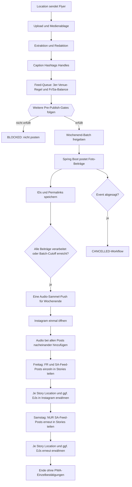
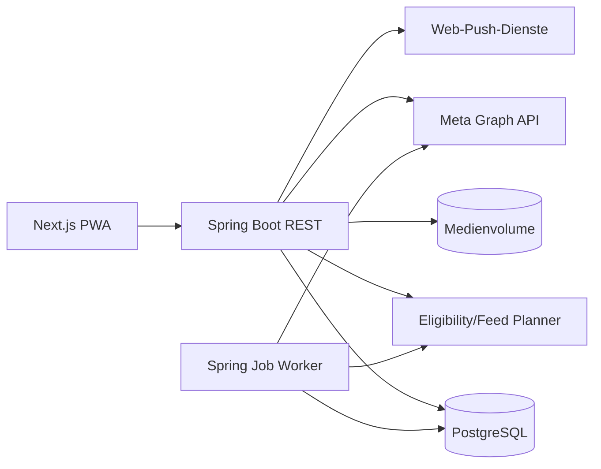
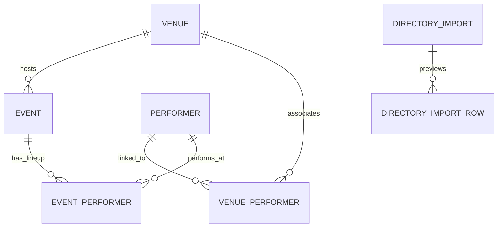
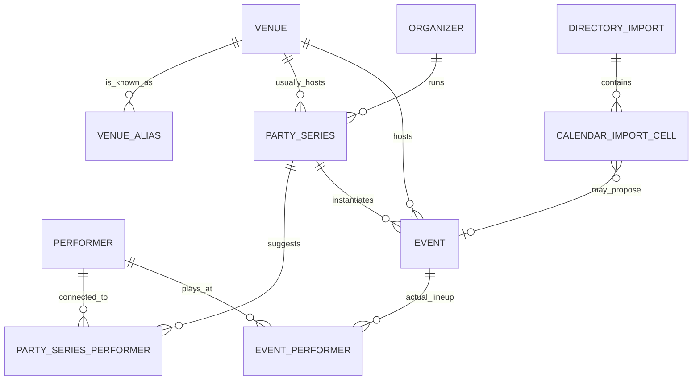
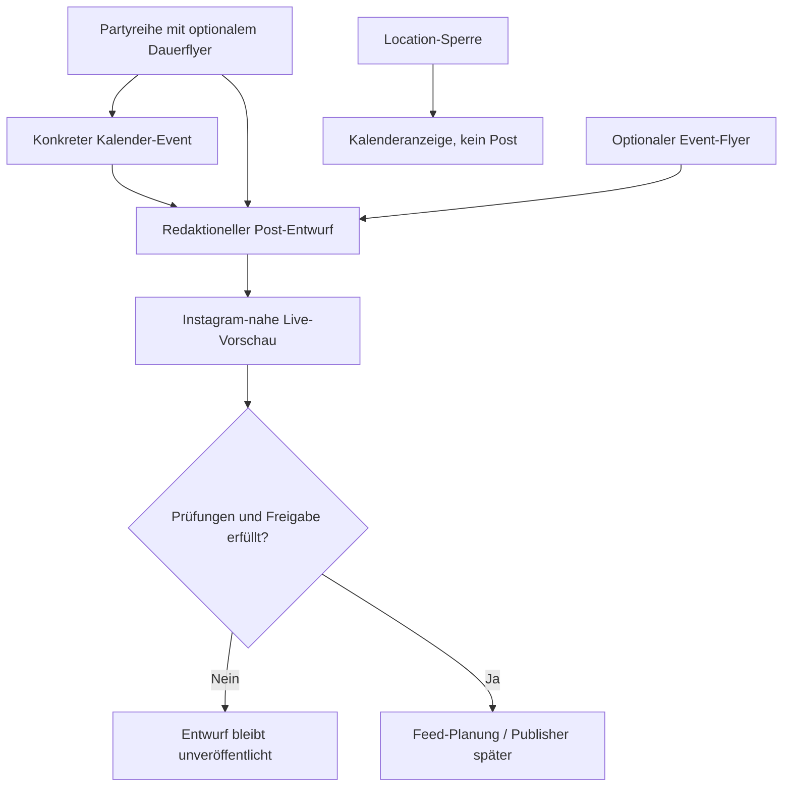

# NoizyCologne – Lastenheft, Pflichtenheft & Entwicklungs-/Lernhandbuch

> **Version:** 1.9 · **Stand:** 5. November 2026 · **Status:** Persistente Team-Anwendung mit Redaktion, Party-Discovery und Änderungsprüfung; Instagram-Publishing nicht implementiert
> **Zielgruppe:** NoizyCologne-Team und Entwickler  
> **Source of Truth:** Diese Version ersetzt v1.6 und frühere Projektdokumente fachlich. Für das tatsächlich implementierte Verhalten gilt zusätzlich der aktuelle Codezustand; nur dokumentierte Features sind noch nicht automatisch umgesetzt.  
> **Wichtig:** Dieses Handbuch enthält Lastenheft, Pflichtenheft, technische Lern-/Agenten-Referenzen **und einen Ist-/Soll-Abgleich**. Die früheren Beispielskripte sind nicht automatisch identisch mit der aktuellen Codebasis. Die Entwicklung erfolgt auf Arch Linux; der Benutzer hat den lokalen Kalender-Prototyp erfolgreich getestet. Plattform-Funktionen werden vor Produktivstart im realen Meta-Konto verifiziert.  
> **Verbindlicher Projektumfang (05.11.2026):** Ausschließlich Partys. Konzerte sind ausdrücklich unerwünscht und von Discovery sowie deren Kalenderübernahme ausgeschlossen. Frühere Konzertbezüge in diesem Handbuch gelten als überholte Beschreibung.
> **Verbindlicher Vorbehalt:** Weitere fachliche Pflichtschritte **vor** dem Posting sind angekündigt und noch nicht beschrieben. Bis zu deren Freigabe bleibt das reguläre automatische Publishing **deaktiviert** (`NOIZY_PUBLISH_ENABLED=false`).

**Für die tägliche Arbeit im Team:** Das [Team-Handbuch](TEAM-HANDBUCH.md) erklärt die tatsächlich vorhandenen Abläufe ohne technische Vorkenntnisse. Dieses Projektdokument bleibt die fachliche und technische Referenz mit ausdrücklich getrenntem Ist- und Soll-Zustand. Aktueller Bedienstand: Kapitel 23 bis 26; Qualitätsregeln: Kapitel 25 und [QUALITY.md](QUALITY.md). Das Publishing-Flag allein aktiviert keinen Versand: Ein Instagram-Publisher und seine Warteschlange sind im aktuellen Code nicht vorhanden.

---

## Inhaltsübersicht

1. Arbeitsweise und Definitionen
2. Produktidee, Ziel und Grenzen
3. **Lastenheft:** Anforderungen aus Sicht von NoizyCologne
4. **Pflichtenheft:** technische Umsetzung und Abnahme
5. End-to-End-Workflows und Statusmodelle
6. Technische Architektur / Repo-Struktur
7. Datenmodell, Migrationen und API
8. Instagram- und Musik-Integration: echte Möglichkeiten / Risiken
9. Feed-Planung und Freitag-/Samstag-Balance
10. Eventabsagen, Löschen und CANCELLED-Grafik
11. Sicherheit, Datenschutz und Betriebsregeln
12. **Lokales Setup mit Arch Linux und VS Code**
13. **Lern- und Coding-Roadmap in kleinen Schritten**
14. **VPS, Domain, DNS, Docker, GitHub Actions CI/CD und HTTPS – Schritt für Schritt**
15. Teststrategie, Monitoring, Backup und Wiederherstellung
16. Priorisiertes Backlog, Meilensteine und Definition of Done
17. Vor-Publishing-Workflow: Platz für neue Anforderungen
18. Quellen und Entscheidungen / Änderungsprotokoll
19. **CI/CD-Referenzkonfigurationen für das Repo (GitHub Actions + VPS)**
20. **Location- und DJ/Act-Stammdaten, Zuordnungen und Tabellenimport**
21. **Google-Sheets-Modell: Party-Portfolio, Partyreihen und Jahreskalender (neu v1.5)**
22. **Dokumentation-first-Workflow, Smartphone-Notizen und Coding-Agent-Übergaben**
23. **Aktueller Produktstand, Flyer- und Redaktionskonzept sowie offene Schritte (aktualisiert 05.11.2026)**
24. **Location Discovery, Vorschläge und manuelle Instagram-Rückfragen (v1.8)**
25. **Permanente Code-Quality-Routine**
26. **Event Change Monitoring und zentraler Cancellation-Prozess**

---

# 1. Arbeitsweise und Definitionen

### 1.1 Was ist bereits entschieden?

> **Zeitliche Einordnung:** Die folgenden Stichpunkte enthalten historische Architekturentscheidungen. Für die tatsächlich lokale Bedienbarkeit und neuere Änderungen vom 31.10.2026 siehe 1.1a und Kapitel 23. Frühe Hinweise zu noch nicht gebuchtem Hosting, Excel-Import oder automatischem DJ-Tagging sind durch v1.7 teilweise überholt.

- NoizyCologne bereitet von Kölner Locations/Veranstaltern gelieferte **Partyflyer** auf und veröffentlicht **gewöhnliche Instagram-Foto-/Feed-Posts**. **Keine Reels als Kernformat.**
- Textinformationen aus Flyern: Name, Datum, Einlass/Beginn, Location, Genres, Acts/DJs, Eintritt (wenn vorhanden), Social-Handles, weitere Hinweise.
- **Stammdaten:** Locations und DJs/Acts werden getrennt verwaltet und über m:n-Beziehungen verbunden. Die dauerhafte Location-Zuordnung ist ausdrücklich **nicht** gleichbedeutend mit einem Auftritt bei jedem Event. Für Caption und Story zählen nur **explizit dem Event zugeordnete** Acts.
- **Neu v1.5 – echte Sheet-Struktur aus Screenshots:** Ein Party-Portfolio enthält **Partyreihen** mit Veranstalter, Turnus, Genres und ggf. DJ-Vorgaben; Jahreskalender enthalten **konkrete Datumszellen je Venue-Spalte**. Eine Partyreihe ist nicht dasselbe wie ein einzelner Eventtermin. Portfolio-DJs sind keine bestätigten Event-Auftritte.
- Daraus entstehen überprüfbare Veranstaltungseinträge, Foto-Medien, Captions, Hashtags und Musikvorschläge.
- Nach Veröffentlichung erhält das zuständige Teammitglied **höchstens eine Sammel-Push pro Wochenend-Batch (Freitag + Samstag)**: Audio in Instagram nachtragen. Alle Beiträge werden **ohne Einzel-Bestätigungen, ohne regelmäßigen Wechsel zwischen Instagram und PWA** direkt in Instagram bearbeitet. Eine technische Bestätigung des Musikstatus durch Meta steht nicht zur Verfügung.
- **Verbindlicher manueller Story-Rhythmus:** **Freitags** werden sowohl die **Freitags- als auch die Samstags-Feed-Beiträge** jeweils als eigene Instagram-Story geteilt; **samstags** werden **nur die Samstags-Beiträge erneut** als einzelne Stories geteilt. Nach jedem Reshare werden die passende Location und ggf. DJs/Acts **manuell in der nativen Instagram-App** erwähnt (Android/iOS). **Keine** automatisierte Story-Erstellung, keine Story-Pushs und keine PWA-Abhakpflicht.
- Reihenfolge von Feed-Posts **manuell bestimmbar**. Automatische Planung schlägt eine valide Reihenfolge vor, darf manuelle Anordnung nicht heimlich ändern.
- 3-Spalten-Planung: **dieselbe Location darf nicht innerhalb von drei aufeinanderfolgenden veröffentlichten Posts erneut auftreten** (gleitendes 3er-Fenster). Freitag und Samstag möglichst ausgeglichen.
- Bei Ausfall/Absage werden geplante Posts gestoppt bzw. eine **CANCELLED**-Grafik und eine Absage-Caption generiert. Veröffentlichte Bilder können **nicht** per dokumentierter Publishing-API ersetzt werden.
- Ein gemeinsames Backend (Java 21 / Spring Boot 4), PostgreSQL/Flyway, Web-App/PWA (Next.js 16 / TypeScript), Docker und Caddy.
- **Lokaler Entwicklungsrechner: Arch Linux** mit VS Code, pacman, Java 21 und Node 24 via nvm.
- **Git-Push auf `main` = automatische Produktionsauslieferung:** GitHub Actions testet Backend/Frontend, baut zwei Docker-Images, lädt sie in GHCR und aktualisiert den Ubuntu-VPS über SSH; kein manuelles `git pull` oder Bauen auf dem VPS. Fehlgeschlagene Tests verhindern den Deploy.
- Der tatsächliche Veröffentlichungs-Scheduler für Instagram bleibt unabhängig davon **standardmäßig deaktiviert**, bis die angekündigten fachlichen Vorbedingungen vollständig definiert und getestet sind.
- **Aktualisierung v1.7:** VPS und Domain sind inzwischen bereitgestellt; `noizycologne.de` zeigt die öffentliche Landingpage, weitere technische Subdomains sind vorbereitet. Frühere Kauf-/Budgetbeispiele in diesem Handbuch gelten als **historische Planung**, nicht als aktueller Projektstatus. Budgetbeschränkung: **maximal 12 € sofort via PayPal**, keine Einrichtungsgebühr erwünscht; tatsächlicher erster Rechnungsbetrag ist maßgeblich.

### 1.1a Verbindliche Entscheidungen vom 31.10.2026 (v1.7; ersetzen ältere Vorschläge bei Widerspruch)

- **Manuelle Stammdaten statt Excel-Automatismus:** Die früheren Tabellen dienen nur als historische Orientierung. Der MVP ersetzt sie durch die manuelle Pflege im NoizyCologne-Party-Portfolio und Kalender. Die in Kapitel 20/21 beschriebenen Importer bleiben **historische/optionale Später-Ideen**, **kein aktueller Muss-Entwicklungsschritt**. Insbesondere wird keine XLSX-Datei automatisch importiert oder synchronisiert.
- **Partyreihen-Dauerflyer:** Jede Partyreihe kann optional genau einen **Standard-/Dauerflyer** referenzieren. Er gehört zur Partyreihe und ist unabhängig vom Turnus; ein Dauerflyer kann auch bei unregelmäßigen Partys bestehen. **Inzwischen persistent implementiert; aktueller Stand siehe Kapitel 23.**
- **Veranstaltungsflyer hat Vorrang:** Für eine konkrete Veranstaltung kann im Redaktionsbereich ein eigenes Bild hinterlegt werden. Dieses überschreibt den Standardflyer **nur für den zugehörigen Instagram-Beitragsentwurf**, niemals das Original der Partyreihe oder andere Termine.
- **Instagram-artige Redaktion verpflichtend:** Jede Veranstaltung, die für einen Instagram-Feed-Beitrag bearbeitet wird, erscheint im Redaktionsbereich als realistische **Instagram-Foto-Post-Vorschau** mit Bild, Account-Kopf, Caption, Hashtags und Mentions. Eingaben aktualisieren die Post-Ansicht live. **Inzwischen mit persistenten Entwürfen implementiert; die Vorschau ist keine Instagram-Veröffentlichung.**
- **Kalender ist eigenständig:** Kalendereinträge und Location-Sperren können angelegt, angezeigt, bearbeitet und gelöscht werden; farbige Partyreihen und ein optionaler Turnus sind bedienbar. **Gespeicherte Daten liegen inzwischen in PostgreSQL und bleiben nach einem Browser-Reload erhalten.** Ein Kalendertermin erzeugt weiterhin keinen Instagram-Post.
- **Mentions ≠ Auftritt:** Eine Partyreihe kennt Resident-DJs, weitere DJs und Veranstalter. In einem Event werden Instagram-DJ-Mentions abhängig von der Party-Vorgabe vorausgewählt oder manuell angehakt. Eine Mention behauptet **nicht automatisch** einen bestätigten Auftritt; tatsächliches Event-Line-up bleibt ein eigenständiges, später zu pflegendes Fachdatum.
- **Keine automatische Posting-Freigabe:** Kein Kalendertermin und kein Turnus erzeugt automatisch einen veröffentlichbaren Beitrag. Abnahme, echte Bilddatei, bereinigte Caption und zusätzliche Pre-Publish-Gates bleiben erforderlich. `NOIZY_PUBLISH_ENABLED=false`.


### 1.2 Noch ausdrücklich offen

- Zusätzliche Pflichtprüfungen, Abnahmen und Rollen **vor dem Posting** (werden in Kapitel 17 ergänzt).
- Welche Teamrollen tatsächlich existieren; zunächst Modellvorschlag, später gemeinsam entscheiden.
- Welches Instagram Professional-Konto/Meta-Login tatsächlich verwendet werden kann; Meta-App-Berechtigungen im echten Konto testen.
- Ob nach **API-veröffentlichten** Foto-Posts Musik auf **beiden** Plattformen nachträglich hinzufügbar ist. Der bisherige praktische Test betraf einen normalen Foto-Beitrag eines anderen Accounts; er bestätigt nicht automatisch den API-Fall.
- Welche Location-Eingangswege über einen geschützten Web-Upload hinaus nötig sind (z. B. E-Mail).
- Exakte Domain, Provider, Domain-Laufzeit, Zahlungsmodell und Checkout-Preis.
- **Google-Tabelle:** Die inzwischen hochgeladenen **Screenshots** belegen sichtbare Spalten und einige Beispiele (Portfolio-Tab und Kalender mit Location-Spalten). Der **vollständige Dateiinhalt, alle Tabs, zusammengeführte/versteckte Spalten, Formeln und Stammdaten** sind weiterhin nicht eingelesen; Importierung erst nach XLSX-Export/autorisiertem Zugriff, mit Vorschau und Freigabe. Kapitel 21 beschreibt das beobachtete Format. Keine nicht sichtbaren Datensätze erfinden.

### 1.3 Arbeitsregeln für die Entwicklung

1. **Ein Feature pro Schritt**: Backend + Migration + API + UI + Test + kleines Commit.
2. Geschäftslogik zuerst mit **Unit-Tests**, externe APIs über Adapter abstrahieren.
3. Bis zum bestandenen End-to-End-PoC wird **nicht automatisch auf dem produktiven Account gepostet**.
4. Keine erfundenen Veranstaltungsdaten. Unklare Flyer-Felder bleiben offen und blockieren nötigenfalls die Freigabe.
5. Secrets niemals in Git, Screenshots, Tickets oder Browser-Logs.
6. Jede Workflow-Regel wird über `PublishEligibilityService` **serverseitig** erzwungen. Ein Frontend-Schalter allein ist keine Sicherheit.
7. **Git-Konvention:** Lokal entwickeln → vollständiges Quality Gate und null IDE-Fehler/-Warnungen nachweisen → committen → freigegebenen Arbeitsbranch pushen. Ein Push auf `main` startet automatisch Tests, Docker-Build, GHCR, Deploy und Smoke-Test und erfordert deshalb einen entsprechenden Deployment-Auftrag. Andere Branches gehen nicht direkt live; die Referenzkonfiguration in Kapitel 19 ist kein zusätzliches Approval-Gate des tatsächlich vorhandenen Workflows.
8. Kein Live-Deploy überspringt Tests; technische Bereitstellung ≠ Freigabe zum Instagram-Posting (`NOIZY_PUBLISH_ENABLED=false`).
9. Das Dokument bei jeder Anforderungsänderung mit einer Zeile im Änderungsprotokoll aktualisieren.

### 1.3a Verbindlicher Arbeitsmodus: Dokumentation zuerst, Code durch Entwickler/Agents

- **Keine Starterpakete/ZIP-Archive und keine ungefragt erzeugten Repository-Dateien.** Das einzige fortgeschriebene Projektergebnis in diesen Anforderungsrunden ist **eine vollständige, versionierte Markdown-Datei**.
- Anforderungen können jederzeit **kurz und umgangssprachlich vom Smartphone** eingehen. Sie werden verständlich ausformuliert, in die richtige Fachsektion eingearbeitet und mit dem Änderungsprotokoll verknüpft.
- **Anforderung ≠ Implementierungsauftrag:** Eine neue Idee ändert zunächst die Spezifikation. Erst eine explizite Coding-Aufgabe berechtigt zur Erstellung/Änderung von Code oder zum Push in ein Repository.
- Später entwickelt der Eigentümer selbst in **VS Code auf Arch Linux** oder beauftragt Coding-Agents (z. B. GitHub Copilot/Cline/Codex). Agents erhalten klar abgegrenzte Tickets, betroffene Module, Tests und Abnahmekriterien.
- Die reale Codebasis bleibt im **Git-Repository**; diese MD beschreibt den Soll-Zustand. Unterschiede zwischen Dokumentation und tatsächlichem Code werden nicht stillschweigend als implementiert ausgegeben.
- **Ein vollständiges Dokument pro Version:** Keine konkurrierenden Fragmentdateien als neue „Wahrheit“. Ein Update ersetzt ältere Dokumentversionen fachlich; ältere Stände dienen nur als Historie.
- Bei Vorschlägen zu Workflow-Schritten **vor dem Posting** bleibt `NOIZY_PUBLISH_ENABLED=false`, bis diese Schritte gesammelt definiert, umgesetzt, getestet und freigegeben sind.
- Für Arbeitsweisen, mobile Notizen und Agenten-Übergaben siehe **Kapitel 22**.

### 1.4 Glossar

| Begriff | Bedeutung |
|---|---|
| Submission | Von einer Location gelieferte Flyer-Einsendung |
| Event | Redaktionell geprüfte Veranstaltung mit Datum, Location, Genres usw. |
| DJ/Act (Performer) | Wiederverwendbarer Stammdatensatz für DJ, Band oder weiteren Musik-Act |
| Location-DJ-Zuordnung | Allgemeine/regelmäßige Zuordnung zu einer Location; bedeutet **keine** automatische Event-Buchung |
| Event-Line-up | Bestätigte tatsächliche Auftritte bei einem konkreten Event; **nicht** identisch mit redaktionell gewählten @Mentions |
| Tabellenimport | Historische Option außerhalb des aktuellen MVP; keine automatische Übernahme der Excel-/Google-Daten |
| Partyreihe / Party-Serie | Wiederkehrendes Veranstaltungsformat aus „Partys Portfolio“ (Name, Venue, Veranstalter, Turnus, Genre und mögliche Acts) |
| Kalendereintrag | Konkretes Event oder eine Location-Sperre am gewählten Datum; im aktuellen MVP manuell gepflegt, noch kein publishfähiger Beitrag |
| Dauerflyer | Optionales Standardbild der Partyreihe; unabhängig vom Turnus und von einzelnen Terminen |
| Event-Flyer | Optionales Bild für einen konkreten redaktionellen Beitrag, überschreibt dort den Dauerflyer |
| Redaktionelle Post-Vorschau | Instagram-nahe, aber ausschließlich interne Live-Ansicht eines Entwurfs |
| Draft | Vorbereiteter Instagram-Entwurf **in NoizyCologne**, kein nativer Instagram-Draft |
| Posting Plan | Geordnete Warteschlange der zu publizierenden Beiträge |
| Gate | Serverseitig geprüfte Voraussetzung vor Veröffentlichung |
| Media Container | Vorstufe der Instagram Graph API, **kein** Instagram-App-Entwurf |
| Handoff | Übergabe eines veröffentlichten Posts an ein Teammitglied für die Musikbearbeitung |
| Weekend Batch | Ein zusammengehöriger Wochenend-Posting-Stapel (Freitag + Samstag, pro Instagram-Konto) |
| Audio-Hinweis | Einmaliger Push je Wochenend-Batch an den zuständigen Empfänger, keine Einzeltask-Pushs |
| Audio-Status | Nacharbeit erforderlich bzw. **nicht technisch nachweisbar**; keine fiktive Erledigt-Bestätigung |
| Story-Reshare | Bereits veröffentlichten Foto-Beitrag **manuell in der Instagram-App** als einzelne Story teilen; Location/DJs dort erwähnen |
| Story-Freitag | Alle bereits veröffentlichten Wochenend-Feed-Posts für **Freitag UND Samstag** einzeln als Stories teilen |
| Story-Samstag | Die bereits veröffentlichten **Samstags-Feed-Posts erneut** einzeln als Stories teilen; **keine** Freitags-Reshares |
| Reconciliation | Abgleich lokaler Daten mit dem tatsächlichen Instagram-Status |
| PoC | Proof of Concept: möglichst kleiner technischer Machbarkeitstest |

---

# 2. Produktidee und Systemgrenzen

**Problem:** Für einen lokalen Musik-Event-Account kommen Flyer von verschiedenen Locations. Die redaktionelle Aufbereitung ist wiederholend: Daten lesen, Genreeinordnung, Accounts erwähnen, Text schreiben, Hashtags ergänzen, Beiträge ausgewogen verteilen, Veröffentlichung koordinieren, Musik stapelweise nachtragen, Feed-Posts einzeln in Stories weiterverbreiten, Location/DJs erwähnen und kurzfristige Absagen verarbeiten.

**Lösung:** Eine geschützte Redaktion-PWA mit nachvollziehbarer Content-Pipeline. Automatisch, wo verlässlich; mit klaren Teamaufgaben, wo Instagram-Funktionen oder fachliche Prüfung manuelles Handeln erfordern.

**Nichtziele (V1):** Vollautomatische Musikzuordnung zu Foto-Posts, Reels-Produktion, private Instagram-APIs, Browser-Bots zum Manipulieren der Instagram-App, Scraping geschützter Inhalte, komplexe Microservices, lokales Video-/LLM-Hosting auf dem kleinen VPS.

## 2.1 Prozess in einer Grafik



**Abgrenzung:** Feed-Publishing ist automatisiert. Nachträgliche Musik, natives **Beitrag-in-Story-teilen** und echte Story-@Erwähnungen erfolgen manuell **innerhalb Instagram**. Die zweimalige Story-Nutzung eines Samstagsposts bedeutet **keinen zweiten Feed-Post**. Die PWA darf diese Schritte weder als API-automatisiert noch als geprüft erledigt darstellen.

---

# 3. Lastenheft – **WAS** das Produkt leisten soll

> Das Lastenheft beschreibt Anforderungen **ohne** technische Implementierung vorzuschreiben. Muss = verpflichtend, Soll = wichtig, Kann = spätere Erweiterung.

## 3.1 Stakeholder und Rollen

- **NoizyCologne-Redaktion:** erhält Flyer, prüft Events, pflegt Inhalte, plant Feed.
- **Publisher:** gibt Reihenfolge/Posts nach allen Gates frei, überwacht Veröffentlichung.
- **Wochenend-Bearbeiter:** bekommt einen Audio-Sammelhinweis, ergänzt Audio für alle Posts in einem Durchgang direkt in Instagram; **freitags** teilt er die Freitag- und Samstagsposts jeweils in einzelne Stories, **samstags** nur die Samstagsposts ein zweites Mal. Die jeweiligen Location-/DJ-Erwähnungen erfolgen vollständig in Instagram; **keine PWA-Bestätigung pro Post**.
- **Admin:** verwaltet Team, Kontoverbindung, Rollen, Systemparameter und Monitoring.
- **Locations:** liefern Flyer und Änderungen; ein eigenes Login für Locations ist **optional/später**.

Eine Person kann mehrere Rollen besitzen. Die endgültige Rechteverteilung ist **offen**.

## 3.2 Funktionale Anforderungen

| ID | Priorität | Anforderung | Abnahme / Prüfkriterium |
|---|---|---|---|
| LF-001 | Muss | Login und zugriffsgeschütztes Redaktion-Dashboard | Ohne Session kein Zugang zu nichtöffentlichen Inhalten |
| LF-002 | Muss | Flyer manuell hochladen (JPEG/PNG) | Datei sichtbar, unverändertes Original gespeichert |
| LF-003 | Muss | Stammdaten von Locations inkl. IG-Handle | Event referenziert eindeutige Location-ID |
| LF-004 | Muss | Datum, Uhrzeit, Location, Genres, Acts und Hinweise erfassen | Event kann bearbeitet und validiert werden |
| LF-005 | Muss | Erkennungsfehler korrigieren; keine fehlenden Angaben erfinden | Unklare Angaben bleiben sichtbar / editierbar |
| LF-006 | Muss | Caption, Hashtags, @Mentions erzeugen und editieren | Vorschau entspricht gespeichertem Entwurf |
| LF-007 | Muss | Unterschiedliche Posts je Veranstaltung und Quelle erkennen | Doppelte Flyer werden markiert, nicht still gelöscht |
| LF-008 | Muss | Posting-Reihenfolge auswählen (Drag-and-drop + Buttons) | Gespeicherte Positionen bleiben nach Reload erhalten |
| LF-009 | Muss | Feed-Vorschau in 3 Spalten | Neueste Beiträge links oben, richtige Reihenfolge |
| LF-010 | Muss | Keine Venue-Wiederholung in 3 aufeinanderfolgenden Posts | A-B-A wird serverseitig blockiert |
| LF-011 | Muss | Freitag/Samstag ausgewogen vorschlagen | Balancer liefert reproduzierbaren Vorschlag und Begründung |
| LF-012 | Muss | Workflow-Freigabe mit offenen zusätzlichen Gates | Gesperrter Beitrag wird nie veröffentlicht |
| LF-013 | Muss | Gewöhnlichen Foto-Post geplant via Instagram veröffentlichen | Meta bestätigt Media-ID, Permalink abrufbar |
| LF-014 | Muss | Retry / Unsicherheitszustand ohne blinde Doppelposts | Timeout führt nicht automatisch zu Duplikat |
| LF-015 | Muss | Musik-Nacharbeit als Stapel auf Android und iOS | Alle Wochenend-Beiträge in Instagram bearbeitbar; **kein PWA-Rücksprung/Bestätigungsbutton pro Beitrag** |
| LF-016 | Muss | **Eine Sammel-Push pro Wochenend-Batch** und optionale Batch-Übersicht | Bei 13 Freitags- und 11 Samstags-Events maximal **eine Audio-Push pro zuständiger Person/Berechtigungsgerät**, keine 24 Einzelbenachrichtigungen; ohne Push bleibt Übersicht im Dashboard |
| LF-017 | Muss | Eventabsage / CANCELLED-Aktion | Neue Grafik + Absage-Caption, keine falsche Überschreibung |
| LF-018 | Muss | Geplante Posts stornieren | Nicht publizierter Post kann zuverlässig gestoppt werden |
| LF-019 | Muss | Audit-Log für Änderungen, Freigaben und tatsächliche Systemereignisse | Wer, was, wann erkennbar; **kein erfundener Audio-Erfolgsnachweis** |
| LF-020 | Muss | Rollen/Berechtigungen | Unberechtigte Person kann weder publizieren noch löschen |
| LF-021 | Soll | Automatische Flyer-Texterkennung / strukturiertes Extrahieren | Felder mit Confidence und Nachbearbeitung |
| LF-022 | Soll | Musikvorschläge nach Genre, Band oder Titel | Vorschlag im Handoff sichtbar, keine automatische Foto-Audio-API unterstellt |
| LF-023 | Soll | Externe manuelle Instagram-Posts erkennen | Planung zeigt Warnung und kann neu berechnet werden |
| LF-024 | Soll | Veröffentlichte Posts entfernen | Wenn API nicht verifiziert, verlässlicher Instagram-Manuell-Workflow |
| LF-025 | Soll | Wochenend-Batch einer zuständigen Person zuweisen | Zuständigkeit je Batch, keine Einzeltask-Bestätigungen |
| LF-026 | Kann | Flyer via E-Mail automatisiert importieren | Eingänge werden zu ungeprüften Submissions |
| LF-027 | Kann | Direkter Upload durch Locations | Upload mit klarer Rechte- und Quellprüfung |
| LF-028 | Kann | Post-Performance/Insights | Berichte im Dashboard |
| LF-029 | Muss | Automatisches Deployment nach `git push origin main` | CI grün → Images mit Commit-SHA in GHCR → VPS aktualisiert sich ohne manuelles Eingreifen |
| LF-030 | Muss | Bei fehlerhaften Tests kein Release | Testfehler → weder neue Image-Version produktiv noch Änderung an laufenden Containern |
| LF-031 | Muss | Automatische Deploy-Kontrolle und Fehler-Rollback | Smoke-Test scheitert → vorheriger Image-Stand wird erneut gestartet, Workflow rot |
| LF-032 | Muss | Einziger Audio-Sammelhinweis für Freitag und Samstag | `UNIQUE(batch_id, recipient_id, AUDIO_DIGEST)` verhindert doppelte Auto-Pushs; auch bei 24 Events |
| LF-033 | Muss | Batch-Verarbeitung ohne App-Pingpong | Push → Instagram öffnen → Songs nacheinander ändern; keine Rückkehr zur PWA zwischen den Posts erforderlich |
| LF-034 | Muss | **Freitags** alle veröffentlichten **FR- und SA-Feed-Beiträge** jeweils als eigene Story teilen | Freitag-Story-Liste enthält beide Eventtage; echtes Reshare erfolgt ausschließlich manuell in Instagram |
| LF-035 | Muss | Location und ggf. DJs/Acts in Stories erwähnen | Handles liegen für beide Story-Runden vor; echte @Erwähnungen erfolgen manuell in Instagram |
| LF-036 | Muss | Musiknacharbeit korrekt als unverifiziert behandeln | Keine automatische Umstellung auf `CONFIRMED`, weil die API die manuelle Audiobearbeitung nicht verlässlich nachweist |
| LF-037 | Muss | **Samstags ausschließlich die Samstagsposts erneut als einzelne Stories teilen** | Ein Samstags-Feed-Post erscheint in der Freitag- **und** Samstag-Story-Liste, Freitags-Feed-Posts nur in der Freitags-Liste |
| LF-038 | Muss | **Keine** Story-Automatik, zusätzlichen Story-Pushs oder PWA-Abhakschritte | Beide Story-Runden erfolgen vollständig in nativer Instagram-App auf iOS/Android; Backend dokumentiert keine vermeintlichen Story-Erfolge |
| LF-039 | Muss | Wiederverwendbare Location-Stammdaten mit optionalen IG-Handles verwalten | Location anlegen, suchen, bearbeiten und deaktivieren; Events verwenden stabile UUID |
| LF-040 | Muss | DJ-/Act-Stammdaten unabhängig von Locations speichern | Ein DJ/Act kann ohne Location existieren und mehreren Locations zugeordnet werden |
| LF-041 | Muss | Locations und DJs/Acts in **m:n-Beziehung** verknüpfen | Eine Location hat mehrere Acts, ein Act mehrere Locations; Zuordnung einzeln lösbar |
| LF-042 | Muss (späteres Line-up-Modul) | **Bestätigtes Event-Line-up separat** von Party-DJs und redaktionellen Mentions pflegen | Erwähnungen können manuell gewählt werden; kein automatischer Auftrittsnachweis daraus |
| LF-043 | Kann/später | Historischer Vorschlag: externe Google-Tabelle importieren | Nur nach neuer Beauftragung; MVP pflegt Daten manuell |
| LF-044 | Kann/später | Falls Import später beauftragt wird: idempotent und dublettensicher | Keine Dubletten; Namens-/Handle-Konflikte in Review |
| LF-045 | Muss | Unklare oder fehlende IG-Handles nicht automatisch ergänzen | Ohne verifizierten Handle keine automatische @Mention; Quelle/Prüfstatus sichtbar |
| LF-046 | Muss | Location-Daten in Feed- und Story-Planung wiederverwenden | 3er-Regel nach `venue_id`, nicht nach Schreibweise; Story-Liste aus Event-Line-up |
| LF-047 | Soll | DJ/Act über Name/Handle suchen und beim Flyer-Matching vorschlagen | Uneindeutige Treffer werden nicht automatisch ausgewählt |
| LF-048 | Kann/später | Bei künftigem Import Herkunft und Änderungen nachvollziehen | Quelle, Importzeit, Bearbeiter und Änderungspfad nachvollziehbar |
| LF-049 | Kann/später | Google-Sheets-Synchronisierung als historische Option | Nur bei ausdrücklicher Freigabe, kein MVP |

| LF-050 | Muss | Partyreihen zusätzlich zu Locations/DJs und konkreten Events speichern | `party_series` ist unabhängig von `event`, kann aber mit Venue und optionalen Acts verbunden sein |
| LF-051 | Kann/später | Optionaler historischer Excel-Import „Partys Portfolio“ | Nicht Bestandteil des manuell gepflegten MVP |
| LF-052 | Kann/später | Optionaler Import historischer Jahreskalender mit Venue-Spalten | Keine automatische Übernahme im aktuellen MVP |
| LF-053 | Kann/später | Bei künftigem Import Kürzel und Venue-Aliase kontrolliert auflösen | Alias-Zuordnung nie ohne Prüfung |
| LF-054 | Muss | Auftrittsnachweis von Portfolio-DJ-Angabe **und von Mentions** trennen | Eine vorausgewählte Erwähnung ist keine Bestätigung eines Auftritts; manuelle Mention-Auswahl bleibt erlaubt |
| LF-055 | Kann/später | Historische Importregel: `Insta: ja` nie als Handle deuten | Gilt bei erneut beschlossenem Import; sonst manuelle Handle-Eingabe |
| LF-056 | Muss | Turnus als optionale Partyregel führen, unklare Regel als Freitext behandeln | Keine frei erfundenen zukünftigen Termine; aktuell keine Terminautomatik |
| LF-057 | Kann/später | Review-Queue bei künftiger Import-/Automatikfunktion | Keine stille Automatik bei Mehrdeutigkeit |
| LF-058 | Kann/später | Historischer XLSX-Importer mit mehreren Tabs/Spalten | Nicht Teil des MVP; nur bei neuem Auftrag |
| LF-059 | Muss | Nur geprüfte konkrete Events zum Feed-Planer zulassen | Kalendereintrag ohne Flyer/Eventdetails erhält `NEEDS_REVIEW` und ist nicht publish-fähig |
| LF-060 | Soll | Partyreihe als Vorlage für Event-Caption und Genre-Vorschläge nutzen | Redaktionsentwurf übernimmt nur gekennzeichnete Vorschläge, nicht ungeprüfte Fakten |

### 3.2a Ergänzte und neu priorisierte Anforderungen (v1.7)

| ID | Priorität | Fachliches Verhalten | Abnahme | Status 31.10.2026 |
|---|---|---|---|---|
| LF-061 | Muss | Partyreihe hat eine frei wählbare, eindeutige Farbkennung für Kalenderanzeige | Farbwahl in Stammdaten; Kalender benutzt diese Farbe | Lokal verifiziert |
| LF-062 | Muss | Partyreihe kann einen optionalen Dauerflyer speichern und austauschen | Standardbild in Party-Stammdaten hinterlegt, ohne Eventpflicht und ohne Turnusabhängigkeit | Spezifiziert |
| LF-063 | Muss | Redaktion übernimmt Dauerflyer automatisch als vorausgewählte Bildquelle | Redaktionsentwurf zeigt vorhandenen Standardflyer; Quelle bleibt erkennbar | Spezifiziert |
| LF-064 | Muss | Veranstaltung kann ein eigenes Beitragsbild erhalten | Event-Flyer ersetzt Dauerflyer nur für diesen Beitrag; andere Termine/Partyreihe unverändert | Spezifiziert |
| LF-065 | Muss | Redaktion zeigt stets eine Instagram-Foto-Post-nahe Live-Vorschau | Header, Bildfläche, Caption, Hashtags, Mentions und Interaktionstypen sichtbar; Live-Änderung | Spezifiziert |
| LF-066 | Muss | Kalendertermin und Instagram-Beitragsentwurf getrennt halten | Event ohne fertigen Post möglich, aber nicht freigebbar; Location-Sperre erzeugt keinen Post | Teilweise lokal: Kalender ja, Redaktion ausstehend |
| LF-067 | Muss | Ohne tatsächlich verfügbares Bild und Freigabe kein Instagram-Publishing | Platzhalter kann nicht als Beitragsbild freigegeben werden | Spezifiziert |
| LF-068 | Muss | Partyreihe optional mit wöchentlichem / monatlichem Turnus oder Freitextregel | Auswahl bleibt im Editor erhalten; automatische Eventgenerierung vorerst aus | Lokal verifiziert (State) |
| LF-069 | Muss | Event-Mentions unabhängig von bestätigtem Auftritt auswählbar | Resident-Voreinstellung nur bei aktivierter Regel; jeder Haken individuell änderbar; keine Auftrittszusage | Lokal verifiziert (State) |
| LF-070 | Muss | Kalender ermöglicht mehrere Events pro Tag, Sperren, Bearbeiten und Löschen | Termine nach Speichern farbig im Raster; State bleibt beim Navigieren erhalten | Lokal verifiziert (State) |
| LF-071 | Muss | Stammdaten und Kalendereinträge später dauerhaft per Spring Boot/PostgreSQL speichern | Browser-Reload ohne Datenverlust; API-Validierung und Berechtigung | Nicht implementiert |

**Änderung der Priorisierung gegenüber LF-043, LF-044, LF-048, LF-049, LF-051 bis LF-058:** Die früher als „Muss“ geplante XLSX-/Google-Sheets-Importfunktion gehört **nicht zum aktuellen MVP**. Die Teams pflegen Portfolio und Kalender manuell. Die alten Kennungen bleiben aus Nachvollziehbarkeitsgründen bestehen, ihre Priorität und Implementierungsreihenfolge sind durch diese v1.7-Entscheidung aufgehoben. Eventuelle Importfunktionen benötigen eine neue ausdrückliche Freigabe.


## 3.3 Nichtfunktionale Anforderungen

| ID | Kategorie | Ziel |
|---|---|---|
| LN-001 | Bedienbarkeit | Mobil auf Android/iPhone; Desktop für Planung |
| LN-002 | Performance | Normale Dashboard-Aktionen ohne unnötige Sekunden-Wartezeiten; große Dateien asynchron |
| LN-003 | Zuverlässigkeit | Zustandswechsel transaktional; Scheduler mit Datenbank-Leases / Sperren |
| LN-004 | Sicherheit | TLS, HttpOnly/Secure-Cookies, CSRF-Schutz, Rollenprüfung, verschlüsselte Meta-Tokens |
| LN-005 | Datenschutz | Sparsame personenbezogene Daten, Lösch-/Aufbewahrungskonzept, Quellnachweis |
| LN-006 | Betriebsmodell | Ein günstiger Linux-VPS, keine Pflicht zu bezahlten Managed-Services |
| LN-007 | Kosten | Bei Bestellung höchstens **12 € sofort per PayPal**, keine überraschenden Bereitstellungs- oder Vorauszahlungskosten |
| LN-008 | Wartbarkeit | Maven, modulare Packages, Tests, Flyway, Git, README, Logik nicht im Controller |
| LN-009 | Portabilität | Docker Compose: lokal und VPS mit getrennten ENV-Secrets |
| LN-010 | Erweiterbarkeit | Neue Pre-Publish-Gates ohne Umbau aller Controller einfügbar |
| LN-011 | Lokale Umgebung | Arch Linux + VS Code + pacman; keine Ubuntu-/APT-Befehle auf dem Entwicklungsrechner |
| LN-012 | CI/CD | Jeder Push auf `main` startet Test → Build → GHCR → SSH-Deploy; Container werden **auf GitHub gebaut**, nicht auf dem kleinen VPS |
| LN-013 | Release | Images unveränderlich mit Commit-SHA, vorherige Version für Rollback gespeichert, Ausführung serialisiert |
| LN-014 | Mindestschutz ab erstem Online-Test | HTTPS, SSH-Key, Team-Authentifizierung, Secret-Trennung, keine öffentlichen DB-Ports; unbekannte Subdomain ist allein kein Zugangsschutz |
| LN-015 | Datenqualität | Normalisierte, nachvollziehbare Handles; Unklarheiten bleiben im Review; Import nie stillschweigend überschreibend |

## 3.4 Erfolgskriterien / Muss-Demo

1. Ein Teammitglied lädt einen echten, freigegebenen Veranstaltungsflyer hoch.
2. Aus dem Flyer entsteht ein korrigierbarer Eventdatensatz samt Caption/Hashtags.
3. Drei verschiedene Locations erscheinen in einer validen Dreierfolge; `A → B → A` wird mit verständlichem Hinweis gesperrt.
4. Freitag- und Samstag-Veranstaltungen werden bei vorhandenem Angebot gemischt.
5. Ein freigegebener Testbeitrag wird als **Foto-Post** über die offizielle API veröffentlicht.
6. Für einen Test-Batch mit **13 Freitag- und 11 Samstagsposts** erhält die zuständige Person **eine einzige Audio-Sammel-Push** (auf dem ausgewählten Gerät); sie bearbeitet die Musik hintereinander in Instagram, ohne PWA-Einzelbestätigungen. **Freitag** teilt sie bei vollständig veröffentlichtem Batch **24 einzelne Stories** (13 FR + 11 SA); **Samstag** teilt sie **11 weitere Stories** (nur dieselben SA-Posts). In beiden Runden ergänzt sie Location-/DJ-Handles direkt in Instagram. Kein erneutes Feed-Publishing und kein Story-Push.
7. Bei Absage vor Veröffentlichung stoppt der Plan; bei Absage nach Veröffentlichung wird eine Absage-Grafik als neuer Post möglich.
8. Jede Änderung ist mit Akteur und Zeit nachvollziehbar.

---

# 4. Pflichtenheft – **WIE** wir es umsetzen

## 4.1 Technologie- und Architekturentscheidungen

| Bereich | Wahl | Warum |
|---|---|---|
| Java | 21 LTS | Verlässliche Sprache / vertrauter Stack |
| Backend | Spring Boot 4.x, Spring Web MVC, Validation, Security | REST, Sicherheit und Scheduling |
| Persistenz | Spring Data JPA/Hibernate | Domänenmodell und Transaktionen |
| Migrationen | Flyway | Versioniertes DB-Schema |
| Datenbank | PostgreSQL 16 oder neuer | Relationen, Constraints, Transaktionen, Locking |
| Frontend | Next.js 16, React, TypeScript, Tailwind | Responsive Editor-/PWA-Oberfläche |
| Auth unserer App | Sessions + Secure/HttpOnly Cookie | Team-Zugriff, eigene RBAC-Prüfung |
| Meta-Anbindung | `InstagramGateway`-Adapter | OAuth/API-Versionen und Capabilities austauschbar |
| Job-Ausführung | PostgreSQL-Jobtabelle + Spring Scheduler | 1 VPS, kein Kafka/Redis nötig |
| Push | Web Push + VAPID, Service Worker | Plattformübergreifend ohne App Store |
| Bilder | Java ImageIO/geeignete Bildbibliothek | JPEG-Export + CANCELLED-Overlay |
| OCR | `FlyerExtractor`-Interface | Zuerst manuell, später OCR/cloud oder lokal austauschbar |
| Reverse Proxy | Caddy | Automatisches HTTPS |
| Deployment | Docker Compose | Reproduzierbar, niedrige Kosten |
| CI/CD (ab erstem lauffähigem Repo) | GitHub Actions + GHCR + SSH | Auf `main` automatisch Tests → immutable SHA-Images → VPS-Deploy/Smoke-Test |
| Lokaler Entwicklungs-Host | Arch Linux + pacman + VS Code | Lokale Pakete getrennt vom Server-Betriebssystem |
| Server-OS | Ubuntu 24.04 LTS | Stabiler VPS-Betrieb, nur Image-Pulls und Compose-Updates |

**MVP zuerst als modularer Monolith**. Nicht separate „Services“ als eigenständige Prozesse bereitstellen; fachliche Module in einer Spring-Anwendung genügen.

### 4.1a Redaktion und Medienmodell – verbindliche UI-Regel (v1.7)

Die Redaktionsseite ist **kein reines Formular**: Links oder oberhalb stehen editierbare Werte, daneben bzw. darunter eine in jedem Bearbeitungszustand sichtbare Instagram-nahe **Foto-Feed-Post-Ansicht**. Auf mobilen Bildschirmen wird die Vorschau vor die technischen Eingabedetails priorisiert. Die Preview zeigt den NoizyCologne-Accountkopf, das tatsächlich gewählte Flyerbild in einer realistischen Feed-Bildfläche, eine darunter liegende Caption sowie sichtbare Hashtags und @Mentions. Einfache Like-/Kommentar-/Teilen-/Speichern-Icons können als reine Darstellung genutzt werden; sie dürfen keine echte Instagram-Interaktion vortäuschen.

**Medienauflösung beim Öffnen eines Entwurfs:** `event_specific_flyer` (falls vorhanden und gültig) → `party_series.default_flyer` → leerer Platzhalter. Der Platzhalter blockiert Freigabe. Flyermedien bleiben referenzierte Assets mit Original und ggf. nichtdestruktiven Crop-/Ansichtsmetadaten; keine Kopie oder Änderung des Party-Standards bei eventbezogenem Override. Vor Live-Posting gelten separate Anforderungen an Besitz/Nutzungsrechte, Bildformat, sichere Bereitstellung und Meta-API-Prüfung.

**Grenzen:** Die HTML-Vorschau bildet das künftige Erscheinungsbild möglichst realistisch ab, ist aber weder ein echter Instagram-Post noch ein Instagram-App-Entwurf. Instagram kann Schriftumbruch, Crop und UI leicht anders darstellen; echte Freigabe benötigt einen konsistenten serverseitigen Datensatz. Reels gehören nicht zum geplanten Workflow.


## 4.2 Empfohlene, zentrale Login-Strategie

**Empfehlung:** Facebook Login mit verknüpftem Professional-Instagram-Konto als erste zu prüfende Integration, weil optional die Instagram Audio API für die Suche vorgesehen ist. Wenn die Voraussetzung nicht erfüllt ist, muss Foto-Publishing alternativ über Instagram Login möglich bleiben. Die zwei OAuth-Verfahren sind **nicht identisch** (Tokens, Berechtigungen, Endpunkte). Nicht blind OAuth-Code oder Tokens vermischen.

**Verbindlich erst nach einem echten Meta-PoC festlegen:** Welche Login-Variante kann NoizyCologne tatsächlich autorisieren, welche Musik-Suchfunktionen stehen dort zur Verfügung und welche Rechte erfordert Veröffentlichung? Die Arbeit an Upload, Planung, API und PWA läuft davon unabhängig.

## 4.3 Rollen und Permissions (technischer Vorschlag)

```text
ADMIN          = Konten/Team/Sicherheitskonfiguration
EDITOR         = Upload, Events, Captions, Planung bearbeiten
PUBLISHER      = Plan prüfen/freigeben, posten, stornieren
AUDIO_EDITOR   = Audio-Aufgaben übernehmen und bestätigen
VIEWER         = lesen
```

Prüfung **in Spring Security und im Service**, nicht nur durch ausgeblendete Frontend-Buttons. Für sensible Aktionen (Löschen, Absage, Kontotrennung) zusätzliche Bestätigung und Audit.

## 4.4 Abgrenzung der Subsysteme



---

# 5. Fachliche Workflows und Zustandsmodelle

## 5.1 Normaler Event- und Wochenend-Workflow

1. Locations/Veranstalter liefern Flyer; das Team bereitet die Inhalte auf.
2. NoizyCologne speichert Original/Quelle, extrahiert Eventdaten und lässt unsichere Angaben redaktionell prüfen.
3. Caption, Hashtags und Instagram-Handles der Location/Acts werden als **editierbarer, versionierter** Content-Draft vorbereitet.
4. Redaktion ordnet Beiträge in einen Wochenend-Batch ein (Freitag/Samstag; Beispiel **13 + 11 = 24 Posts**).
5. Feed-Reihenfolge, 3er-Location-Regel, Freitag-/Samstag-Balance und sämtliche noch zu ergänzenden Pre-Publish-Gates werden geprüft.
6. Freigegebene Posts werden als normale Foto-Beiträge über die offizielle Instagram-API veröffentlicht; Media-ID und Permalink werden gespeichert.
7. Nach **Batch-Abschluss** (alle Posts veröffentlicht, terminal fehlgeschlagen oder nach einem definierten Cutoff) entsteht **ein einziger Audio-Hinweis** für die zuständige Person; wenn es fehlgeschlagene Posts gibt, zeigt die Batch-Ansicht diese gesondert an. Der Hinweis darf nicht suggerieren, dass diese veröffentlicht wurden.
8. Die Person wechselt **einmal** zu Instagram und ergänzt Musik an den veröffentlichten Posts **nacheinander ohne PWA-Rücksprünge**.
9. **Freitag:** Die veröffentlichten Beiträge für **Freitag und Samstag** werden in der nativen Instagram-App jeweils als **eigene Story** geteilt und mit Location-/DJ-@Erwähnungen ergänzt. **Samstag:** Nur die **Samstagsposts** werden dort als eigene Stories **erneut** geteilt und erneut erwähnt. Keine doppelte Feed-Veröffentlichung, keine PWA-/Instagram-Wechselpflicht, **keine Story- oder Audio-Erledigt-Buttons pro Beitrag**.
10. Technisch bleibt der Musikstatus **unverifiziert**. Ein gesendeter Push oder ein verstrichenes Wochenende ist **keine** Bestätigung, dass Audio/Stories fertig sind.

### Batch-Cutoff / Zeitpunkt der einzigen Push

- Der Batch umfasst standardmäßig **ein komplettes Wochenende** für einen Instagram-Account (`Europe/Berlin`).
- **Eine automatische Audio-Push** pro Batch und zuständiger Person (bei mehreren Endgeräten optional ein festgelegtes primäres Gerät).
- Standard: senden, sobald sämtliche relevanten Veröffentlichungsjobs einen Endstatus haben; andernfalls **einmal** zum konfigurierbaren, redaktionell festgelegten Cutoff. Bei späteren Posts **keine zweite automatische Audio-Push** für denselben Batch.
- Für tatsächlich **über beide Tage verteilt** veröffentlichte Posts ist die Benachrichtigung erst nach dem letzten relevanten Posting sinnvoll. Falls das Team Audio früher braucht, muss es den Zeitpunkt der gesamten Veröffentlichungs-Charge bewusst passend planen.
- Ein ausgefallener Push führt nicht zu Einzel-Pushs. Das Dashboard enthält stets die konsolidierte Übersicht.

## 5.2 Posting-, Audio- und Batch-Status getrennt

```java
public enum PublicationStatus {
    DRAFT, SCHEDULED, BLOCKED, CLAIMED, CONTAINER_CREATED,
    READY_FOR_PUBLISH, PUBLISHING, PUBLISHED,
    UNKNOWN_REMOTE_RESULT, FAILED, CANCELLED_LOCALLY,
    REMOVED_EXTERNALLY
}

// Der Instagram-Foto-Musikstatus lässt sich über die hier
// eingesetzte öffentliche API nicht sicher automatisiert prüfen.
public enum AudioStatus {
    NOT_APPLICABLE, MANUAL_AUDIO_PENDING, NOT_VERIFIABLE
}

public enum WeekendBatchStatus {
    PLANNING, APPROVED, PUBLISHING, READY_FOR_AUDIO_NOTICE, ARCHIVED
}
```

`PUBLISHED` beschreibt nur den erfolgreich veröffentlichten Feed-Post. `NOT_VERIFIABLE` darf **nicht** als `COMPLETED`/`CONFIRMED` ausgegeben werden. Ein manuell gelöschter Instagram-Beitrag wird gesondert reconciled. `UNKNOWN_REMOTE_RESULT` nach Timeout verhindert blinde Doppelposts. Der Batch wird nach Ablauf archiviert, ohne Audio oder Stories als erledigt zu behaupten.

## 5.3 Abbruch- und Notfallregeln

- Vor `PUBLISHING`: lokale geplante Veröffentlichung sauber stornierbar.
- Bei laufendem API-Aufruf: Status zunächst sperren/prüfen, nicht als garantiert abgebrochen anzeigen.
- Nach Instagram-Erfolg: **nicht** behaupten, dass lokales Löschen den Instagram-Post entfernt.
- Bei kurzfristiger Absage: **Schnelle Information kann Vorrang vor optischer Feed-Balance haben**, mit dokumentierter manueller Publisher-Entscheidung. Sonst gilt die harte Location-Regel.

---

# 6. Projektstruktur und Architektur

```text
noizycologne/
├── README.md
├── docs/
│   └── NoizyCologne_Entwicklungshandbuch_v1.4_Arch_CICD_Locations_DJs.md
├── .gitignore
├── .env.example
├── .vscode/
│   ├── extensions.json
│   ├── settings.json
│   └── launch.json                 # später
├── backend/
│   ├── pom.xml
│   ├── Dockerfile
│   └── src/
│       ├── main/java/de/noizycologne/
│       │   ├── NoizyCologneApplication.java
│       │   ├── config/
│       │   ├── auth/               # interne Sessions / RBAC
│       │   ├── venue/              # Locationstammdaten + Handles
│       │   ├── performer/          # DJs/Bands/Acts, Venue- und Event-Zuordnungen
│       │   ├── directoryimport/    # CSV/XLSX-Vorschau, Mapping, Dublettenprüfung
│       │   ├── submission/         # Flyer-Upload, Originaldateien
│       │   ├── event/              # Termine und Fakten
│       │   ├── content/            # Captions/Hashtags
│       │   ├── workflow/           # PrePublishGate (erweiterbar)
│       │   ├── feed/               # Reihenfolge und 3er-Planer
│       │   ├── instagram/          # OAuth, Publisher, Reconcile
│       │   ├── audio/              # Handoff-Aufgaben, Musikvorschlag
│       │   ├── cancellation/       # Absage und Grafik
│       │   ├── push/               # VAPID, Subscriptions, Outbox
│       │   ├── media/              # geschützte Dateien, JPEG
│       │   ├── common/             # Errors, IDs, Auditing
│       │   └── jobs/               # Worker und Ausführung
│       ├── main/resources/
│       │   ├── application.yml
│       │   ├── application-dev.yml
│       │   ├── application-prod.yml
│       │   └── db/migration/
│       │       ├── V1__base_schema.sql
│       │       ├── V2__event_submission.sql
│       │       ├── V3__content_and_planning.sql
│       │       ├── V4__publication_and_audio.sql
│       │       ├── V5__cancellation_and_push.sql
│       │       ├── V6__weekend_audio_digest.sql # sobald vollständig definiert
│       │       └── V7__venue_performer_directory.sql
│       └── test/java/de/noizycologne/
├── frontend/
│   ├── package.json
│   ├── Dockerfile
│   ├── next.config.ts
│   ├── public/
│   │   ├── sw.js
│   │   └── icons/
│   └── src/
│       ├── app/
│       │   ├── (auth)/login/page.tsx
│       │   ├── (dashboard)/dashboard/page.tsx
│       │   ├── (dashboard)/submissions/page.tsx
│       │   ├── (dashboard)/events/page.tsx
│       │   ├── (dashboard)/feed/page.tsx
│       │   ├── (dashboard)/audio-tasks/[id]/page.tsx
│       │   ├── (dashboard)/cancellations/page.tsx
│       │   └── manifest.ts
│       ├── components/
│       ├── features/
│       └── lib/api.ts
├── .github/
│   └── workflows/
│       └── deploy.yml             # Push auf main -> Tests, Docker, GHCR, VPS
├── infra/
│   ├── compose.local.yml
│   ├── compose.prod.yml           # Produktions-Images aus GHCR, KEINE build:-Keys
│   ├── deploy.sh                  # Pull, DB-Backup, Up, Health, Rollback
│   └── Caddyfile
└── scripts/
    ├── backup-db.sh
    └── restore-db.sh
```

**Leitlinie:** Controller nehmen HTTP an; Services enthalten Geschäftsregeln; Repositories kümmern sich um Daten; der `InstagramGateway` macht externe HTTP-Aufrufe. Keine `RestClient`-Aufrufe aus JPA-Entitäten oder Vue/React-Komponenten.

---

# 7. Datenmodell, SQL-Migrationen und REST-API

## 7.1 Tabellen (fachlicher Zielzustand)

| Tabelle | Zweck | Schlüssel / Hinweise |
|---|---|---|
| `app_user` | Teamkonten | Password-Hash / Rollen, aktives Konto |
| `user_role` | Zuordnung | `user_id`, `role` |
| `venue` | Locations | ID, Name, Stadt, Handles, Aktivstatus |
| `event_submission` | Flyer-Eingänge | source, storage path, hash, status |
| `media_asset` | Bilder | original/optimized/cancelled, MIME, checksum |
| `event` | geprüfte Veranstaltungen | date, venue_id, start_time, timezone |
| `performer` | DJ/Band/Act-Stammdaten | display_name, kind, instagram_handle, handle_status, active |
| `venue_performer` | Allgemeine m:n-Zuordnung Location ↔ Act | venue_id, performer_id, relation_type, source, active |
| `event_performer` | Bestätigtes Event-Line-up, ersetzt altes `event_artist`-Entwurfsmodell | event_id, performer_id, billing_order, confirmed |
| `directory_import` / `directory_import_row` | Vorschau, Herkunft und Zeilenentscheidungen eines Imports | source, mapping, checksum, status, action, conflict |
| `event_genre` | Genre-Klassifikation | Event-ID, Normalform + Original |
| `extraction_result` | OCR-Rohdaten | Provider, JSON, Confidence pro Feld |
| `content_draft` | Caption/Hashtags | revision, state, event_id, media_asset_id |
| `instagram_account` | Pro-Konto & Token | IDs, Login-Typ, verschlüsselter Token |
| `posting_plan` | Planungslauf | account_id, window, version, approved_by |
| `posting_plan_item` | sortierter Plan | position, planned_at, draft_id, lock flags |
| `pre_publish_gate_result` | Gate-Protokoll | gate_key, evaluated_at, passed, evidence |
| `instagram_publication` | tatsächliche Posts | media_id, container_id, permalink, status |
| `publication_attempt` | API-Versuche | lease, request correlation, error state |
| `weekend_batch` | Wochenend-Stapel pro IG-Account | friday_date, timezone, cutoff_at, assignee_user_id, status |
| `weekend_batch_publication` | Veröffentlichungen im Batch | batch_id, publication_id, position, event_day |
| `batch_audio_notification` | Einmaliger Audio-Hinweis | batch_id, recipient_id, status, sent_at, `UNIQUE(batch_id, recipient_id, kind)` |
| Story-Listen als **abgeleitete Ansicht** (keine Pflicht-Persistenz tatsächlicher Reshares) | Freitag = veröffentlichte FR+SA-Posts; Samstag = veröffentlichte SA-Posts erneut | weekend_batch_id, story_day, publication_id, event_day, venue_handle, artist_handles, position; kein `completed` |
| `audio_handoff_task` | **Alt-/Entwurfsmodell; V1.2 nicht mehr als Pflicht-Workflow** | keine Einzelbestätigungen oder individuellen Pushs |
| `push_subscription` | Browsergeräte | user_id, endpoint, p256dh, auth, enabled |
| `push_outbox` | Push-Aufträge | dedupe_key, tries, next_retry_at |
| `event_cancellation` | Grund und Mitteilung | event_id, severity, old_post_action, audit |
| `audit_log` | Nachvollziehbarkeit | actor_id, aggregate, action, before/after redacted |

**Kein `refresh_token` als Pflichtfeld festlegen**, sofern der verwendete Meta-Login einen anderen Token-Lebenszyklus vorsieht. Die jeweilige Token-Strategie in `InstagramAuthService` kapseln.

### 7.1a Datenmodell-Ergänzung v1.7 (Ziel, nicht als existierende Migration ausgeben)

- `party_series`: `id`, `name`, `instagram_handle`, `color`, optionale `recurrence_rule`, optionaler `default_flyer_media_id` (FK zu Medienverwaltung). Die Referenz kann `NULL` sein; Dauerflyer darf nicht an eine konkrete Termin-ID gebunden werden.
- `actor`: Person oder Kollektiv mit Instagram-Handle und Rollen `DJ` / `ORGANIZER`; m:n-Partybeziehungen für Resident, weitere DJs und Veranstalter. Das derzeitige lokale React-Modell und künftige relationale Schema können sich strukturell unterscheiden.
- `calendar_entry`: `id`, Datum, Eintragstyp `EVENT` / `CLOSURE`, `venue_id`, optional `party_series_id`, Startzeit, Sperrgrund, Bemerkung. Mehrere Einträge je Datum sind erlaubt.
- `media_asset`: persistierte Medienmetadaten, ursprüngliche Datei, MIME-Typ, Größe, Ablagepfad, Rechte-/Sicherheitsmerkmale, optional Varianten/Crop. Kein BLOB als zwingende Vorgabe; das Ablagekonzept ist vor Implementierung zu entscheiden.
- `editorial_post_draft`: referenziert **genau einen Kalender-Event** (entsprechend der später festzulegenden Kardinalität), besitzt eigene bearbeitete Caption, Hashtags, @Mentions, optional ein `event_specific_flyer_media_id`, Prüf-/Freigabestatus und Änderungsverlauf. Der Vorlagenflyer bleibt in `party_series`.
- **Keine implizite Medienübernahme durch Datenmutation:** Für die Vorschau darf ein vorhandener Standardflyer als Quelle berechnet werden. Beim final freigegebenen Post muss die verwendete Media-Referenz eindeutig fixiert sein, damit ein späterer Austausch des Dauerflyers ältere Freigaben nicht verändert.
- Die vorhandenen Flyway-SQL-Beispiele in älteren Kapiteln sind **Vorschläge aus früheren Planungsständen**, nicht bereits migrierte Datenbanken. Neue Migrationen erst aus dem aktuellen Repo und einer bewussten Schemaentscheidung ableiten.


## 7.2 Erste wirklich ausführbare Flyway-Migration (`V1__base_schema.sql`)

**Lernziel:** Beziehungen/Constraints verstehen. Nicht alle 20 Tabellen auf einmal bauen. Erste echte Migration:

```sql
CREATE EXTENSION IF NOT EXISTS pgcrypto;

CREATE TABLE venue (
  id UUID PRIMARY KEY DEFAULT gen_random_uuid(),
  name VARCHAR(160) NOT NULL,
  city VARCHAR(120) NOT NULL DEFAULT 'Köln',
  instagram_handle VARCHAR(100),
  active BOOLEAN NOT NULL DEFAULT TRUE,
  created_at TIMESTAMPTZ NOT NULL DEFAULT NOW()
);

CREATE TABLE event (
  id UUID PRIMARY KEY DEFAULT gen_random_uuid(),
  venue_id UUID NOT NULL REFERENCES venue(id),
  title VARCHAR(220) NOT NULL,
  event_date DATE NOT NULL,
  doors_at TIME,
  starts_at TIME,
  timezone VARCHAR(64) NOT NULL DEFAULT 'Europe/Berlin',
  status VARCHAR(40) NOT NULL DEFAULT 'DRAFT',
  created_at TIMESTAMPTZ NOT NULL DEFAULT NOW(),
  updated_at TIMESTAMPTZ NOT NULL DEFAULT NOW(),
  version BIGINT NOT NULL DEFAULT 0
);

CREATE INDEX idx_event_date ON event(event_date);
CREATE INDEX idx_event_venue_date ON event(venue_id, event_date);
```

**Übung:** Migration starten → Tabellen in PostgreSQL prüfen → `venue` anlegen → `event` referenzieren → ungültige `venue_id` als Fehler testen.

## 7.3 Spätere Planungstabellen (`V3__content_and_planning.sql` – Ausschnitt)

```sql
CREATE TABLE posting_plan (
  id UUID PRIMARY KEY DEFAULT gen_random_uuid(),
  instagram_account_id UUID NOT NULL,
  starts_at TIMESTAMPTZ NOT NULL,
  ends_at TIMESTAMPTZ NOT NULL,
  status VARCHAR(40) NOT NULL DEFAULT 'DRAFT',
  version BIGINT NOT NULL DEFAULT 0,
  CHECK (ends_at > starts_at)
);

CREATE TABLE posting_plan_item (
  id UUID PRIMARY KEY DEFAULT gen_random_uuid(),
  posting_plan_id UUID NOT NULL REFERENCES posting_plan(id) ON DELETE CASCADE,
  content_draft_id UUID NOT NULL,
  position INTEGER NOT NULL CHECK (position > 0),
  planned_at TIMESTAMPTZ,
  locked BOOLEAN NOT NULL DEFAULT FALSE,
  UNIQUE (posting_plan_id, position),
  UNIQUE (posting_plan_id, content_draft_id)
);
```

**Achtung:** Dieses Snippet ist absichtlich noch **nicht allein lauffähig**, solange `instagram_account` und `content_draft` nicht in früheren Migrationen existieren. Im Coding-Schritt Migrationen vollständig und in korrekter Reihenfolge erstellen. Bei Umordnung mit `UNIQUE(position)` Positionen transaktional über temporäre Werte oder ein sicheres Bulk-Verfahren aktualisieren; nie wechselweise zwei gleiche Positionen erzeugen.

## 7.4 REST-Kontrakt (geplante APIs)

| Methode | Route | Zweck |
|---|---|---|
| `POST` | `/api/auth/login` | Team-Login |
| `POST` | `/api/auth/logout` | Session beenden |
| `GET/POST` | `/api/venues` | Locations listen/anlegen |
| `GET/POST/PATCH` | `/api/performers[/{id}]` | DJs/Bands/Acts suchen, anlegen, bearbeiten |
| `GET/POST/DELETE` | `/api/venues/{id}/performers[/{performerId}]` | Allgemeine Venue-DJ-Verbindungen verwalten |
| `GET/PUT` | `/api/events/{id}/lineup` | Event-spezifisches, geordnetes Line-up verwalten |
| `POST` | `/api/directory-imports` | CSV/XLSX hochladen und nur Vorschau erzeugen |
| `GET` | `/api/directory-imports/{id}/preview` | Neu/Update/Konflikt/Unklar anzeigen |
| `POST` | `/api/directory-imports/{id}/commit` | geprüfte Zeilen importieren, geschützt/idempotent |
| `GET/PATCH` | `/api/venues/{id}` | Location prüfen/ändern |
| `POST` | `/api/submissions` | Multipart-Flyer-Upload |
| `GET` | `/api/submissions/{id}` | Upload und Status |
| `POST` | `/api/submissions/{id}/extract` | Extraktion anstoßen |
| `GET/POST` | `/api/events` | Events listen/anlegen |
| `PATCH` | `/api/events/{id}` | Veranstaltungsdaten korrigieren |
| `POST` | `/api/events/{id}/drafts` | Caption-Draft erzeugen |
| `PATCH` | `/api/drafts/{id}` | Text/Flyer korrigieren |
| `GET` | `/api/feed/plans/{id}` | Posting-Queue/Vorschau |
| `PUT` | `/api/feed/plans/{id}/order` | Reihenfolge ersetzen; Version beachten |
| `POST` | `/api/feed/plans/{id}/suggest` | Balance-Vorschlag |
| `POST` | `/api/feed/plans/{id}/validate` | Regeln/Gates prüfen |
| `POST` | `/api/feed/plans/{id}/approve` | Plan freigeben, sofern alle Gates erfüllt |
| `GET` | `/api/instagram/oauth/connect` | OAuth starten (Login-Variante festlegen) |
| `GET` | `/api/instagram/oauth/callback` | OAuth-Callback, state prüfen |
| `POST` | `/api/publications/{id}/publish-test` | nur abgesicherter PoC |
| `GET` | `/api/publications` | Veröffentlichungen/Status |
| `GET` | `/api/weekend-batches/{id}/handoff` | ein zusammengefasster Musik-/Story-Überblick (nur lesen) |
| `GET` | `/api/weekend-batches/{id}/publications` | veröffentlichte Posts in geplanter Reihenfolge, IG-Permalinks, Handles |
| `GET` | `/api/weekend-batches/{id}/stories?day=FRIDAY` | **FR+SA**-Beiträge als einzelne Freitag-Stories + Location/DJ-Handles (read-only) |
| `GET` | `/api/weekend-batches/{id}/stories?day=SATURDAY` | **Nur SA**-Beiträge als einzelne erneute Samstag-Stories + Location/DJ-Handles (read-only) |
| `POST` | `/api/weekend-batches/{id}/audio-notice` | geschützte, idempotente manuelle **Erstauslösung** nur falls noch kein Batch-Hinweis existiert; keine Wiederholungsflut |
| `POST` | `/api/push/subscriptions` | Web-Push-Abo speichern |
| `DELETE` | `/api/push/subscriptions` | Web-Push-Abo widerrufen |
| `POST` | `/api/events/{id}/cancel` | Absage erzeugen, Automatik stoppen |
| `POST` | `/api/cancellations/{id}/publish` | Absage-Post nach Freigabe veröffentlichen |
| `POST` | `/api/publications/{id}/mark-removed` | manuell in Instagram gelöscht → lokal abgleichen |

Konventionen: JSON, RFC-7807-ähnliche Fehler (`application/problem+json`), Pagination, Request-Validierung, Rechteprüfung, Audit, UTC-Zeitstempel für Speicherung. Bei `PUT /order`: `If-Match` oder `expectedVersion` verwenden; Konflikt ergibt HTTP `409`.

### Beispiel: Order-Request

```json
{
  "expectedVersion": 4,
  "items": [
    { "draftId": "<uuid-a>", "position": 1 },
    { "draftId": "<uuid-b>", "position": 2 },
    { "draftId": "<uuid-c>", "position": 3 }
  ]
}
```

---

# 8. Instagram-Publishing und Musik-Handoff

## 8.1 Realistische API-Grenzen

| Aufgabe | Entscheidung |
|---|---|
| Foto-Post über offizielle Instagram API veröffentlichen | **Ja**, über Medien-Container + `media_publish` bei Professional-Konto / korrekter Freigabe |
| Musik direkt beim Foto-Post per API hinzufügen | **Nein**, kein für Foto-Posts dokumentierter Publishing-Parameter |
| Musik in Instagram-App nachträglich ergänzen | Nutzerseitig bei gewöhnlichem Beitrag getestet; **API-geposteter Beitrag auf Android + iOS noch zu testen** |
| Native Instagram-Entwürfe via API erstellen | **Nein**; unsere Drafts leben in der eigenen Datenbank |
| Coverbild bereits veröffentlichten Foto-Posts austauschen | **Nicht** per offizieller Publishing-API |
| Veröffentlichten Post per API löschen | **Unklar/version-/authabhängig**: widersprüchliche Berichte; für V1 **nicht garantiert** und standardmäßig deaktiviert; manueller App-Workflow als verlässlicher Fallback |
| Musik nachträglich per API ändern | **Nein**, manuell in Instagram |
| Band-/Tracksuche über Instagram Audio API | Optional, nur nach realem OAuth-/Capability-Test; **nicht** gleichbedeutend mit Audio für Fotos |

**Keine ungetestete `DELETE /{media-id}`-Implementierung als produktives Versprechen.** Im Zweifel über `Instagram öffnen → Post entfernen` und danach `mark-removed` im eigenen System synchronisieren.

## 8.2 Instagram Gateway

```java
public interface InstagramGateway {
    MediaContainerResult createPhotoContainer(
        InstagramAccount account, URI publicJpegUrl, String caption);
    ContainerStatus fetchContainerStatus(
        InstagramAccount account, String containerId);
    PublishResult publishContainer(
        InstagramAccount account, String containerId);
    Optional<RemotePublication> fetchPublication(
        InstagramAccount account, String mediaId);
    List<RemotePublication> recentMedia(
        InstagramAccount account, int limit);
}
```

**Keine echten Access-Tokens in der Frontend-Response.** OAuth `state` wird sicher und einmalig gespeichert (Ablaufdatum + Nutzer-/Session-Zuordnung). Tokens verschlüsselt speichern, erneuern/neu verbinden entsprechend der gewählten Login-Art. Redirect-URI muss exakt mit der Meta-Konfiguration übereinstimmen.

## 8.3 Publishing-Schritte

```text
1. Eligibility / Planversion / Live-Feed prüfen.
2. Job exklusiv claimen; Status CLAIMED.
3. JPEG über öffentlich abrufbare, zeitlich begrenzte HTTPS-URL bereitstellen.
4. Medien-Container mit Caption anlegen.
5. Status abrufen, bis Meta die Veröffentlichung erlaubt.
6. media_publish exakt kontrolliert ausführen.
7. Media-ID/Permalink speichern; Status PUBLISHED.
8. Veröffentlichung dem Wochenend-Batch zuordnen; **keine Einzel-Push erzeugen**. Nach Abschluss/Cutoff einmalige `AUDIO_DIGEST`-Benachrichtigung via Outbox.
9. Bei Timeout: UNKNOWN_REMOTE_RESULT, erst Remote-Zustand abgleichen.
```

**Vorsicht:** Der Instagram-Graph-API-Container ist ein Publishing-Zwischenschritt, keine Möglichkeit, später in der Instagram-App im Entwürfe-Bereich weiterzuarbeiten.

## 8.4 Plattformübergreifender **Sammel-Handoff ohne App-Pingpong** (verbindliche V1.2-Entscheidung)

**Problem:** Bei z. B. **13 Freitags- und 11 Samstags-Veranstaltungen** wären 24 Einzel-Pushs und die Abfolge `Instagram → PWA bestätigen → Instagram → ...` unbrauchbar. Diese frühere Entwurfslogik wird **ersatzlos gestrichen**.

**Zielablauf:**

1. Alle zu einem Wochenende gehörenden Team-Flyer/Posts werden vorbereitet, geprüft, sortiert und nach Freigabe über die Instagram-API veröffentlicht.
2. Der Backend-Worker ermittelt anhand der gespeicherten Media-IDs/Permalinks die veröffentlichten Beiträge des Batches.
3. **Genau ein automatischer Audio-Sammelhinweis** wird pro Wochenende und zuständiger Person erzeugt. Text z. B.: **„NoizyCologne: 24 Wochenend-Beiträge online – bitte Musik in Instagram nachtragen.“** Die Zahl enthält nur wirklich veröffentlichte Posts; Fehler werden in der optionalen Übersicht angezeigt.
4. Der Push öffnet bei Antippen **eine einzige Batch-Übersicht** mit dem Button „Instagram-Profil öffnen“, Anzahl, optionaler geordneter Linkliste und Musikvorschlägen/Location-/DJ-Handles. Alternativ öffnet der Bearbeiter Instagram unmittelbar selbst.
5. Die Person ergänzt **alle Audiotracks innerhalb der Instagram-App**, ohne zwischendurch zur PWA zu wechseln. **Kein einzelner Audio-Task, kein Bestätigungsbutton, kein nächster PWA-Beitrag.**
6. Der Story-Ablauf (Kapitel 8.6) ist zeitlich getrennt von dieser einen Audio-Push: **freitags alle FR- und SA-Beiträge** als einzelne Stories teilen; **samstags nur die SA-Beiträge erneut** teilen. Location-/DJ-Erwähnungen in jeder Story manuell in Instagram ergänzen. Kein zusätzlicher Story-Push.
7. In der App gibt es **keinen verpflichtenden Erledigt-Schritt**, auch nicht pauschal nach 24 Posts. Die PWA protokolliert lediglich Veröffentlichung und Benachrichtigungsversand. Audio/Story sind `NOT_VERIFIABLE`, bis eine tatsächlich unterstützte Prüfmöglichkeit existiert.

**Benachrichtigungsregeln:**

- Ein Wochenende/Instagram-Account bildet **einen Batch** (Freitag und Samstag gemeinsam); `weekend_batch.friday_date` identifiziert den Wochenendbeginn.
- `UNIQUE(batch_id, recipient_id, notification_kind)` + transaktionale Outbox verhindern Doppel-Pushs bei Retry, Worker-Neustart und parallelem Scheduler; Web Push garantiert keine exakt einmalige Zustellung auf dem Endgerät.
- Ein Push wird nach dem **letzten relevanten Posting** oder zu einem bewusst gewählten Batch-Cutoff geplant; **nicht nach jedem Post**. Späte Beiträge lösen **keinen weiteren automatischen** Audio-Hinweis aus.
- Mehrere Geräte: Web-Push-Abos sind **geräte-/browsergebunden**. Für wirklich nur eine sichtbare Push pro Person das *primäre Push-Gerät* im Profil auswählen; sonst können mehrere Geräte dieselbe Sammelnachricht anzeigen.
- Ohne Push-Berechtigung ist der Batch über das Dashboard erreichbar; **kein stiller Verlust** der Informationen, keine erzwungene Nutzeraktion.
- Eine fällige Sammel-Push wird nicht als erfolgreich zugestellt markiert, solange der Push-Provider nicht akzeptiert hat. Fehlschläge werden in der Outbox mit begrenzter Wiederholung behandelt; es entstehen dabei **keine neuen logischen Benachrichtigungen**.

**Android:** moderner Browser mit Push-Erlaubnis; **iOS:** installierte Home-Bildschirm-PWA ab iOS 16.4 mit expliziter Freigabe. Auf beiden Geräten den realen Push/Permalink testen; die PWA kann das native Öffnen der Instagram-App nicht auf jedem System erzwingen. Deshalb zeigt sie echte HTTPS-Permalinks und einen Profil-Link an.

### Datenbankkontrakt für einmalige Sammel-Benachrichtigungen (Migration ab V6, Entwurf)

```sql
CREATE TABLE weekend_batch (
    id UUID PRIMARY KEY DEFAULT gen_random_uuid(),
    instagram_account_id UUID NOT NULL REFERENCES instagram_account(id),
    friday_date DATE NOT NULL,
    timezone VARCHAR(64) NOT NULL DEFAULT 'Europe/Berlin',
    cutoff_at TIMESTAMPTZ,
    assignee_user_id UUID REFERENCES app_user(id),
    status VARCHAR(32) NOT NULL DEFAULT 'PLANNING',
    UNIQUE (instagram_account_id, friday_date)
);

CREATE TABLE weekend_batch_publication (
    batch_id UUID NOT NULL REFERENCES weekend_batch(id),
    publication_id UUID NOT NULL REFERENCES instagram_publication(id),
    position INTEGER NOT NULL,
    event_day DATE NOT NULL,
    PRIMARY KEY (batch_id, publication_id),
    UNIQUE (batch_id, position)
);

CREATE TABLE batch_audio_notification (
    id UUID PRIMARY KEY DEFAULT gen_random_uuid(),
    batch_id UUID NOT NULL REFERENCES weekend_batch(id),
    recipient_id UUID NOT NULL REFERENCES app_user(id),
    notification_kind VARCHAR(32) NOT NULL DEFAULT 'AUDIO_DIGEST',
    status VARCHAR(32) NOT NULL DEFAULT 'PENDING',
    created_at TIMESTAMPTZ NOT NULL DEFAULT now(),
    sent_at TIMESTAMPTZ,
    UNIQUE (batch_id, recipient_id, notification_kind)
);
```

**Migration beachten:** `instagram_account`, `instagram_publication` und `app_user` müssen vor V6 bestehen. Das ist ein **Zielschema-Ausschnitt**, noch keine sofort ausführbare Migration im leeren Projekt. Die bereits vorgesehene `push_outbox` referenziert die **eine** `batch_audio_notification` über einen eindeutigen `dedupe_key` (z. B. `audio-digest:<batch-id>:<recipient-id>`). Der Outbox-Worker darf denselben Auftrag nicht parallel claimen.

### Service Worker (`frontend/public/sw.js`, vereinfachte Vorlage)

```js
self.addEventListener('push', (event) => {
  const payload = event.data?.json() ?? {};
  const batchId = String(payload.batchId ?? '');
  const count = Number(payload.publishedCount ?? 0);
  if (!/^[0-9a-f-]{36}$/i.test(batchId)) return;
  const safeCount = Number.isInteger(count) && count >= 0 ? count : 0;

  event.waitUntil(self.registration.showNotification('NoizyCologne', {
    body: `${safeCount} Beiträge online – bitte Musik in Instagram ergänzen.`,
    tag: `audio-weekend-${batchId}`,
    data: { url: `/weekend-batches/${batchId}/handoff` }
  }));
});

self.addEventListener('notificationclick', (event) => {
  event.notification.close();
  const path = event.notification.data?.url ?? '/';
  const url = new URL(path, self.location.origin);
  if (url.origin !== self.location.origin ||
      !/^\/weekend-batches\/[0-9a-f-]{36}\/handoff$/i.test(url.pathname)) return;

  event.waitUntil((async () => {
    const windows = await clients.matchAll({type: 'window', includeUncontrolled: true});
    const existing = windows.find(c => c.url.startsWith(self.location.origin));
    if (existing) {
      await existing.navigate(url.href);
      return existing.focus();
    }
    return clients.openWindow(url.href);
  })());
});
```

**Hinweis:** Web-Push-VAPID/Subscription, persistente Outbox und sichere Authentifizierung sind zusätzlich erforderlich. `tag` hilft beim Zusammenfassen sichtbarer Notifications, **ersetzt aber keine serverseitige Einmaligkeitsregel**. Bei fehlendem technischen Audio-Nachweis niemals „24/24 Musik erledigt“ anzeigen.

## 8.5 PoC-Testprotokoll für Musik bei API-Fotos

| Gerät | API-Post sichtbar | Post-Menü „Bearbeiten“ | „Audio hinzufügen“ | Song wechselbar | Ergebnis |
|---|---|---|---|---|---|
| iPhone / Instagram-App | ☐ | ☐ | ☐ | ☐ | offen |
| Android / Instagram-App | ☐ | ☐ | ☐ | ☐ | offen |

**Abbruchkriterium:** Wenn ein API-gepostetes Foto sich nicht mit Musik versehen lässt, muss der Entwurf in den manuellen Notification-Publishing-Fallback wechseln. Ein bereits veröffentlichter Beitrag darf nicht vorgetäuscht als „mit Musik fertig“ gelten.

## 8.6 Stories und @Mentions – **manueller Zwei-Tage-Ablauf (Instagram-App)**

**Verbindliche Team-Praxis (V1):** Story-Reshares und Erwähnungen finden **ausschließlich manuell in der nativen Instagram-App** auf Android oder iOS statt. NoizyCologne veröffentlicht nur die Feed-Fotos automatisiert, stellt optional eine lesbare Orientierungsliste bereit und sendet **keine** zusätzliche Story-Benachrichtigung. Die bereits definierte **einmalige** Push betrifft **nur Audio-Nacharbeit**.

### Freitag: Freitag **und** Samstag bewerben

1. Die Redaktion hat die regulären Feed-Beiträge bereits freigegeben und – sofern der Instagram-Publisher erfolgreich war – veröffentlicht.
2. Die Team-Person öffnet Instagram und teilt **jeden veröffentlichten Freitags- und Samstags-Feed-Beitrag** **einzeln** als Story über die native Funktion „Beitrag in deiner Story teilen“.
3. Bei **jeder Story** fügt sie manuell die zutreffende Location und – falls vorhanden – die **im konkreten Event-Line-up** hinterlegten DJs/Acts als **echte Instagram-Erwähnungen** hinzu. Eine allgemeine `venue_performer`-Zuordnung darf **nicht** automatisch zu einer Event-Erwähnung werden. Handle-Zuordnungen dürfen nicht zwischen Events vertauscht werden.
4. Die Freitag-Story-Liste ist ein **read-only Hilfsmittel** (`GET .../stories?day=FRIDAY`), keine Checkliste mit Pflichtbestätigung. Die Reihenfolge der Story-Veröffentlichung kann innerhalb der App gewählt werden.

### Samstag: **ausschließlich Samstag** wiederholen

1. Es werden **nur die bereits veröffentlichten Samstag-Feed-Beiträge** erneut als **einzelne Instagram-Stories** geteilt; **keine Freitags-Beiträge**.
2. Location und ggf. DJs/Acts werden für jede neue Story erneut manuell in Instagram erwähnt.
3. Das ist ein **erneuter Story-Reshare derselben Samstag-Feed-Posts** – **kein zweiter Feed-Post**, kein erneuter Graph-API-Publish-Aufruf, kein Duplikat im Drei-Spalten-Feed.
4. Die Samstag-Story-Liste (`GET .../stories?day=SATURDAY`) ist wiederum nur Orientierung. Keine zusätzliche Push und keine PWA-Bestätigung pro Story.

### Abgrenzung zur Audio-Sammel-Push

- **Genau eine** Audio-Sammel-Push pro Wochenend-Batch / zuständiger Person bzw. ausgewähltem Gerät, unabhängig davon, ob Freitag und Samstag Story-Runden stattfinden.
- Nach dem Push kann die Person alle Songs hintereinander in Instagram ergänzen. **Kein Wechsel zur PWA** zwischen den Beiträgen notwendig.
- Die Story-Arbeit erfolgt an den vorgesehenen Tagen manuell und unabhängig vom Zeitpunkt der Audio-Sammel-Push; diese ist **keine** Story-Aufgabe und löst keine Story-Runde aus.
- Bei verspäteter Veröffentlichung oder fehlgeschlagenen Posts erscheinen in Story-Listen **nur tatsächlich veröffentlichte Beiträge**; nichts als geteilt markieren, was noch nicht live ist.
- Eine manuelle Story am Freitag verschwindet nach normaler Instagram-Story-Laufzeit. Der Samstag-Reshare erzeugt eine **neue Story** aus demselben Feed-Post.

### Lesende Daten für die PWA (ohne Erledigt-Zwang)

Für jeden tatsächlich veröffentlichten Post liefern die Story-Listen mindestens `publicationId`, `instagramPermalink`, `eventDate`, `eventDay`, `venueName`, `venueInstagramHandle`, `artistInstagramHandles[]` (ausschließlich aus dem bestätigten `event_performer`-Line-up) und `feedPosition`. `day=FRIDAY` filtert auf FR+SA und `day=SATURDAY` nur auf SA. Der Server ermittelt Eventtage nach `Europe/Berlin`; er behauptet weder Story-Erfolg noch tatsächlich gesetzte Mentions. Es wird keine weitere persistent gespeicherte Story-Abarbeitung benötigt.

**Beispiel für 13 Freitags- und 11 Samstags-Events bei vollständig veröffentlichtem Batch:**

| Tag | Welche Feed-Beiträge als Stories teilen? | Neue Stories | Location-/DJ-Erwähnungen |
|---|---|---:|---|
| **Freitag** | 13 Freitags- + 11 Samstags-Posts | **24** | In jeder Story manuell |
| **Samstag** | Nur die 11 Samstags-Posts erneut | **11** | In jeder Story erneut manuell |
| **Summe** | 24 unterschiedliche Feed-Posts, 11 davon zweimal als Story | **35** | Komplett native Instagram-App |

**API-Grenze:** Die Graph API kann unter passenden Voraussetzungen eigenständige Story-Medien hochladen. Das ist **nicht** identisch mit dem nativen Reshare eines bestehenden Feed-Beitrags samt anklickbarer Beitragskarte und interaktiven @Mention-Stickern. Diese Automatisierung ist **kein** V1-Ziel. Android/iOS-PoC prüft Story-Sharing und Mention-Workflow in der nativen Instagram-App.

**Abnahmefall:** Ein erfolgreich veröffentlichter Batch umfasst 13 FR- und 11 SA-Feed-Posts. Die Team-Person ergänzt Musik ohne PWA-Einzelbestätigung, teilt **am Freitag 24 Stories** und **am Samstag nur 11 weitere** – immer mit den passenden Location-/DJ-Erwähnungen direkt in Instagram. Es entstehen keine weiteren Feed-Posts, keine Story-Pushs und keine erzwungenen Rücksprünge zur PWA.
---

# 9. Feed-Planung: 3 Spalten, Locations, Freitag und Samstag

## 9.1 Reihenfolge

- Queue ist **pro Instagram-Konto** getrennt; Zeitraum z. B. kommendes Wochenende.
- Änderungen via Drag-and-drop, auf Mobilgeräten zusätzlich „Hoch/Runter“ und Positionsnummer.
- Manuelle Reihenfolge bleibt erhalten, außer bei explizitem „Optimieren“-Klick.
- **Freigegebener Plan ist versioniert**. Jede redaktionelle Änderung nach Freigabe fordert erneute Validierung.
- App zeigt aktuellen Instagram-Bestand sowie eine simulierte Drei-Spalten-Ansicht nach jeder geplanten Veröffentlichung.

## 9.2 Verbindliche Venue-Regel

**In jedem gleitenden Fenster von bis zu 3 aufeinanderfolgenden veröffentlichten Beiträgen darf eine Location nur einmal vorkommen.** Dabei zählen mindestens die letzten zwei **tatsächlich** veröffentlichten Posts als Kontext, wenn deren Locations sicher bekannt sind.

```text
Erlaubt:   A -> B -> C -> A -> B -> C
Gesperrt:  A -> B -> A        (A erscheint in einem 3er-Fenster 2x)
Gesperrt:  A -> A -> B
```

Bei zu wenigen Locations gibt es u. U. **keinen** gültigen Plan. Dann blockiert Auto-Publishing und die UI zeigt die Ursache statt eine unmögliche Reihenfolge zu „reparieren“. Ein geänderter Live-Feed, angeheftete Posts und externe Posts können die Vorschau verfälschen → Warnung und ggf. Reconciliation. Eine optische Reihenposition kann nicht garantiert werden, wenn Teammitglieder gleichzeitig direkt in Instagram posten.

## 9.3 Freitag/Samstag als weiche Optimierung

- `event_date` mit `Europe/Berlin` zu FR/SA/SONSTIG klassifizieren.
- Wenn genügend Inhalte aus beiden Tagen vorhanden sind: möglichst FR/SA/FR/SA statt großer Tagesblöcke.
- Bei sechs verfügbaren Kandidaten (3+3): Ziel 3:3. Bei ungleicher Anzahl: anteilig fair, nicht künstlich 50/50 erzwingen.
- Event-Deadline/Ankündigungsfenster und harte Venue-Regel haben Vorrang. Bei Balance-Abweichung reicht ein dokumentierter Hinweis und Freigabe, **wenn** alle harten Regeln erfüllt sind.

## 9.4 Optimierungsalgorithmus (erst V1, nicht KI nötig)

- Kandidaten nach Freigabestatus, Event-Deadline, fixierten Positionen laden.
- Alle zulässigen nächsten Kandidaten gegen letzte zwei Venue-IDs prüfen.
- Mit **begrenztem Backtracking/Beam Search** mehrere Reihenfolgen testen, statt nur gierig „besten nächsten“ auswählen.
- Scoring: Fr/Sa-Wechsel + Deadline + geringe Positionsänderung + zeitlicher Abstand; reproduzierbare Tie-Breaker.
- Ergebnis mit `location_conflict`, `balance_score`, `expectedVersion` und Warnungen speichern.
- **Vor tatsächlichem Publish** erneut die letzten Instagram-Posts und die Planversion prüfen.

### Drei automatisierte Kern-Tests

```java
assertTrue(isValid(List.of("A", "B", "C", "A")));
assertFalse(isValid(List.of("A", "B", "A")));
assertFalse(isValid(List.of("A", "A", "B")));
```

### Beispiel sechs Posts (Veröffentlichungsfolge, ältester zuerst)

| Post | Venue | Eventtag |
|---:|---|---|
| 1 | A | Freitag |
| 2 | B | Samstag |
| 3 | C | Freitag |
| 4 | A | Samstag |
| 5 | B | Freitag |
| 6 | C | Samstag |

**Instagram-Raster neueste zuerst:** `C(SA) | B(FR) | A(SA)` darüber und `C(FR) | B(SA) | A(FR)` darunter. Die UI darf die Publikationsfolge nicht mit der sichtbaren Rasterfolge verwechseln.

---

# 10. Kurzfristige Absage, Löschung und CANCELLED-Grafik

## 10.1 Separater fachlicher Workflow

Ein Teammitglied kann ein Event auf `CANCELLED` setzen, einen Grund erfassen und einen Absagetext zur Prüfung erstellen. Bei der Datenerfassung keine Vermutungen über Krankheiten, Ursachen oder Personen veröffentlichen; nur bestätigte Angaben verwenden.

**Fall A – Post erst geplant:** Queue-Item und Publishing-Job deaktivieren, Plan neu validieren, ggf. CANCELLED-Post als separaten Post vorschlagen.

**Fall B – Post bereits veröffentlicht:** Bestehendes Foto kann per offizieller Publishing-API **nicht** ersetzt werden. NoizyCologne erstellt aus dem Originalflyer eine neue Grafik mit „CANCELLED / ABGESAGT“ (kontrastreich, lesbar), dazu Caption; Publisher entscheidet über neuen Post und Umgang mit Original.

**Fall C – ursprünglichen Post entfernen:** Lokaler Klick darf nicht so aussehen, als sei der Instagram-Post schon gelöscht. V1 führt in Instagram zu manueller Löschung und anschließendem Status-Abgleich. Ein möglicher API-Delete wird als **gesonderte experimentelle Capability** erst bei offizieller Bestätigung und erfolgreichem Account-Test freigeschaltet. Unterschiedliche Drittanbieterberichte nicht als Beleg für allgemeine Verfügbarkeit nehmen.

## 10.2 Absage vor Feed-Ästhetik

Ein eiliges CANCELLED-Posting darf als bewusst freigegebene **Notfallausnahme** priorisiert werden. Es wird protokolliert, wenn die normale 3er-Regel oder Wochenend-Balance dadurch nicht eingehalten wird. Notfallausnahmen dürfen nur berechtigte Publisher auslösen und müssen nachprüfbar sein. Kein stillschweigendes Brechen der Regeln durch einen Scheduler.

## 10.3 Datensätze und UI

- `event.status = CANCELLED`, `event_cancellation.reason`, `cancelled_at`, `actor_id`, optional `announcement_text`.
- CANCELLED-Grafik als **neues** `media_asset` und neuer `content_draft`, keine Überschreibung des Originalflyers.
- UI-Aktionen: „Geplanten Post stoppen“, „Absagegrafik erstellen“, „Absage prüfen und posten“, „Original in Instagram öffnen“, „Original manuell gelöscht bestätigen“.
- Neue Publication erhält eigene Instagram-ID; nie dieselbe ID als „ausgetauschtes Bild“ ausgeben.

---

# 11. Sicherheit, Datenschutz und Betrieb

## 11.0 Mindestschutz – auch wenn die Subdomain nur dem Team bekannt ist

**Entscheidung:** Tiefergehende Sicherheitsreviews, Penetrationstests, fortgeschrittenes Monitoring und optional MFA können später erfolgen. Die folgenden Maßnahmen sind **aber ab dem ersten öffentlichen Zugriff Pflicht** und ausdrücklich kein späteres TODO:

1. HTTPS über Caddy und eine korrekte DNS-Zuordnung; Team-Login mit Rollenprüfung im Backend; kein offenes Redaktions-Dashboard.
2. SSH nur mit Schlüsseln, bekannte Hostkeys kontrollieren, keine Passwörter oder Tokens in Git oder CI-Logs.
3. PostgreSQL und Spring/Next-Container ohne öffentliche Host-Ports; nur Caddy an 80/443. Regelmäßige Backups für DB **und** Medien.
4. GitHub-Actions-Secrets nicht im Image; GHCR-Token auf dem VPS nur für `read:packages`, mit angemessen geschützter Docker-Konfiguration.
5. `.env` auf dem VPS `chmod 600`, Team-Accounts und Veröffentlichungsrechte serverseitig kontrollieren. `NOIZY_PUBLISH_ENABLED=false` bleibt bis zur fachlichen Freigabe.

**Warum:** Ein „geheimer“ Subdomainname kann durch DNS-/Zertifikatsprotokolle, Links, Browserhistorie oder Weitergabe bekannt werden. Das ist keine Authentifizierung. Die späteren Security-Arbeiten bauen auf diesen Grundlagen auf, nicht andersherum.

## 11.1 App-Security

- Kein ungeschütztes Admin-Panel. Eigene Login-Session, Rollen/Permission, CSRF-Schutz bei Cookie-Sessions.
- Login-Bruteforce begrenzen; sichere Passworthashes (z. B. Argon2id/bcrypt), später optional 2FA.
- HttpOnly/Secure/SameSite-Cookies und HTTPS; keine Tokens in `localStorage`.
- Medienupload nach echtem Dateityp prüfen, Größenlimit, Pixel-/Speicherlimit, Dateinamen normalisieren.
- Öffentliche Bild-URLs für Meta nur als **zeitlich begrenzte, schwer erratbare Publishing-URLs**, ohne Meta-seitige Login-Pflicht. Keine ungeschützte Dateiliste.
- Instagram-OAuth: genau passende Redirect-URI, `state`+CSRF, minimal erforderliche Scopes, Tokens verschlüsselt und nicht geloggt.
- Rate-Limits für Upload und APIs, Rollen für Veröffentlichung und Absage.
- Push-Payload enthält Batch-ID, neutrale Veröffentlichungsanzahl und internen Pfad, keine geheimen Accounts/Tokens.
- Post-Abbruch, Delete und Freigabe: Audit inklusive Nutzer, Uhrzeit, Begründung.

## 11.2 Privatsphäre und Rechte

- Urheber-/Nutzungsrechte an Flyern, Logos, Texten und Bildern klären.
- Personenbezogene Informationen (z. B. Handles) nur im nötigen Umfang verarbeiten.
- Berechtigungen, Speicherdauer, Lösch- und Auskunftsabläufe dokumentieren; DSGVO-Texte rechtlich prüfen lassen.
- Speicherung und Verarbeitung durch KI-/OCR-Drittanbieter nur bewusst, mit Datenschutzprüfung und Kostenkontrolle aktivieren.

## 11.3 Stabilität

- Veröffentlichungsjobs in DB mit Status/Lease; nicht bloß einzelne `@Scheduled`-Methode mit `findAll()` und parallelen Doppelevents.
- Push-Outbox ebenfalls persistent; fehlgeschlagene Pushs mit Backoff erneut versuchen; HTTP 404/410 ⇒ Subscription deaktivieren.
- Logging mit Correlation IDs, ohne Access-Tokens und sensiblen Event-Metadaten.
- Healthchecks, DB-Backups, Monitoring, Migration vor Deploy, Rollback-Prozedur.

---
# 12. Schritt-für-Schritt: lokales Setup unter Arch Linux mit VS Code

> **Betriebssysteme bewusst getrennt:** Lokal **Arch Linux** (pacman); auf dem VPS **Ubuntu 24.04 LTS** (apt). Nicht dieselben Host-Installationsbefehle verwenden. Für Runtime-Pakete gelten Dockerfiles. Keine Produktions-Tokens lokal.

## Schritt 12.1 – Pacman, VS Code, Git und Java 21

**Lernziel:** Paketmanager vs. Laufzeitumgebung unterscheiden. Auf dem Arch-PC:

```bash
sudo pacman -Syu
sudo pacman -S --needed git curl unzip openssh ca-certificates \
  jdk21-openjdk code docker docker-compose docker-buildx nvm

archlinux-java status
sudo archlinux-java set java-21-openjdk
java -version
javac -version
git --version
code --version
```

Archs Paket `code` ist die **Code-OSS**-Variante; falls du bereits Microsoft VS Code installiert hast, kannst du sie behalten und `code` aus der Paketliste auslassen. Bei Code-OSS kann die Extension-Quelle von Microsofts VS-Code-Build abweichen. Nach der Java-Auswahl ggf. Terminal neu starten. <https://wiki.archlinux.org/title/Java> · <https://wiki.archlinux.org/title/Visual_Studio_Code>

## Schritt 12.2 – Node.js 24 über nvm

Arch ist ein Rolling Release: keine zufällige systemweite Node-Version für ein fixes Next.js-Projekt verwenden. Für Bash (auch geeignet für das integrierte VS-Code-Terminal):

```bash
source /usr/share/nvm/init-nvm.sh
nvm install 24
nvm use 24
node --version
npm --version
```

Die `source`-Zeile in die persönliche `~/.bashrc` übernehmen (bei Zsh entsprechend in die Shell-Konfiguration); anschließend neues Terminal öffnen. In das Repo eine `.nvmrc` mit `24` committen. <https://wiki.archlinux.org/title/Node.js_package_guidelines>

## Schritt 12.3 – Docker Engine und Compose unter Arch

```bash
sudo systemctl enable --now docker.service
sudo systemctl status docker.service --no-pager
sudo docker version
sudo docker compose version
sudo docker buildx version
sudo docker run --rm hello-world
```

Wenn `docker` ohne `sudo` funktionieren soll, wäre eine `docker`-Gruppenmitgliedschaft möglich, diese gewährt jedoch praktisch Root-Rechte. Die Befehle in diesem Lernhandbuch verwenden lokal bewusst `sudo docker`. Im späteren CI-Job bedient GitHub Actions Docker auf dem Runner; ein Docker-Build auf dem VPS ist **nicht** erforderlich. <https://wiki.archlinux.org/title/Docker>

## Schritt 12.4 – Entwicklungsordner und Git

```bash
mkdir -p ~/dev/noizycologne
cd ~/dev/noizycologne
git init -b main
mkdir -p docs infra scripts .vscode .github/workflows
printf '# NoizyCologne\n\nSiehe docs/NoizyCologne_Entwicklungshandbuch_v1.1_Arch_CICD.md\n' > README.md
printf '24\n' > .nvmrc
code .
```

Lege die MD unter `docs/` ab. Im VS-Code-Terminal `git status` aufrufen. Ein privates GitHub-Repository erstellen, den Remote setzen und bei gewünschtem Live-Deployment nur den Branch `main` dafür verwenden:

```bash
git remote add origin git@github.com:DEIN-ACCOUNT/noizycologne.git
# Nach dem ersten Commit:
git push -u origin main
```

Wichtig: Solange das eigentliche Backend/Frontend-Gerüst noch fehlt, kann das CI sinnvollerweise noch nicht grün werden. Die Workflow-Datei kommt im Modul „CI/CD“ dazu, wenn `backend/` und `frontend/` mindestens bauen.

## Schritt 12.5 – VS Code für Java, Spring Boot und Next.js

Erweiterungen (in Code-OSS ggf. über Open VSX statt Microsoft Marketplace):

- Java Extension Pack `vscjava.vscode-java-pack`
- Spring Boot Extension Pack `vmware.vscode-boot-dev-pack`
- ESLint `dbaeumer.vscode-eslint`
- Prettier `esbenp.prettier-vscode`
- Container Tools (optional)

```bash
code --install-extension vscjava.vscode-java-pack
code --install-extension vmware.vscode-boot-dev-pack
code --install-extension dbaeumer.vscode-eslint
code --install-extension esbenp.prettier-vscode
```

Wenn eine Extension im Code-OSS-Store fehlt, die kompatible Erweiterung über eine geprüfte Quelle installieren oder die Microsoft-Version von VS Code verwenden. Keine zufälligen VSIX-Dateien aus Drittquellen übernehmen. In VS Code `Strg+Umschalt+P` → „Spring Initializr“ auswählen.

**Überprüfung:** `java -version` = 21, `node -v` = 24.x, Docker und Compose laufen, VS Code erkennt Java. Lokal wird PostgreSQL wie in Schritt 12.7 per Container gestartet.

## Schritt 12.6 – `.gitignore` und lokale Environment-Datei

Datei `.gitignore`:

```gitignore
.env
.env.*
!.env.example
!.env.*.example
node_modules/
.next/
target/
*.log
.idea/
.vscode/*.code-workspace
.DS_Store
backups/
uploads/
```

Datei `.env.example` (nur Platzhalter, **kein Passwort in Git**):

```dotenv
# Lokal und produktiv unterschiedlich befüllen
DB_USER=noizy
DB_PASSWORD=CHANGE_ME_LONG_RANDOM_PASSWORD
DB_NAME=noizy
DOMAIN=app.example.de
NOIZY_PUBLISH_ENABLED=false

# Erst nach Meta-PoC setzen; nie committen
META_APP_ID=
META_APP_SECRET=
META_REDIRECT_URI=

# Erst beim Push-Modul setzen
VAPID_PUBLIC_KEY=
VAPID_PRIVATE_KEY=
VAPID_SUBJECT=mailto:admin@example.de
```

Erzeuge lokal `.env` aus der Vorlage und trage ein **eigenes starkes lokales Passwort** ein:

```bash
cp .env.example .env
chmod 600 .env
```

`git status` darf `.env` **nicht** anzeigen. In Produktionsumgebungen zusätzlich Secret-Rotation, Verschlüsselung und Backup-Zugriff berücksichtigen.

## Schritt 12.7 – PostgreSQL lokal als Container

Datei `infra/compose.local.yml`:

```yaml
services:
  db:
    image: postgres:16-alpine
    restart: unless-stopped
    environment:
      POSTGRES_USER: ${DB_USER}
      POSTGRES_PASSWORD: ${DB_PASSWORD}
      POSTGRES_DB: ${DB_NAME}
    ports:
      - "127.0.0.1:5432:5432"
    volumes:
      - pgdata_local:/var/lib/postgresql/data
    healthcheck:
      test: ["CMD-SHELL", "pg_isready -U $$POSTGRES_USER -d $$POSTGRES_DB"]
      interval: 5s
      timeout: 3s
      retries: 10

volumes:
  pgdata_local:
```

Starten **aus dem Projektroot**:

```bash
sudo docker compose --env-file .env -f infra/compose.local.yml up -d
sudo docker compose --env-file .env -f infra/compose.local.yml ps
sudo docker compose --env-file .env -f infra/compose.local.yml \
  exec db psql -U noizy -d noizy -c 'SELECT version();'
```

**Erwartung:** Status `healthy`, `SELECT version()` zeigt PostgreSQL. Der Host-Port ist ausschließlich auf `127.0.0.1` gebunden.

> Achtung: Wenn `DB_USER` oder `DB_NAME` von `noizy` abweichen, passe den `psql`-Befehl entsprechend an. Bestehende PostgreSQL-Datenvolumes übernehmen geänderte `POSTGRES_*`-Werte nicht automatisch.

## Schritt 12.8 – Spring Boot 4 in VS Code erstellen

1. `Ctrl+Shift+P` → **Spring Initializr: Create a Maven Project**.
2. **Aktuelle Spring-Boot-4.x-Version** wählen (genauen Patchstand im Repo festhalten; nicht unnötig auf eine veraltete Patchversion fixieren).
3. Sprache **Java**, Group `de.noizycologne`, Artifact `backend`, Name `noizycologne-backend`.
4. Packaging **Jar**, Java **21**.
5. Starter auswählen: **Spring Web**, **Validation**, **Spring Data JPA**, **PostgreSQL Driver**, **Flyway Migration**, **Spring Security**, **Spring Boot Actuator**, **Spring Boot Test** (falls nicht ohnehin enthalten).
6. Projekt in den Repo-Unterordner `backend/` erzeugen; darauf achten, dass nicht versehentlich `backend/backend/` entsteht.
7. Spring-Boot-Projekt öffnen, Maven-Import abwarten, `backend/pom.xml` prüfen.

**Abnahme:**

```bash
cd ~/dev/noizycologne/backend
./mvnw -v
./mvnw test
```

Für den ersten Start muss eine funktionierende DB-Konfiguration existieren. Datei `backend/src/main/resources/application-dev.yml`:

```yaml
spring:
  datasource:
    url: jdbc:postgresql://localhost:5432/noizy
    username: ${DB_USER:noizy}
    password: ${DB_PASSWORD}
  jpa:
    hibernate:
      ddl-auto: validate
  flyway:
    enabled: true

management:
  endpoints:
    web:
      exposure:
        include: health,info

noizy:
  publish:
    enabled: false
```

**Hinweis:** `spring.flyway` verwendet in Spring Boot 4 ggf. ein zusätzliches Datenbank-Modul; stelle in Maven sicher, dass `org.flywaydb:flyway-database-postgresql` passend zur vom Boot-BOM verwalteten Flyway-Version vorhanden ist, falls die automatische PostgreSQL-Erkennung es benötigt.

Zum Entwickeln können die Variablen aus `.env` in der Shell exportiert werden:

```bash
cd ~/dev/noizycologne
set -a
source .env
set +a
cd backend
SPRING_PROFILES_ACTIVE=dev ./mvnw spring-boot:run
```

**Erwartung:** Bei vorhandener Migration startet die Anwendung; `/actuator/health` ist erreichbar:

```bash
curl -i http://localhost:8080/actuator/health
```

Falls Startfehler auftreten: **zuerst** DB-Verbindung, aktive Profile, Flyway-Dependencies und Fehlerstacktrace prüfen. Keinesfalls `ddl-auto=create` als schnelle Lösung für Produktionsschema verwenden.

## Schritt 12.9 – Die erste REST-Funktion entwickeln

Datei `backend/src/main/java/de/noizycologne/venue/VenueController.java` (didaktisch minimal):

```java
package de.noizycologne.venue;

import org.springframework.web.bind.annotation.GetMapping;
import org.springframework.web.bind.annotation.RequestMapping;
import org.springframework.web.bind.annotation.RestController;
import java.util.List;

@RestController
@RequestMapping("/api/venues")
public class VenueController {
    @GetMapping
    public List<String> list() {
        return List.of("Location A", "Location B");
    }
}
```

**Test:**

```bash
curl http://localhost:8080/api/venues
```

**Erwartetes Lernziel:** HTTP → Controller → JSON. **Wichtig:** Dies ist nur eine Dummy-Route. Spring Security blockiert standardmäßig Endpunkte, bis Sicherheitsregeln definiert sind. Für erste Experimente ausschließlich ein lokales `dev`-Profil verwenden; danach echte Auth und Repository/Service einbauen, nicht pauschal `/api/**` öffentlich schalten.

## Schritt 12.10 – Next.js 16 in VS Code erstellen

```bash
cd ~/dev/noizycologne
nvm use 24
npx create-next-app@16 frontend --ts --eslint --tailwind --app --src-dir --use-npm
cd frontend
npm run dev
```

**Erwartung:** `http://localhost:3000` zeigt die Next.js-Seite. Die genaue CLI-Optionen können sich ändern; bei einer interaktiven Abfrage TypeScript, ESLint, Tailwind, App Router und `src/` aktivieren.

Für die spätere Frontend-API ist ein **same-origin Reverse Proxy** in Produktion vorgesehen (`/api/*` geht zu Spring Boot). Lokal im Entwicklungsbetrieb wahlweise Next.js-Rewrite `/api/* → localhost:8080` konfigurieren oder ein lokales Dev-Proxy; **kein Produktions-CORS-Wildcard**.

Beispiel `frontend/next.config.ts`:

```ts
import type { NextConfig } from 'next';

const nextConfig: NextConfig = {
  output: 'standalone',
  async rewrites() {
    if (process.env.NODE_ENV !== 'development') return [];
    return [{ source: '/api/:path*', destination: 'http://localhost:8080/api/:path*' }];
  },
};

export default nextConfig;
```

Danach im Client `fetch('/api/venues', { credentials: 'include' })` nutzen. Im echten UI Lade-/Fehlerzustand und Sessionbehandlung ergänzen.

## Schritt 12.11 – Erste lokale Mini-End-to-End-Demo

1. Datenbank `healthy`.
2. Spring Boot im Profil `dev` gestartet.
3. Next.js gestartet.
4. `/api/venues` von Next.js über den Rewrite zu Spring Boot erreichbar.
5. Einen Venue-Datensatz über Repository/API speichern und in Next.js anzeigen.
6. Ein automatisierter Backend-Test und ein einfacher Frontend-Test bestehen.
7. Git-Commit:

```bash
cd ~/dev/noizycologne
git add .
git commit -m "feat: bootstrap noizycologne backend frontend and local db"
```

**Nächste Etappe:** Nicht sofort Instagram anbinden. Erst Entities, Tests und eine zuverlässige Posting-Gate-Logik schaffen.

---

# 13. Lernpfad: 13 Coding-Module in sinnvoller Reihenfolge

> **Rhythmus:** Jedes Modul endet mit einem kleinen, funktionierenden Ergebnis. Nicht nur Code kopieren: Änderungen erklären können, Tests schreiben, bewusst Fehler provozieren und beheben.

## Modul 0 – Git und Entwicklungsumgebung

- **Lernen:** Git-Branch/Commit, Java 21, Maven-Lifecycle, npm, Docker-Netzwerke, `env`.
- **Bauen:** Monorepo, Spring- und Next-Startseite, lokale Postgres-DB.
- **Übung:** DB-Container stoppen → Spring-Fehler verstehen → Container starten → Health grün.
- **Fertig, wenn:** `./mvnw test`, `npm run lint`, `docker compose ps` funktionieren.
- **Commit:** `chore: initialize monorepo and development tooling`.

## Modul 1 – Datenmodell und Flyway

- **Lernen:** UUID, `@Entity`, FK, Unique Constraint, DB-Migration, `@Version`.
- **Bauen:** `venue`, `event` mit Flyway V1, JPA Repositories.
- **Übung:** Event mit ungültiger Venue-ID speichern → FK-Fehler erklären.
- **Fertig, wenn:** Integrationstest Venue → Event läuft in echter Testdatenbank; keine `ddl-auto=create`-Abhängigkeit.
- **Commit:** `feat: add venue and event persistence`.

## Modul 1b – Location- und DJ-Stammdaten (neu v1.4)

- **Lernen:** m:n-Verknüpfung, Trennung Stammdaten vs. Eventdaten, natürliche vs. technische Schlüssel, Dubletten und Import mit Vorschau.
- **Bauen:** `performer`, `venue_performer`, `event_performer`, REST-CRUD, Line-up-Editor; Flyway `V7__venue_performer_directory.sql` als spätere Migration, nicht in bestehende ausgeführte Migrationen hineineditieren.
- **Übung:** Zwei Locations, ein gemeinsamer DJ, zwei Events: DJ nur im Line-up von Event A. Story-Liste B darf ihn **nicht** erwähnen.
- **Test:** einmalige Venues + Acts, gültige UUID-FKs, Konflikterkennung, Alias/Handle-Normalisierung.
- **Commit:** `feat: add venue performer directory and event lineups`.

## Modul 1c – Tabellenimport (neu v1.4)

- **Lernen:** CSV/XLSX-Eingabe, Dry-Run, Import-Mapping, idempotentes Upsert, Transaktionen und Audit.
- **Bauen:** Import mit Vorschau und Zeilenstatus; `commit` nur nach ausdrücklicher Bestätigung. Datenquelle zunächst exportierte Google-Tabelle.
- **Übung:** dieselbe Datei zweimal importieren; keine zusätzlichen Stammdaten oder Zuordnungen beim zweiten Lauf.
- **Test:** fehlender Handle, gleicher Name an verschiedenen Orten, widersprüchlicher Handle, ein DJ bei mehreren Locations, Excel-/CSV-Leerzeilen.
- **Commit:** `feat: add reviewed directory import`.

## Modul 1d – Dauerflyer, Medien und Party-/Event-Abgrenzung (neu v1.7)

- **Lernen:** optionale Fremdschlüssel, Objekt-/Dateispeicherung, Referenzen, Daten-Lebenszyklus und nichtdestruktive Bildvarianten.
- **Bauen:** Party-Portfolio mit optionalem Standardflyer; klare Anzeigelogik `Eventbild > Dauerflyer > Platzhalter`; Event-spezifische Medien ändern nie andere Termine.
- **Testen:** Party mit und ohne Turnus, mit und ohne Dauerflyer; zwei Events derselben Partyreihe, davon nur eines mit Spezialflyer.
- **Fertig, wenn:** die Bildquelle in der redaktionellen Post-Vorschau stimmt und später dauerhaft gespeichert werden kann.


## Modul 2 – REST und Validierung

- **Lernen:** DTO ≠ Entity, Bean Validation, HTTP 400/404/409, Problem Details.
- **Bauen:** `GET/POST/PATCH /api/venues`, `GET/POST/PATCH /api/events`.
- **Übung:** Termin in der Vergangenheit oder fehlender Venue-Name; Fehlermeldung im UI anzeigen.
- **Fertig, wenn:** Controller- und Service-Tests grün; SQL/DTO-Schichten getrennt.
- **Commit:** `feat: implement venue and event CRUD api`.

## Modul 3 – Team-Login und Rollen

- **Lernen:** Spring Security, Sessions, HttpOnly/SameSite, CSRF, Passwort-Hashing, RBAC.
- **Bauen:** Login/Logout, Demo-User, `EDITOR` und `PUBLISHER`.
- **Übung:** Eingeloggter Viewer ruft `approve` auf → `403` statt Erfolg.
- **Fertig, wenn:** API und UI ohne Anmeldung geschützt sind.
- **Commit:** `feat: add team authentication and permissions`.

## Modul 4 – Flyer-Upload, Medien und Prüfung

- **Lernen:** Multipart, MIME-Sniffing, Dateihash, Größenlimits, Bildtransformationen, sichere Pfade.
- **Bauen:** `submission`, `media_asset`, Upload-API, geschützte Vorschau.
- **Übung:** GIF/HTML als `.jpg` tarnen → Upload wird sicher abgelehnt.
- **Fertig, wenn:** Originalbild + optimierte JPEG-Version gespeichert, DB-Referenz vorhanden.
- **Commit:** `feat: handle flyer submissions and media assets`.

## Modul 5 – OCR und strukturierte Eventdaten

- **Lernen:** Interface/Adapter, strukturierte JSON-Extraktion, Confidence pro Feld, menschliche Kontrolle.
- **Bauen:** zuerst manuelle Eingabemaske; danach `FlyerExtractor` mit Test-Fake, OCR-Provider später.
- **Übung:** Flyer mit mehrdeutigem Datum → `NEEDS_REVIEW` statt falsch geratenem Post.
- **Fertig, wenn:** Rohdaten und korrigierte Daten getrennt, Änderungen nachvollziehbar.
- **Commit:** `feat: add event extraction review pipeline`.

## Modul 6 – Caption/Hashtags/Mentions

- **Lernen:** Templates, DTOs, Validierung, Textversionen, String-Escaping.
- **Bauen:** aus Daten eine Caption erzeugen, manuell editieren, Vorschau rendern.
- **Übung:** Fehlender DJ-Handle darf keine erfundene Markierung erzeugen.
- **Fertig, wenn:** Text auch **ohne externe KI** erzeugbar ist; KI optional über Interface.
- **Commit:** `feat: generate and edit instagram captions`.

## Modul 6a – Instagram-nahe redaktionelle Feed-Post-Vorschau (neu v1.7)

- **Lernen:** wiederverwendbare React-Komponenten, synchronisierte Form-/Vorschau-Zustände, Bildvorschau, Accessibility und responsive CSS.
- **Bauen:** Bearbeitungsoberfläche wie ein Instagram-Foto-Feed-Post: NoizyCologne-Kopf, echtes ausgewähltes Bild, Caption, Hashtags und Mentions; Eingaben aktualisieren die Vorschau sofort.
- **Testen:** Dauerflyer/Override/kein Bild, lange Caption, mobile Breite, keine Veröffentlichung mit Platzhalter, keine als Instagram-Funktion ausgegebenen UI-Attrappen.


## Modul 7 – Feed-Planer als Kernalgorithmus

- **Lernen:** List-/Set-Algorithmen, Fensterprüfung, Backtracking, `@Version`, Race Conditions.
- **Bauen:** Queue + `FeedPlanningService`, optimierte Reihenfolge, Drag-and-drop und Tastaturbuttons.
- **Übung:** `A-B-A` vs. `A-B-C-A`; Freitag-/Samstag-Vorschläge bei 3:3 und 4:2 vergleichen.
- **Fertig, wenn:** echte 3-Spalten-Vorschau + serverseitige Regelprüfung und Tests.
- **Commit:** `feat: implement venue-safe feed scheduling`.

## Modul 8 – Publish-Gates und künftiger Pre-Publish-Workflow

- **Lernen:** Strategy Pattern, Ergebnisobjekte, Audit, Geschäftsregel vs. Scheduling.
- **Bauen:** `PrePublishGate`, `PublishEligibilityService`, Gates für Datenqualität, Queue, Balance-Review, Planversion; **zusätzliche Gate-Definition bleibt zunächst blockierend**.
- **Übung:** Direkter Publish-API-Aufruf und Scheduler müssen beide denselben `BLOCKED`-Status liefern.
- **Fertig, wenn:** ohne vollständige Gate-Freigabe **kein** API-Publishing erreichbar ist.
- **Commit:** `feat: enforce prepublish eligibility gates`.

## Modul 9 – Instagram OAuth und technischer Foto-PoC

- **Lernen:** OAuth `state`, Redirects, Token-Lebenszyklus, Meta-Berechtigungen, Media Container, Contract Tests.
- **Bauen:** `InstagramGateway`, Meta-Test-Account-Verbindung, **ein manueller expliziter Testpost**.
- **Übung:** Invalides OAuth-`state` abweisen; API-Timeout in `UNKNOWN_REMOTE_RESULT` überführen.
- **Fertig, wenn:** Meta-ID/Permalink gespeichert, kein doppelter Post nach Retry, PoC dokumentiert.
- **Commit:** `feat: integrate instagram photo publishing`.

## Modul 10 – Scheduler und Produktions-Freigabe

- **Lernen:** PostgreSQL-Leases, Transaktionen, Job Claiming, UTC/Zeitzonen und Retry Backoff.
- **Bauen:** Scheduler mit `FOR UPDATE SKIP LOCKED`/atomarem Claim, Live-Feed-Abgleich, Gate-Check unmittelbar vor Publish.
- **Übung:** Zwei Worker gleichzeitig starten; nur einer darf denselben Job claimen.
- **Fertig, wenn:** Idempotenz/Unknown-Result-Protokoll bestanden, reguläres Publishing nur nach Freigabe konfigurierbar.
- **Commit:** `feat: add safe scheduling and reconciliation`.

## Modul 11 – Android/iOS PWA, **Sammel-Push** und Story-Handoff

- **Lernen:** `manifest.ts`, Service Worker, PushSubscription, VAPID, HTTPS, Permissions, Outbox, SQL-`UNIQUE`, Batch-/Dedupe-Logik.
- **Bauen:** Push-Opt-in, `weekend_batch`, eine `AUDIO_DIGEST`-Outbox-Nachricht je Batch/Zuständigem, **eine** Batch-Übersicht (nur lesend), Permalinks und Location-/DJ-Handles. **Keinen** Einzel-Bestätigungsbutton.
- **Übung:** 13 Freitag + 11 Samstag → 24 Posts → **eine** Audio-Sammel-Push; Story-Ansicht **Freitag = 24**, **Samstag = 11**; Worker doppelt starten, Retry und Cutoff testen; iPhone/Android Musik sowie beide manuellen Story-Runden und @Mentions in Instagram testen.
- **Fertig, wenn:** kein PWA-/IG-App-Pingpong, kein Status „Audio bestätigt“ ohne Beleg, keine 24 Pushs, Story-Ansichten nach Wochentag korrekt und keine Fake-Erledigt-Flags.
- **Commit:** `feat: add single weekend audio digest and story reshare workflow`.

## Modul 12 – Absagen, VPS und Betriebsfähigkeit

- **Lernen:** Exception Paths, Medien-Overlay, Feature Flags, Docker-Deployment, TLS, Logging, Backup.
- **Bauen:** Absage-Grafik + neuer Post, mark-removed-Fallback, Caddy/Compose/VPS und sofortiges CI/CD mit SHA-Images nach GHCR.
- **Übung:** Event kurzfristig absagen; prüfen, dass geplanter Job nicht auslöst; Backup und Restore im Testsystem durchführen.
- **Fertig, wenn:** End-to-End-Demo, Tests und automatisches Deployment über GitHub Actions bestanden; Push auf `main` aktualisiert den VPS ohne Login am Server.
- **Commit:** `feat: implement cancellations and production deployment`.

## Modul 13 – CI/CD-Lernübung (früh parallel zu Modul 0–3)

- **Lernen:** Unterschied Git, GitHub Actions Runner, GHCR-Image, Container im VPS, SHA-Tag, SSH-Hostkey, Environment-Secrets.
- **Bauen:** `.github/workflows/deploy.yml`, `infra/deploy.sh`, produktive Compose-Datei ohne `build:`-Schlüssel.
- **Übung A:** Test bewusst fehlschlagen lassen → **kein** Deployment.
- **Übung B:** Test reparieren → `git push origin main` → Workflow grün → geänderte Startseite ist live.
- **Übung C:** Test/Health nach Deployment scheitern lassen → Workflow rot, vorheriges Image wieder gestartet (DB-Migrationen bleiben gesondert zu behandeln).
- **Fertig, wenn:** Commit-SHA in GHCR, auf dem VPS in `.active-tag` und in der GitHub Actions Run-Historie übereinstimmt.
- **Commit:** `ci: deploy SHA-tagged Docker images to VPS on main push`.

### Lernnotiz-Vorlage für jedes Modul

```md
### Modul X – <Name>
- Was habe ich verstanden?
- Welche 3 Fragen sind noch offen?
- Welcher Code wurde umgesetzt?
- Welcher Test beweist das Verhalten?
- Welcher Fehler trat auf und wie wurde er behoben?
- Git-Commit / PR:
- Abnahme: [ ] bestanden
```

---

# 14. VPS, eigene Domain, Docker und HTTPS – vom Kauf bis Deployment

> **Host-OS auf dem VPS: Ubuntu 24.04 LTS, trotz lokalem Arch Linux.** Der Server bekommt fertige Images aus GHCR und führt keine lokalen Maven-/Next-/Docker-Builds durch. Aktualisierung erfolgt durch GitHub Actions, nicht durch manuelles `git pull`.
>
> **Noch keine konkrete Kaufempfehlung:** VPS-/Domain-Preise, PayPal-Möglichkeiten, Vertragslaufzeiten und Neukunden-Vorauszahlungen ändern sich. Vor Bestellung zählt ausschließlich der **angezeigte Gesamtbetrag heute** – nicht ein rechnerischer Monatspreis. Mit 12 € Budget ist eine separate Domain + VPS ggf. nicht immer möglich. Dann zuerst lokal entwickeln und erst bei passendem Angebot den VPS buchen.

## Schritt 14.1 – Hosting-Checkliste vor der Bestellung

- [ ] VPS mit Root-/SSH-Zugang, Ubuntu 24.04 verfügbar.
- [ ] **Mindestens 4 GB RAM**, 2 vCPU und ausreichend SSD als Start; 8 GB komfortabler für Medienbearbeitung.
- [ ] Docker erlaubt; feste IPv4 oder geeignetes Routing, 80/443 erreichbar.
- [ ] **Keine Einrichtungsgebühr**.
- [ ] **Erste sofort fällige Zahlung inkl. Steuer ≤ 12 €**.
- [ ] **PayPal** ist im tatsächlichen Produkt-Checkout verfügbar.
- [ ] Keine versteckte 12-/24-Monats-Vorauszahlung, Aktivierungsgebühr oder Kaution.
- [ ] Domain separat: Preis für erstes Jahr, Verlängerung, DNS und ggf. Zahlungsart prüfen.
- [ ] Datenschutz/Serverstandort, Backupmöglichkeiten, Kündigungsbedingungen geprüft.

**Kostensparende Reihenfolge:** Software lokal fertig entwickeln → VPS buchen → wenn Domain im Gesamtbudget möglich, direkt mitkaufen → DNS/HTTPS → Meta-Callback konfigurieren. Für das spätere Web-Push- und OAuth-End-to-End-Testen ist eine echte HTTPS-Domain nötig; lokal kann ein Tunnel/temporäre Testdomain helfen, wenn sie sicher und für Meta gültig ist.

## Schritt 14.2 – VPS anlegen

1. Ubuntu **24.04 LTS** auswählen.
2. Vorzugsweise schon beim Anbieter **SSH Public Key** hinterlegen.
3. Server-IP, Nutzername, Provider-Konsole/Recovery-Verfahren dokumentieren (nicht im öffentlichen Git).
4. **Noch nicht** die Meta-App produktiv verbinden.

### SSH-Key auf dem Entwicklungsrechner

```bash
ssh-keygen -t ed25519 -C "noizycologne-vps" -f ~/.ssh/noizycologne_vps
cat ~/.ssh/noizycologne_vps.pub
```

**Nur die `.pub`-Datei** in den Provider kopieren; den privaten Schlüssel niemals weitergeben. Eine Passphrase setzen und möglichst einen Schlüsselagent nutzen.

### Erste Verbindung

```bash
ssh -i ~/.ssh/noizycologne_vps root@SERVER_IP
```

Die erste Anmeldung hängt vom Provider ab; einige Images verwenden statt `root` einen vorkonfigurierten Nutzer.

## Schritt 14.3 – Basis-Härtung und Deploy-User

Auf dem VPS (bei Root-Anmeldung):

```bash
apt update && apt upgrade -y
apt install -y sudo ufw curl git ca-certificates
adduser deploy
usermod -aG sudo deploy
mkdir -p /home/deploy/.ssh
cp /root/.ssh/authorized_keys /home/deploy/.ssh/authorized_keys
chown -R deploy:deploy /home/deploy/.ssh
chmod 700 /home/deploy/.ssh
chmod 600 /home/deploy/.ssh/authorized_keys
ufw allow OpenSSH
ufw allow 80/tcp
ufw allow 443/tcp
ufw enable
ufw status verbose
```

**Kritische Sicherheitsreihenfolge:**

1. In einem **zweiten Terminal** `ssh -i ~/.ssh/noizycologne_vps deploy@SERVER_IP` testen.
2. **Erst dann** Root-Login/Passwort-SSH abschalten, wenn der neue Zugang plus Provider-Recovery funktioniert.
3. Konfiguration über eine Datei in `/etc/ssh/sshd_config.d/` setzen und `sshd -t` vor Reload prüfen. Je nach Ubuntu/OpenSSH heißt der Dienst `ssh`.
4. Aufpassen, dass Provider-Cloud-Initialisierung eigene SSH-Einstellungen überschreibt.

Beispiel nach erfolgreichem Login-Test:

```bash
sudo tee /etc/ssh/sshd_config.d/90-noizycologne.conf >/dev/null <<'EOF'
PermitRootLogin no
PasswordAuthentication no
KbdInteractiveAuthentication no
EOF
sudo sshd -t
sudo systemctl reload ssh
```

**Niemals** bei ungeprüftem SSH-Key und ohne Recovery alles aussperren.

## Schritt 14.4 – Docker auf dem VPS

- Docker Engine, Compose-Plugin aus der offiziellen Ubuntu-Anleitung installieren: <https://docs.docker.com/engine/install/ubuntu/>.
- Testen: `sudo docker version`, `sudo docker compose version`.
- Docker-Daemon und Firewall-Konfiguration verstehen. Keine Postgres-/Spring-/Next-Ports öffentlich exponieren.
- Deploy-User kann über `sudo docker compose ...` arbeiten; Docker-Gruppenmitgliedschaft ist ein sicherheitsrelevantes Privileg.

## Schritt 14.5 – Domain / DNS

Für Beispiele verwenden wir **`app.example.de`**. Durch die tatsächlich gekaufte Domain ersetzen.

| DNS Record | Name | Wert |
|---|---|---|
| `A` | `app` | `SERVER_IP` |
| `AAAA` | `app` | nur eintragen, wenn IPv6 zuverlässig funktioniert |

Optional später `www`/Rootdomain; für das geschützte Dashboard genügt ein Hostname.

**Prüfung lokal:**

```bash
getent ahostsv4 app.example.de
```

Erst wenn DNS auf deinen Server zeigt und Ports 80/443 erreichbar sind, kann Caddy ein öffentliches TLS-Zertifikat anfordern. Die endgültige Meta-OAuth-Redirect-URI wird dann z. B. `https://app.example.de/api/instagram/oauth/callback`.

## Schritt 14.6 – Produktion: nur ein öffentlicher HTTPS-Host

**Vorteil:** Browser ruft `/api/*` auf demselben Host auf, daher keine umständlichen Cross-Origin-Cookies/CORS-Probleme.

```text
https://app.example.de/
    ├── /dashboard/...  → Next.js:3000
    ├── /audio-tasks/... → Next.js:3000
    ├── /api/...         → Spring Boot:8080
    └── /media-publish/* → Spring Boot (signierte temporäre Medien-URLs)

PostgreSQL:5432 → nur internes Docker-Netz
```

### Datei `infra/Caddyfile`

```caddyfile
app.example.de {
    encode zstd gzip

    @backend path /api/* /media-publish/*
    handle @backend {
        reverse_proxy api:8080
    }

    handle {
        reverse_proxy frontend:3000
    }
}
```

`app.example.de` später gegen die echte Domain ersetzen. Caddy stellt TLS bei funktionierendem DNS und erreichbaren Ports automatisch bereit. Actuator-Details nicht öffentlich routen; Health intern abfragen.

## Schritt 14.7 – Dockerfiles

**Datei `backend/Dockerfile`:**

```dockerfile
FROM maven:3.9-eclipse-temurin-21 AS builder
WORKDIR /app
COPY pom.xml .
COPY src ./src
RUN mvn -B -DskipTests package

FROM eclipse-temurin:21-jre-jammy
WORKDIR /app
RUN groupadd --system app && useradd --system --gid app app
COPY --from=builder /app/target/*.jar /app/app.jar
USER app
EXPOSE 8080
ENTRYPOINT ["java", "-XX:MaxRAMPercentage=65", "-jar", "/app/app.jar"]
```

**Datei `frontend/Dockerfile`:** (`next.config.ts` muss `output: 'standalone'` enthalten)

```dockerfile
FROM node:24-alpine AS builder
WORKDIR /app
COPY package*.json ./
RUN npm ci
COPY . .
RUN npm run build

FROM node:24-alpine
ENV NODE_ENV=production
WORKDIR /app
COPY --from=builder /app/public ./public
COPY --from=builder /app/.next/standalone ./
COPY --from=builder /app/.next/static ./.next/static
EXPOSE 3000
CMD ["node", "server.js"]
```

**Hinweis:** Vor dem Deployment Dependencies aktualisieren und **echte Tests lokal/CI laufen lassen**. Das Backend-Container-Build überspringt Tests nur, weil diese vor dem Image-Build bereits Pflicht sind. Im Frontend müssen `.dockerignore`-Dateien `node_modules`, `.next`, `.env` usw. vom Build-Kontext ausschließen; das Backend `target`, `.env`, private Schlüssel.

## Schritt 14.8 – Docker Compose Produktion mit GHCR-Images (kein Build auf dem VPS)

Die bisherige `build: ../backend`/`build: ../frontend`-Variante wird **verworfen**. Die **vollständige neue Compose-Datei** steht in Kapitel 19 und separat im CI/CD-Starterpaket. Das VPS-Compose referenziert nur `ghcr.io/${IMAGE_OWNER}/noizycologne-api:${IMAGE_TAG}` und das analoge Web-Image; der Tag ist immer der **Git-Commit-SHA**, nicht `latest`.

- Datenbank/Medien/Caddy-Zertifikate bleiben als persistente Docker-Volumes erhalten.
- Nur Caddy veröffentlicht 80/443, Ports 5432, 8080 und 3000 bleiben intern.
- `NOIZY_PUBLISH_ENABLED=false` ist in der VPS-`.env` gesetzt und bleibt bei jedem Auto-Deploy erhalten.
- Docker-Images werden auf GitHub Actions gebaut; ein 4-GB-VPS muss die schweren Build-Schritte nicht ausführen.

## Schritt 14.9 – GitHub/GHCR und einmaliges VPS-Bootstrap

**Ziel:** Danach brauchst du für Releases **kein SSH und kein manuelles Deploy** mehr, nur `git push origin main`.

1. Ein **privates GitHub-Repository** für NoizyCologne verwenden. In den Repository-Settings unter „Actions“ GitHub Actions zulassen.
2. Beim initialen VPS-Setup mit Ubuntu wie in Schritten 14.2–14.4 `deploy` anlegen, SSH testen, Docker Engine samt Compose installieren.
3. `deploy` für automatisches `docker compose` Zugriff auf den Docker-Daemon geben. **Achtung:** Mitgliedschaft in der Docker-Gruppe ist root-äquivalent – nur diesen kontrollierten Account verwenden und SSH ausschließlich per Key erlauben.
4. Zielverzeichnis **einmalig** anlegen: 

```bash
# auf dem VPS, nach Installation von Docker (als administrativer Benutzer):
sudo usermod -aG docker deploy
sudo mkdir -p /opt/noizycologne
sudo chown deploy:deploy /opt/noizycologne
# deploy neu anmelden, um die Gruppenmitgliedschaft zu aktivieren
```

5. Produktions-Secrets **nur auf dem VPS** in `/opt/noizycologne/.env` verwalten, mindestens:

```dotenv
DOMAIN=team.example.de
DB_NAME=noizy
DB_USER=noizy
DB_PASSWORD=EIN_STARKES_EIGENES_PASSWORT
NOIZY_PUBLISH_ENABLED=false
```

```bash
# als deploy auf dem VPS
cd /opt/noizycologne
chmod 600 .env
```

6. Private GHCR-Images brauchen beim **Docker-Pull auf dem VPS** eigene Leseberechtigung: Ein **Personal Access Token (classic)** mit minimal `read:packages`, berechtigt für das Image-Paket. Einmal als `deploy` über Standard-Eingabe bei GHCR anmelden (Token **nicht** als Bash-Befehlsparameter schreiben):

```bash
# als deploy auf dem VPS, Token interaktiv über stdin einlesen
read -rs GHCR_TOKEN
printf '\n'
printf '%s' "$GHCR_TOKEN" | docker login ghcr.io -u GITHUB_USERNAME --password-stdin
unset GHCR_TOKEN
chmod 700 "$HOME/.docker" 2>/dev/null || true
chmod 600 "$HOME/.docker/config.json"
```

`docker login` kann Credentials ohne zusätzlichen Credential-Helper lediglich codiert, **nicht verschlüsselt**, in `~/.docker/config.json` speichern. Dateizugriff absichern und Token mit begrenzter Berechtigung verwenden. In GitHub Actions selbst wird zum **Push** der automatische `GITHUB_TOKEN` mit `packages:write` genutzt; der VPS-Pull-Token wird nicht als GitHub Actions Secret benötigt. <https://docs.github.com/en/packages/working-with-a-github-packages-registry/working-with-the-container-registry>

7. Einen **separaten SSH-Deploy-Schlüssel** lokal auf Arch erstellen und nur dessen Public Key für `deploy` autorisieren:

```bash
ssh-keygen -t ed25519 -C 'noizycologne-github-actions' -f ~/.ssh/noizy_actions
cat ~/.ssh/noizy_actions.pub
# public key beim VPS in /home/deploy/.ssh/authorized_keys ergänzen
```

Private-Key-Inhalt als GitHub Actions Repo-Secret `VPS_SSH_KEY` speichern, nicht in Git. GitHub Secrets:

| Secret | Inhalt |
|---|---|
| `VPS_HOST` | IP oder Hostname deines VPS (kein kompletter URL-Pfad) |
| `VPS_SSH_KEY` | Inhalt des separaten, dedizierten privaten Deploy-Schlüssels |
| `VPS_KNOWN_HOSTS` | **vorab verifizierter** SSH-Hostkey des VPS im `known_hosts`-Format |

Den SSH-Hostkey **unabhängig** mit dem Fingerprint aus der Provider-Konsole oder einer bereits verifizierten SSH-Verbindung vergleichen. `ssh-keyscan` kann ihn erfassen, **bestätigt aber allein nicht seine Echtheit**. Niemals SSH-Hostkey-Prüfung mit `StrictHostKeyChecking=no` abschalten. Für eine vollautomatische Pipeline muss der Deploy-Key ohne interaktive Passphrase verwendbar sein; den Zugriff deshalb eng auf diesen Zweck beschränken und bei Verdacht rotieren.

8. Unter **GitHub → Settings → Environments → production** die Umgebung anlegen. Für eine direkte Auslieferung **keine manuellen Required Reviewers aktivieren**. Die Berechtigungen für Secrets/GitHub-Repository nur dem nötigen Team geben; `main` ist die Deployment-Grenze.

## Schritt 14.10 – Die CI/CD-Kette (ab jetzt automatisch)

**Pro `git push origin main`:**

```text
Arch Linux + VS Code
  → git add / commit / git push origin main
  → GitHub Actions: Java 21 / Maven verify + PostgreSQL-Testservice
  → GitHub Actions: Node 24 / npm ci / Lint / Next.js build
  → Docker Buildx: Backend-Image + Frontend-Image
  → GitHub Container Registry (ghcr.io) mit beiden Commit-SHA-Tags
  → SSH (verifizierter Hostkey) zum VPS
  → docker compose pull (keine Builds auf dem VPS)
  → Datenbankbackup → docker compose up --wait
  → interne API-Health-Prüfung + HTTPS-Smoke-Test
  → .active-tag aktualisiert (oder Rollback auf vorheriges Image)
```

**Einfaches Entwicklerkommando (nach erstem Setup):**

```bash
git add .
git commit -m 'feat: improve flyer workflow'
git push origin main
# Danach GitHub → Actions → NoizyCologne CI/CD auf grün prüfen
```

Wichtig: **Push ist nicht gleich erfolgreicher Deploy**. Nur wenn **alle** Tests, Image-Builds, Pulls und Checks erfolgreich sind, wird der neue Commit live. Bei einem Fehler bleibt die alte Version aktiv bzw. wird auf die vorherige Image-Version zurückgestellt; **Flyway-Migrationen lassen sich dadurch nicht automatisch zurückrollen**.

**Die vollständigen Dateien für `.github/workflows/deploy.yml`, `infra/compose.prod.yml`, `infra/Caddyfile` und `infra/deploy.sh` stehen in Kapitel 19.** Bei der nächsten VS-Code-Session können sie direkt ins Repo kopiert und an tatsächliche Settings angepasst werden.

**Deployment- und Publishing-Schalter sind getrennt:** Sofort live ist **nur die Code-Änderung**. Das bedeutet **nicht**, dass NoizyCologne Events ohne die noch offenen Pre-Publish-Freigaben automatisch auf Instagram veröffentlicht.

**Abnahme für CI/CD:**

- [ ] Nicht-grüner Backend- oder Frontend-Test stoppt die Pipeline, keine neuen Container.
- [ ] Erfolgreicher Push auf `main` erzeugt zwei neue Images mit SHA-Tag und lädt sie aufs VPS.
- [ ] Domain zeigt die Änderung per HTTPS, Login geschützt, Datenbank/Medien persistent.
- [ ] Der VPS hat `mvn` und `node` fürs Bauen **nicht nötig**.
- [ ] Bei fehlgeschlagenem Smoke-Test läuft wieder die vorherige App-Image-Version (DB-Migrationen separat handhaben).
- [ ] `NOIZY_PUBLISH_ENABLED=false` trotz erfolgreichem technischen Deployment.

## Schritt 14.11 – Meta-App konfigurieren (erst nach HTTPS)

1. In der Meta Developer Console eine passende App erstellen.
2. Instagram Professional-Konto und erforderliche Facebook-Seite/Business-Konfiguration prüfen (wenn Facebook Login gewählt wird).
3. Login-Produkt/Berechtigungen entsprechend **der tatsächlich gewählten API** konfigurieren.
4. Callback-URL exakt eintragen: `https://app.example.de/api/instagram/oauth/callback`.
5. OAuth `state`, Token-Austausch, minimale Scopes und Token-Ablauf testen.
6. Erst in einer isolierten Testumgebung **einen** Foto-PoC veröffentlichen.
7. Auf Android/iOS `Audio hinzufügen` beim **API-Post** prüfen. Erst nach Erfolg das Handoff produktiv freigeben.

## Schritt 14.12 – Betrieb, Rollback und Notfallablauf

**Normalfall:** Änderungen lokal testen, committen und `git push origin main`. Der Server benötigt kein manuelles `git pull` und kein `docker compose build`. Der Deploy-Worker schreibt die erfolgreiche Git-SHA in `/opt/noizycologne/.active-tag`.

**Rollback manuell bei einem Fehler, den die automatische Readiness-Prüfung nicht erkennt:** Ein früheres, noch in GHCR vorhandenes Image mit SHA wählen und nach **kontrollierter DB-Migrationsprüfung** erneut ausrollen. Niemals einfach Datenbankvolumes löschen. In einem Notfall zuerst Scheduler/Publishing deaktiviert lassen, Logs prüfen, Restoreplan beachten.

**Sicherheit:** Eine unbekannte Team-Subdomain ist allein **kein** Passwortschutz. HTTPS, Team-Login, SSH-Schlüssel, GitHub-Secrets, private Ports und Backup gelten ab dem ersten Online-Test; tiefergehende Audits können später folgen (Kapitel 11.0).

---
# 15. Teststrategie, Monitoring und Backups

## 15.1 Automatisierte Tests

| Ebene | Fälle |
|---|---|
| Unit | Venue-3er-Fenster, Fr/Sa-Scoring, Caption, Datum/Wochentag, Gate-Checker |
| Integration | Flyway + echte PostgreSQL-DB, HTTP/RBAC, optimistische Sperren, Job-Leases |
| HTTP/Contract | Meta-Mock für OAuth, Container, Publish, Fehler und Rate Limit |
| Frontend | Upload, Korrektur, Feed-Reorder, Validierungsfehler, **eine Batch-Übersicht ohne Einzelbestätigung** |
| End-to-End | 13 Freitag + 11 Samstag → 24 API-Fotos → **eine Audio-Sammel-Push** → Freitag 24 manuelle Stories, Samstag 11 manuelle Stories, Erwähnungen ausschließlich in Instagram, ohne App-Pingpong |
| Story-Tagesfilter | FRIDAY = 13 FR + 11 SA; SATURDAY = nur 11 SA; keine Freitags-Posts am Samstag; Saturday-Items verweisen auf dieselbe Media-ID/Permalink wie Freitag |
| Story-Betriebsgrenze | Keine automatischen Story-Publikationen, keine zusätzliche Push, keine Status-Bestätigung; nicht veröffentlichte Feed-Posts fehlen in der Story-Liste |
| Sicherheit | 401/403, CSRF, unsichere Medienpfade, SSRF, Token-Leak, Push-URL |
| Fehlerszenario | Meta-Timeout, doppelter Worker, abgelaufener Token, verlorener Push, **Dedupe und Cutoff bei 24 Posts** |
| Redaktion | Falsches Datum/Jahr, mehrdeutige Genres, doppelte Veranstaltungen, Absage |

### Beispiel: unabhängiger Unit-Test für Venue-Regel

```java
static boolean isValid(List<String> venues) {
    for (int i = 0; i < venues.size(); i++) {
        int from = Math.max(0, i - 2);
        for (int j = from; j < i; j++) {
            if (venues.get(i).equals(venues.get(j))) return false;
        }
    }
    return true;
}
```

**Ausbaustufe:** `venue_id` als UUID statt Strings; bereits veröffentlichte zwei Posts berücksichtigen, unbekannte Venue blockiert; pinned/externe Posts mit gesonderten Prüfungen.

## 15.2 Manuelle Geräte-Testmatrix

| Test | Android | iPhone |
|---|---|---|
| PWA installierbar | ☐ | ☐ |
| Push-Berechtigung anfragbar | ☐ | ☐ |
| Push erscheint | ☐ | ☐ |
| Push öffnet die **Wochenend-Übersicht** | ☐ | ☐ |
| Instagram-Permalink funktioniert | ☐ | ☐ |
| Nach **API**-Foto Musik hinzufügen | ☐ | ☐ |
| Song nachträglich ändern | ☐ | ☐ |
| **Ohne** Rückkehr zur PWA alle Songs bearbeiten | ☐ | ☐ |
| Feed-Post als einzelne Story teilen | ☐ | ☐ |
| Location und DJ in Story erwähnen | ☐ | ☐ |
| Trotz 24 Posts nur **eine** Audio-Push auf primärem Gerät | ☐ | ☐ |
| Ohne Push-Berechtigung arbeiten | ☐ | ☐ |

## 15.3 PostgreSQL-Backup

Vorbereitung auf dem VPS:

```bash
mkdir -p ~/apps/noizycologne/backups
chmod 700 ~/apps/noizycologne/backups
cd ~/apps/noizycologne
sudo docker compose --env-file .env -f infra/compose.prod.yml \
  exec -T db sh -c 'pg_dump -U "$POSTGRES_USER" -d "$POSTGRES_DB" -Fc' \
  > "backups/noizy-$(date +%F-%H%M).dump"
```

**Wichtig:** Eine DB-Sicherung allein enthält **nicht** die hochgeladenen Flyer im Docker-Volume `media_data` und auch nicht Domain/DNS-/Meta-Konfiguration oder die Encryption Keys. Medien, `.env`/Secret-Verwaltung und die DB gehören zum Wiederherstellungsplan – getrennt und geschützt sichern. Ein Backup erst dann als gültig ansehen, wenn der **Restore in einer Testumgebung** gelungen ist.

### Restore-Übung (nur Testdatenbank, nicht blind in Produktion!)

```text
1. Frische Test-Postgres-Instanz starten.
2. Backup mit pg_restore einspielen.
3. Migrationsversion und Tabellen prüfen.
4. Stichproben-Events und Medienbezüge verifizieren.
5. Uhrzeit, Dauer, Fehler dokumentieren.
```

## 15.4 Laufende Kontrollen

- Jeden Tag: Job-Queue, fehlgeschlagene Posts, OAuth-/Tokenstatus und offene Audio-Aufgaben.
- Vor jedem Wochenende: Posting-Plan und neue/abgesagte Veranstaltungen prüfen; für die manuelle Story-Arbeit die **Freitag-Liste (FR+SA)** und **Samstag-Liste (nur SA erneut)** bereithalten.
- Regelmäßig: Sicherheitsupdates, Domain-/VPS-Verlängerung, Backup-Restore-Probe.
- Warnungen: `FAILED`, `UNKNOWN_REMOTE_RESULT`, Token läuft ab, Venue-Konflikt, Push-Outbox dauerhaft fehlgeschlagen.

---

# 16. Priorisiertes Backlog, Meilensteine und Definition of Done

## 16.1 Reihenfolge der Umsetzung

| Meilenstein | Inhalt | Abhängigkeit | Abnahme |
|---|---|---|---|
| M0 | Git, VS Code, Backend/Frontend, DB | keine | lokaler Health-Test + Build |
| M1 | Locations + Events + Teamzugriff | M0 | CRUD, RBAC, Tests |
| M2 | Flyer-Upload + JPEG + OCR-Review | M1 | geprüftes Event ohne erfundene Angaben |
| M3 | Captions/Hashtags/Musikvorschläge | M2 | editierbarer Entwurf |
| M4 | Feed-Queue + Location-Regel + Fr/Sa | M3 | 3er-Konflikte blockiert, Vorschau korrekt |
| M5 | **zusätzliche Pre-Publish-Schritte** | M4 + noch offene Anforderungen | alle Gates spezifiziert + getestet |
| M6 | Meta OAuth + API-Foto-PoC | M0 (technisch parallel möglich) | Media-ID/Permalink + Geräte-Test |
| M7 | zuverlässiger Publisher/Scheduler | M5 + M6 | keine doppelten/ungeprüften Posts |
| M8 | Android/iOS **einmaliger Wochenend-Sammel-Push**, Audio-/Story-Handoff | M6 | 13+11 Posts erzeugen **eine** Push, kein Einzeltask-Loop, Testmatrix bestanden |
| M9 | Absage/CANCELLED/Manuell-Löschung | M4 + M6 | abgesagter Job stoppt, neuer Absage-Post |
| M10 | VPS, HTTPS, Backup, Monitoring | M0–M9 | Restore-Test, TLS, 12-€-Budget nach Checkout geprüft |
| M11 | Arch Linux + CI/CD GitHub Actions → GHCR → VPS | M0 (Infrastruktur früh) | `push main` → Test + Build + SHA-Pull + Smoke + Live, ohne manuelles Deploy |

**M6 darf als isolierter technischer PoC früher laufen**, aber keine reguläre automatische Veröffentlichung an den noch nicht geklärten M5-Gates vorbei auslösen.

### 16.1a Tatsächliche nächste Schritte nach lokalem Prototyp (v1.7)

1. **Ist-Stand im lokalen Git committen** (Kalender-State, Farben, Turnus, Actors/DJ-Mentions); vor dem Commit `npx tsc --noEmit` und `git diff --check`. Das Repository auf GitHub kann hinter lokalen Änderungen zurückliegen; dieser Dokumentationsstand ist kein Nachweis eines bereits erfolgten Pushs.
2. **Dokumentation als eine vollständige MD aktualisieren** und im Repo unter `docs/PROJECT.md` einchecken, wenn der vorherige Code-Commit erfolgt ist. Kein zweites, abweichendes Anforderungsdokument parallel pflegen.
3. **Backend-CRUD und Flyway** für Stammdaten/Partyfarben/Turnus/Akteure und Kalender-Events/Sperren. Bis dahin bleiben diese Felder nach Reload verloren.
4. **Optionalen Dauerflyer im Party-Portfolio ergänzen**, inklusive Medienverwaltung und Berechtigungen; zunächst ohne Publishing.
5. **Redaktion als Instagram-Foto-Post-Editor** mit Live-Bild-/Caption-/Hashtag-/Mention-Vorschau und eventbezogenem Flyer-Override umsetzen.
6. Erst danach OCR, Feed-Planung, zusätzliche Freigaben und Instagram-API-PoC in begrenzten, einzeln abnehmbaren Schritten.


## 16.2 Definition of Done je Ticket

- [ ] Fachliche Anforderung + erwartetes Verhalten beschrieben.
- [ ] Domain/API-Vertrag dokumentiert.
- [ ] Migration vorhanden, falls Datenmodell verändert.
- [ ] Validierung und Autorisierung serverseitig getestet.
- [ ] Unit-/Integrationstest für Normal- und Fehlerfall.
- [ ] Frontend mit Lade-, Fehler-, Leere-Zuständen und mobiler Bedienbarkeit.
- [ ] Audit/Logging ohne Secrets.
- [ ] Tests lokal grün, Review erfolgt, Commit aussagekräftig.
- [ ] Falls API-/Plattformannahme: auf echter Umgebung verifiziert oder explizit als unbestätigt markiert.
- [ ] Projekt-MD angepasst.

## 16.3 Erste Entwickler-Tickets (klein geschnitten)

1. `CHORE-001` Monorepo + `.gitignore` + `.env.example` + README.
2. `INFRA-002` Postgres lokal + Docker Compose + Healthcheck.
3. `BE-003` Spring Boot 4 + Java 21 + Flyway initialisieren.
4. `DB-004` `venue`/`event` + Migrationen + Repositorytests.
5. `BE-005` Venue-CRUD mit DTOs und Validation.
6. `FE-006` Next.js 16 + App-Router + API-Client + erste Location-Liste.
7. `SEC-007` Team-Login/RBAC und gesperrte Endpunkte.
8. `BE-008` Flyer-Multipart-Upload + sicherer Medien-Speicher.
9. `FE-009` Upload-/Event-Korrektur-Oberfläche.
10. `TEST-010` Ein End-to-End-Test „Flyer → Event → Draft“ ohne Instagram.

11. `CI-011` GitHub Actions Workflow (Java/Node + DB-Testservice) testen.
12. `DEPLOY-012` GHCR SHA-Images, VPS Pull und Auto-Deploy konfigurieren.
13. `DEPLOY-013` Smoke-Test, GitHub Environment Secrets, Rollback und Backup-Abnahme.

14. `BATCH-014` Wochenend-Batch-Datenmodell inkl. Freitag-/Samstag-Zuordnung und eindeutiger Push-Deduplizierung.
15. `PUSH-015` **Einmalige** Audio-Digest-Push statt Einzelaufgaben; Retry-/Cutoff-/Mehrgeräte-Tests.
16. `STORY-016` Zwei read-only Story-Listen (`FRIDAY`: FR+SA, `SATURDAY`: SA erneut) mit Location-/DJ-Handles; manuelles Story-Reshare in Instagram, kein Bestätigungszwang und kein weiterer Push.
18. `DIR-017` DJ-/Act-Entität, separate Venue- und Event-Zuordnungen, Flyway V7 und Repository-Tests.
19. `DIR-018` Location-/DJ-Verwaltungsoberfläche, Suche, Dublettenhinweis und Event-Line-up-Editor.
20. `IMPORT-019` Google-Tabellenexport einlesen: Spaltenzuordnung, Vorschau, sichere Upserts, Konflikt-Review, Audit.
21. `CAPTION-020` Captions und FR/SA-Story-Listen aus **Event-Line-up**, nicht aus allen zugeordneten DJs ableiten.

**Startpunkt für die erste Coding-Session:** Ticket `CHORE-001` – nicht die Instagram API und nicht die VPS-Buchung. So bleibt Lernen und Debugging überschaubar.

---

# 17. Platzhalter für weitere Pflichtschritte **vor** dem Posting

> **Noch nicht implementieren oder als erledigt markieren.** Die angekündigten Anforderungen kommen später. Die Architektur muss sie aufnehmen können. Reguläres Publish bleibt bis zur vollständigen fachlichen Freigabe **fail closed**.

## 17.1 Schnittstelle für neue Workflow-Gates

```java
public interface PrePublishGate {
    String key();
    GateResult evaluate(PublishContext context);
}

public record GateResult(
    String key,
    boolean passed,
    String message
) {}
```

`PublishEligibilityService` führt die verpflichtenden Gates deterministisch aus. Ein Event kann nur dann `READY_TO_PUBLISH` erreichen, wenn **alle** für die Workflow-Version erforderlichen Gates erfüllt sind. Unbekanntes/falsch konfiguriertes Pflicht-Gate ⇒ **blockieren**, nicht überspringen.

## 17.2 Bereits bekannte Gates

| Gate-Key | Ziel | Regeltyp |
|---|---|---|
| `EVENT_DATA_VALIDATED` | Termin, Venue, Pflichtangaben geprüft | hart |
| `MEDIA_VALIDATED` | gültiges und freigegebenes JPEG | hart |
| `CAPTION_APPROVED` | Text und Handles geprüft | hart |
| `POST_ORDER_SELECTED` | eindeutige Reihenfolge | hart |
| `VENUE_FEED_DIVERSITY` | keine Venue-Wiederholung in 3er-Fenster | hart |
| `WEEKEND_DAY_BALANCE_REVIEWED` | Tagesmix geprüft; dokumentierter begründeter Hinweis möglich | Review |
| `POSTING_PLAN_CURRENT` | Planversion + Live-Feed noch gültig | hart |
| `ADDITIONAL_WORKFLOW_DEFINED` | **noch unbekannte weitere Vor-Publishing-Regeln** vollständig spezifiziert | aktuell **BLOCKED** |

## 17.3 Vorlage zur Aufnahme der nächsten Anforderungen

```md
### WF-NNN – <Name>

- **Fachliches Ziel:**
- **An welcher Stelle:** nach ... / vor ...
- **Auslöser:**
- **Zuständige Rolle/Person:**
- **Pflicht oder optional:**
- **Benötigte Daten:**
- **UI-Aktionen:**
- **Serverseitige Validierung:**
- **Statusübergänge:**
- **Was blockiert das Posting?**
- **Wer darf eine Ausnahme genehmigen?**
- **Benachrichtigungen:**
- **Audit:**
- **E2E-Test/Abnahme:**
- **Auswirkungen auf SQL/API/Frontend/Feed-Queue:**
```

Bei jeder Ergänzung gleichzeitig **Kapitel 3 (Lastenheft), 4 (Pflichtenheft), 5 (Ablauf), 7 (Modell), 9 (Feed), 13 (Coding-Schritt), 16 (Backlog) und dieses Kapitel** anpassen. Niemals nur im Text ergänzen, ohne den Gate-Test zu aktualisieren.

---

# 18. Quellen, Unsicherheiten, Entscheidungshistorie

## 18.1 Offizielle technische Quellen

- **VS Code – Java Extensions:** <https://code.visualstudio.com/docs/java/extensions>
- **VS Code – Spring Boot:** <https://code.visualstudio.com/docs/java/java-spring-boot>
- **Next.js – App Router:** <https://nextjs.org/docs/app>
- **Next.js – PWA mit Web Push:** <https://nextjs.org/docs/app/guides/progressive-web-apps>
- **Spring Initializr:** <https://start.spring.io/>
- **Arch Linux Docker:** <https://wiki.archlinux.org/title/Docker>
- **Arch Linux Java:** <https://wiki.archlinux.org/title/Java>
- **Arch Linux Node/nvm:** <https://wiki.archlinux.org/title/Node.js_package_guidelines>
- **Arch Linux Code-OSS:** <https://wiki.archlinux.org/title/Visual_Studio_Code>
- **Docker Engine auf Ubuntu VPS:** <https://docs.docker.com/engine/install/ubuntu/>
- **GitHub Actions Image-Publishing:** <https://docs.github.com/en/packages/managing-github-packages-using-github-actions-workflows/publishing-and-installing-a-package-with-github-actions>
- **GitHub Container Registry Auth:** <https://docs.github.com/en/packages/working-with-a-github-packages-registry/working-with-the-container-registry>
- **Docker GitHub Actions:** <https://docs.docker.com/build/ci/github-actions/>
- **Docker Compose:** <https://docs.docker.com/compose/>
- **Caddy Reverse Proxy + automatisches HTTPS:** <https://caddyserver.com/docs/quick-starts/reverse-proxy>
- **Meta Instagram API (offizielle Meta-Postman-Sammlung):** <https://www.postman.com/meta/instagram/documentation/6yqw8pt/instagram-api>
- **Meta Content Publishing:** <https://developers.facebook.com/docs/instagram-platform/content-publishing>
- **Meta Audio API:** <https://developers.facebook.com/docs/instagram-platform/content-publishing/audio-api>
- **Meta API Changelog:** <https://developers.facebook.com/docs/graph-api/changelog/>
- **MDN Web Push:** <https://developer.mozilla.org/en-US/docs/Web/API/Push_API>
- **Meta Instagram API (Meta/Postman):** <https://www.postman.com/meta/instagram/documentation/6yqw8pt/instagram-api>
- **Story-API-Grenzen (sekundäre Implementierungsübersicht, Okt. 2026):** <https://ugcapi.dev/guides/instagram-story-via-api/>

**Plattformdokumentation immer gegen den tatsächlich gebuchten Account, Login-Modus und aktuelle Graph-API-Version verifizieren.** Der frühere Ansatz „Delete direkt per API“ ist umstritten: mehrere Drittanbieter dokumentieren unterschiedliche Ergebnisse. Daher für V1 als **unbestätigte Capability mit manuellem Fallback** behandeln, nicht als garantierte Funktion.

## 18.2 Risiken / offene Entscheidungen

| ID | Frage | Maßnahme |
|---|---|---|
| R01 | API-gepostetes Foto erhält später Musik? | Auf Android/iOS live testen |
| R02 | Weitere Pflichtschritte vor Posting? | Kapitel 17; bis dahin publish blockieren |
| R03 | Meta-Login-/Audio-API-Zugriff? | Ein OAuth-/Capability-PoC; nicht zwei Tokensysteme vermischen |
| R04 | API-Löschen von veröffentlichten Posts? | Nicht versprechen; Test/Manual-Fallback |
| R05 | 12 € heute per PayPal inklusive Domain? | Checkout vor Kauf kontrollieren |
| R06 | Flyer schlecht lesbar? | Review-UI + keine erfundenen Angaben |
| R07 | Unterschiedliche Live-Reihenfolge durch Instagram-Pins/extern? | Warnungen/Reconciliation |
| R08 | Nicht genug verschiedene Locations? | Blockieren oder bewusste berechtigte Notfallregel |
| R09 | Nutzer verweigert Push? | Einmalige Batch-Übersicht statt Aufgaben-Polling/Einzeltasks |
| R10 | Posts ohne Musik bis zur Nachbearbeitung sichtbar? | Batch-Cutoff mit Team abstimmen; nur eine Push, Audio bleibt technisch unverifiziert |
| R11 | VPS 4 GB und Builds zu schwer? | Images extern/nacheinander bauen, Ressourcenlimit beachten |
| R12 | OCR/LLM-Kosten? | Feature Flag, Budgetlimit, manuelle V1-Pflege |
| R13 | GitHub Actions Deploy trotz unbekannter Sicherheitsanforderungen? | Minimaler HTTPS/Team-Login/SSH/Token-Schutz ist Pflicht ab erstem Online-Zugriff; vertiefte Härtung später |
| R14 | GitHub Actions/CD fällt aus oder Smoke-Test schlägt fehl? | SHA-Tag, persistente DB-Backups, Image-Rollback und manuelle Fehlerdiagnose |
| R15 | Flyway-Migration bei automatischem Deploy bricht ältere Version? | Rückwärtskompatible Migrationen (expand/migrate/contract), Backup+Restore-Übung; Image-Rollback allein reicht nicht |
| R16 | Instagram-App unterstützt Story-Reshare/Mention auf beiden Geräten? | Android-/iOS-PoC: am Freitag FR+SA, am Samstag nur SA erneut als Story teilen; dabei Location/Act erwähnen |
| R17 | Mehrgeräte-Push erzeugt gefühlt mehrere Benachrichtigungen? | Ein primäres Web-Push-Gerät pro zuständiger Person auswählen |
| R18 | Batch über beide Tage, Push zu früh? | Standard: nach letztem Post/Cutoff, keine automatische zweite Push; Redaktion plant bewusst |
| R19 | Externe Locations-/DJ-Tabelle ohne lesbaren Zugriff oder mit widersprüchlichen Stammdaten? | Keine erfundenen Datensätze; CSV/XLSX-Export oder autorisierte Quelle; Import-Vorschau, Dubletten-Review und bestätigtes Upsert |

### 18.2a Neu offene Detailentscheidungen (v1.7)

- **Medienablage:** Dateisystem/Objektspeicher, Dateigrößenlimit, zulässige Formate, Vorschaubilder, Aufbewahrung und Nutzungsrechte sind vor der Umsetzung des Dauerflyers festzulegen.
- **Beitragsbildformat:** 4:5 als naheliegendes Feed-Preview-Layout; vor Live-Publishing gültige aktuelle Meta-Vorgaben und tatsächlich verwendete Crops prüfen. Kein stilles Zuschneiden des Originals.
- **Flyer-Änderung nach Freigabe:** Eine spätere Änderung am Party-Dauerflyer darf den schon genehmigten/eventuell veröffentlichten Beitrag nicht rückwirkend ändern (fixierte Asset-Version).
- **Posting-Kardinalität:** Ob ein Event später mehr als einen redaktionellen Beitrag besitzen darf, ist offen; die erste Implementierung kann einen primären Post-Entwurf pro Event verwenden, ohne das langfristige Schema starr zu begrenzen.
- **Turnus-Generierung:** Wöchentliche/monatliche Regeln sind derzeit manuell editierbare Stammdaten. Entwürfe für künftige Termine sollen später nur kontrolliert erzeugt und nicht automatisch veröffentlicht werden.


## 18.3 Historie

| Version | Datum | Änderungen |
|---|---|---|
| v1.9 Team und Qualität | 05.11.2026 | Verständliches Team-Handbuch ergänzt; veraltete Prototyp-/Reload-Angaben korrigiert, gespeicherte Freigabe von Instagram-Publishing und noch fehlender Bildversion-Fixierung getrennt. Conversion-/Null-Diagnosen einschließlich INFO blockieren; vier Feldinjektionen auf Konstruktoren umgestellt. Vollständiges Quality Gate und aktueller IDE-Nachweis vor jedem Commit verpflichtend. |
| v1.8 Nur Partys | 05.11.2026 | Konzerte ausdrücklich aus dem Projektumfang ausgeschlossen; Konzertnavigation, Extraktion, Detailabrufe, Matching und manuelle Discovery-Übernahme abgesichert. |
| v1.8 Abrufbudget | 05.11.2026 | Konfigurierbares 2-MiB-Response-Limit mit 4-MiB-Hardcap; Größen- und Zeitlimit getrennt; beide aktuellen Live-Music-Hall-Listen lesend geprüft. |
| v1.8 Quellennavigation | 05.11.2026 | PARTY-/LIVE-Navigation und zugängliche Linkbeschriftungen erkennen, Programmseiten vor Detailabrufen priorisieren, leere Wix-HTML-Einbettungen korrekt diagnostizieren. |
| v1.8 Wix-Programm | 05.11.2026 | Wix-Eventkarten, deutsche Datumsbereiche und textbasierte Jahresvorschauen ergänzt; aktuelles Blue-Shell-Programm mit 55 Einträgen geprüft. |
| v1.8 Detailabruf | 05.11.2026 | Veranstaltungslinks erst nach positivem Abgleich mit aktiven Genres/Aliasen abrufen; Übersicht und Detaildaten mit Konflikterhalt zusammenführen. |
| v1.8 Monitoring | 05.11.2026 | Tägliche Änderungsprüfung, Quellenhistorie, Ersatzpartys und zentraler Cancellation-Service mit separater Grafik/Absageentwurf; Publishing-/Reconciliation-Grenzen ausdrücklich dokumentiert, siehe Kapitel 26. |
| v1.8 Korrektur | 05.11.2026 | robots.txt: führende Wildcards korrekt auswerten, Allow-Priorität und Bot-Gruppen beachten; Blue-Shell-Regressionsfixture ergänzt. |
| v1.8 | 05.11.2026 | Location Discovery mit additiver Migration V12, abgesichertem HTTPS-Crawler, persistenten Vorschlägen und Scanberichten, dienstäglicher Suche, Kalender-Matching und manuellem Instagram-Rückfrageworkflow; siehe Kapitel 24. |
| 0.1 | 29.10.2026 | Grundkonzept Flyer → normaler Instagram-Foto-Post → iOS/Android-Musik-Handoff |
| 0.2 | 29.10.2026 | Manuelle Posting-Reihenfolge, 3er-Venue-Regel, Freitag-/Samstag-Balance, Feed-Vorschau |
| 1.0 | 30.10.2026 | Zentrales Lastenheft und Pflichtenheft; Absage-/CANCELLED-Workflow und Einschränkungen veröffentlichter Posts; vollständige VS-Code-/Ubuntu-/VPS-/Docker-Anleitung; Lernmodule, Tests, SQL, APIs, Tickets, Hosting-Kostencheck und Erweiterungspunkt für neue Pre-Publish-Schritte |

| 1.1 | 30.10.2026 | Lokales Setup vollständig auf Arch Linux/pacman/Code-OSS/nvm umgestellt; direktes CI/CD bei Push auf `main` via GitHub Actions, GHCR SHA-Images und Ubuntu-VPS, DB-Backup, Smoke-Test/Rollback, Secrets und minimaler Sicherheitsschutz ab Tag 1 dokumentiert |
| 1.2 | 30.10.2026 | **Handoff korrigiert:** eine Audio-Sammel-Push pro Wochenend-Batch (z. B. 13 Fr + 11 Sa), keine PWA-Einzelbestätigung/kein App-Pingpong; manueller Instagram-Story-Reshare jedes Feed-Posts und @Erwähnungen von Locations/DJs ergänzt; Datenmodell, API, Tests und Lernmodul synchronisiert |
| 1.3 | 30.10.2026 | **Stories präzisiert:** Freitag manuelles Reshare aller FR+SA-Feed-Posts, Samstag erneutes Reshare ausschließlich der SA-Posts; Locations/DJs jeweils in Instagram erwähnen. Keine Story-Automatik, keine Extra-Pushs, keine PWA-Abhakpflicht. Anforderung, Diagramm, API, Tests und Roadmap synchronisiert. |
| 1.4 | 30.10.2026 | **Location-/DJ-Verzeichnis:** separate Performer-Entität, m:n-Location-Zuordnung und getrenntes Event-Line-up; importierbare Google-Sheet-Daten nach Export, Preview/Dubletten-Review und Freigabe; ergänzte Lastenheft-Anforderungen LF-039–049, Flyway V7, API, Lernschritte, Tests und Backlog. Linkinhalt konnte noch nicht eingelesen werden. |
| 1.5 | 30.10.2026 | **Screenshot-basiertes Google-Sheets-Mapping:** getrenntes Party-Portfolio/Jahreskalender-Modell, wiederkehrende Partyreihen, Termin-Zellen, Venue-Aliase, Veranstalter, Import-Konflikte und sichere Übernahme ohne DJ-Autotagging; LF-050–060, V8-Referenzmigration, API und Lernschritte. Vollständige Google-Datei noch nicht importiert. |
| 1.6 | 30.10.2026 | **Arbeitsmodus korrigiert:** keine Starterpakete oder ungefragt generierten Codedateien; eine fortgeschriebene vollständige Markdown-Spezifikation, smartphone-taugliche Anforderungsaufnahme, expliziter Implementierungsauftrag und agentenfähige Tickets mit Tests/DoD. Kapitel 22 ergänzt; Kapitel 19 ist nur Referenzmaterial. |
| 1.7 | 31.10.2026 | **Ist-/Soll-Abgleich und Redaktion:** lokal funktionsfähiges Party-Portfolio, Actors/Residents/Mentions, Farben, Turnus, Kalender-State inkl. Events/Sperren/Bearbeiten/Löschen; Daten weiterhin flüchtig. Verbindlich: optionaler Dauerflyer in Party-Stammdaten, eventbezogener Flyer-Override, Instagram-artiger Feed-Post-Editor mit Live-Vorschau, keine Publikation ohne Bild/Freigabe; aktueller MVP ohne Excel-Importer. Lasten-/Pflichtenheft, Datenmodell, Roadmap, Tests und neue Kapitel 23 synchronisiert. |

---

# 19. CI/CD-Referenzkonfigurationen für GitHub Actions und den VPS

Die folgenden Blöcke sind **Referenzkonfigurationen im Handbuch**, **keine separat bereitgestellten Starterdateien**. Entwickler oder beauftragte Agents erstellen und prüfen die tatsächlichen Dateien im eigenen Git-Repository. **Nicht** in einem öffentlichen Repo committen: `.env`, SSH-Schlüssel, Meta-Tokens, GHCR-Token. Die Beispiele setzen eigene Implementierungen von `backend/`, `frontend/`, Dockerfiles, Security und Health-Endpunkt voraus.

## Datei `.github/workflows/deploy.yml`

```yaml
name: NoizyCologne CI/CD

on:
  push:
    branches: [main]
  workflow_dispatch:

permissions:
  contents: read

concurrency:
  group: noizycologne-production
  cancel-in-progress: false

jobs:
  test:
    name: Tests (Java + Next.js)
    runs-on: ubuntu-latest
    services:
      postgres:
        image: postgres:16-alpine
        env:
          POSTGRES_DB: noizy_test
          POSTGRES_USER: noizy_ci
          POSTGRES_PASSWORD: ci_only_not_a_real_secret
        ports: ['5432:5432']
        options: >-
          --health-cmd "pg_isready -U noizy_ci -d noizy_test"
          --health-interval 5s --health-timeout 3s --health-retries 12
    env:
      SPRING_DATASOURCE_URL: jdbc:postgresql://localhost:5432/noizy_test
      SPRING_DATASOURCE_USERNAME: noizy_ci
      SPRING_DATASOURCE_PASSWORD: ci_only_not_a_real_secret
    steps:
      - uses: actions/checkout@v6
      - uses: actions/setup-java@v5
        with:
          distribution: temurin
          java-version: '21'
          cache: maven
          cache-dependency-path: backend/pom.xml
      - name: Backend-Tests
        working-directory: backend
        run: ./mvnw -B verify
      - uses: actions/setup-node@v4
        with:
          node-version: '24'
          cache: npm
          cache-dependency-path: frontend/package-lock.json
      - name: Frontend-Abhängigkeiten
        working-directory: frontend
        run: npm ci
      - name: Frontend-Lint
        working-directory: frontend
        run: npm run lint
      - name: Frontend-Build
        working-directory: frontend
        run: npm run build

  images:
    name: Build und Push nach GHCR
    needs: test
    runs-on: ubuntu-latest
    permissions:
      contents: read
      packages: write
    outputs:
      owner: ${{ steps.owner.outputs.value }}
    steps:
      - uses: actions/checkout@v6
      - name: Lowercase Owner
        id: owner
        shell: bash
        run: echo "value=${GITHUB_REPOSITORY_OWNER,,}" >> "$GITHUB_OUTPUT"
      - uses: docker/setup-buildx-action@v4
      - uses: docker/login-action@v4
        with:
          registry: ghcr.io
          username: ${{ github.actor }}
          password: ${{ secrets.GITHUB_TOKEN }}
      - name: Backend-Image bauen
        uses: docker/build-push-action@v7
        with:
          context: ./backend
          push: true
          tags: ghcr.io/${{ steps.owner.outputs.value }}/noizycologne-api:${{ github.sha }}
          cache-from: type=gha,scope=noizy-api
          cache-to: type=gha,mode=max,scope=noizy-api
      - name: Frontend-Image bauen
        uses: docker/build-push-action@v7
        with:
          context: ./frontend
          push: true
          tags: ghcr.io/${{ steps.owner.outputs.value }}/noizycologne-web:${{ github.sha }}
          cache-from: type=gha,scope=noizy-web
          cache-to: type=gha,mode=max,scope=noizy-web

  deploy:
    name: Automatisches VPS-Deployment
    needs: images
    runs-on: ubuntu-latest
    environment: production
    steps:
      - uses: actions/checkout@v6
      - name: Vertrauenswürdigen SSH-Zugang vorbereiten
        shell: bash
        env:
          SSH_PRIVATE_KEY: ${{ secrets.VPS_SSH_KEY }}
          SSH_KNOWN_HOSTS: ${{ secrets.VPS_KNOWN_HOSTS }}
        run: |
          install -m 700 -d "$HOME/.ssh"
          printf '%s\n' "$SSH_PRIVATE_KEY" > "$HOME/.ssh/id_ed25519"
          chmod 600 "$HOME/.ssh/id_ed25519"
          printf '%s\n' "$SSH_KNOWN_HOSTS" > "$HOME/.ssh/known_hosts"
          chmod 600 "$HOME/.ssh/known_hosts"
      - name: Deployment-Konfiguration übertragen
        env:
          VPS_HOST: ${{ secrets.VPS_HOST }}
        run: |
          scp -o BatchMode=yes -o StrictHostKeyChecking=yes \
            infra/compose.prod.yml infra/Caddyfile infra/deploy.sh \
            "deploy@${VPS_HOST}:/opt/noizycologne/"
      - name: Gewählte SHA-Version ausrollen
        env:
          VPS_HOST: ${{ secrets.VPS_HOST }}
          IMAGE_OWNER: ${{ needs.images.outputs.owner }}
          IMAGE_TAG: ${{ github.sha }}
        run: |
          ssh -o BatchMode=yes -o StrictHostKeyChecking=yes "deploy@${VPS_HOST}" \
            "cd /opt/noizycologne && IMAGE_OWNER='${IMAGE_OWNER}' IMAGE_TAG='${IMAGE_TAG}' bash ./deploy.sh"
```

## Datei `infra/compose.prod.yml`

```yaml
name: noizycologne
services:
  db:
    image: postgres:16-alpine
    restart: unless-stopped
    environment:
      POSTGRES_DB: ${DB_NAME}
      POSTGRES_USER: ${DB_USER}
      POSTGRES_PASSWORD: ${DB_PASSWORD}
    volumes:
      - postgres_data:/var/lib/postgresql/data
    healthcheck:
      test: ["CMD-SHELL", "pg_isready -U $$POSTGRES_USER -d $$POSTGRES_DB"]
      interval: 5s
      timeout: 3s
      retries: 15
    networks: [internal]

  api:
    image: ghcr.io/${IMAGE_OWNER}/noizycologne-api:${IMAGE_TAG}
    restart: unless-stopped
    environment:
      SPRING_PROFILES_ACTIVE: prod
      SPRING_DATASOURCE_URL: jdbc:postgresql://db:5432/${DB_NAME}
      SPRING_DATASOURCE_USERNAME: ${DB_USER}
      SPRING_DATASOURCE_PASSWORD: ${DB_PASSWORD}
      NOIZY_PUBLISH_ENABLED: ${NOIZY_PUBLISH_ENABLED:-false}
    volumes:
      - media_data:/app/media
    depends_on:
      db:
        condition: service_healthy
    networks: [internal]

  frontend:
    image: ghcr.io/${IMAGE_OWNER}/noizycologne-web:${IMAGE_TAG}
    restart: unless-stopped
    environment:
      NODE_ENV: production
    networks: [internal]

  caddy:
    image: caddy:2-alpine
    restart: unless-stopped
    ports:
      - "80:80"
      - "443:443"
    environment:
      DOMAIN: ${DOMAIN}
    volumes:
      - ./Caddyfile:/etc/caddy/Caddyfile:ro
      - caddy_data:/data
      - caddy_config:/config
    depends_on: [frontend, api]
    networks: [internal]

networks:
  internal:
volumes:
  postgres_data:
  media_data:
  caddy_data:
  caddy_config:
```

## Datei `infra/Caddyfile`

```caddyfile
{$DOMAIN} {
    encode zstd gzip

    @backend path /api/* /media-publish/*
    handle @backend {
        reverse_proxy api:8080
    }

    handle {
        reverse_proxy frontend:3000
    }
}
```

## Datei `infra/deploy.sh`

```bash
#!/usr/bin/env bash
set -Eeuo pipefail
cd /opt/noizycologne
umask 077
: "${IMAGE_OWNER:?Missing IMAGE_OWNER}"
: "${IMAGE_TAG:?Missing IMAGE_TAG}"
[[ "$IMAGE_OWNER" =~ ^[a-z0-9_.-]+$ ]] || { echo 'Invalid image owner' >&2; exit 2; }
[[ "$IMAGE_TAG" =~ ^[a-f0-9]{40}$ ]] || { echo 'Expected a full 40-character git SHA' >&2; exit 2; }
[[ -f .env ]] || { echo 'Missing /opt/noizycologne/.env' >&2; exit 2; }

exec 9> .deploy.lock
flock -n 9 || { echo 'Already deploying' >&2; exit 1; }

set -a
# .env was manually created on VPS and is not copied from Git.
source .env
set +a
: "${DOMAIN:?Missing DOMAIN}"
export IMAGE_OWNER IMAGE_TAG
COMPOSE=(docker compose --env-file .env -f compose.prod.yml)
"${COMPOSE[@]}" config --quiet

# Best effort for first installation (there is no database yet).
# If a DB exists, a failed backup MUST stop deployment.
if "${COMPOSE[@]}" ps --status running --services | grep -qx db; then
  mkdir -p backups
  stamp="$(date -u +%Y%m%dT%H%M%SZ)"
  "${COMPOSE[@]}" exec -T db sh -c 'exec pg_dump -U "$POSTGRES_USER" "$POSTGRES_DB"' \
    | gzip > "backups/pre-${stamp}.sql.gz"
fi

old_tag="$(cat .active-tag 2>/dev/null || true)"
rollback() {
  if [[ "$old_tag" =~ ^[a-f0-9]{40}$ ]]; then
    echo "Rolling back containers to ${old_tag} (DB migrations remain)" >&2
    export IMAGE_TAG="$old_tag"
    "${COMPOSE[@]}" up -d --wait --remove-orphans || true
  fi
}

if ! "${COMPOSE[@]}" pull api frontend; then
  echo 'Image pull failed; old deployment untouched' >&2
  exit 1
fi

if ! "${COMPOSE[@]}" up -d --wait --remove-orphans; then
  rollback
  exit 1
fi

# Check actual API readiness from inside the Docker network, then Caddy TLS.
ready=false
for attempt in {1..12}; do
  if "${COMPOSE[@]}" exec -T frontend \
      node -e 'fetch("http://api:8080/actuator/health").then(r=>process.exit(r.ok?0:1)).catch(()=>process.exit(1))' \
     && curl -fsS --connect-timeout 5 --max-time 15 "https://${DOMAIN}/" >/dev/null; then
    ready=true
    break
  fi
  sleep 5
done
if [[ "$ready" != true ]]; then
  echo 'Deployment failed readiness check' >&2
  rollback
  exit 1
fi

printf '%s\n' "$IMAGE_TAG" > .active-tag
printf 'Live: %s\n' "$IMAGE_TAG"
```

**Hinweise zum Abgleich:**

- Das Script erwartet auf dem VPS `/opt/noizycologne/.env`, einen authentifizierten `deploy`-Docker-Account und private GitHub Actions Secrets. Für private GHCR-Packages muss `deploy` Leserechte haben.
- Im Backend muss `GET /actuator/health` innerhalb des Docker-Netzes mit HTTP 200 erreichbar sein; im Frontend `npm ci`, `npm run lint`, `npm run build`. Die Tests müssen ohne produktive Meta-Zugangsdaten laufen.
- Caddy enthält `{$DOMAIN}` als Platzhalter, der aus der Container-Umgebungsvariable übernommen wird. `DOMAIN` ist die tatsächlich registrierte Team-Subdomain.
- `docker compose ... up --wait` meldet nicht automatisch jede mögliche fachliche Fehlfunktion. Deshalb läuft zusätzlich der interne API-Readiness-Check und ein HTTPS-Smoke-Test. DB-Schema-Downgrades werden nicht automatisch gemacht.
- Für die `production`-Environment keine manuelle Freigabe aktivieren, falls ein erfolgreicher Push sofort live gehen soll. Schutz vor versehentlichem Push erhältst du über Branch-Regeln und CI-Tests statt über einen manuellen VPS-Login.
- Sobald die noch fehlenden fachlichen Pre-Publish-Schritte spezifiziert sind, schalten wir Instagram-Posting **bewusst separat** frei; der GitHub-Deploy-Workflow ändert diesen Flag nicht selbst.

---

**Nächster praktischer Schritt:** Dieses Dokument in `docs/` committen, `CHORE-001` bearbeiten und die erste lokale Entwicklungsumgebung aufbauen. Die noch kommenden fachlichen Schritte vor dem Posting anschließend als `WF-...` ergänzen, **bevor** wir die Publishing-Automatik für echte Events einschalten.

---

# 20. Location- und DJ-/Act-Stammdaten, Zuordnungen und Tabellenimport (**v1.4; mit v1.5-Screenshot-Ergänzung; Importteil seit v1.7 historisch/optional**)

> **Status:** Fachliches Modell und Referenz-Migration erstellt; **Screenshots liefern einen Teil der exakten Spaltenstruktur, aber keine vollständige Datenübernahme**. Die verlinkte Google-Tabelle war aus der aktuellen Umgebung nicht auslesbar. Eine Liste der vorhandenen Locations/DJs wird deshalb **nicht** behauptet. Als Quelle ist `https://docs.google.com/spreadsheets/d/1x03US7X7Z7ds6KOC5iDV77fqeXDBpNfF9lBAKt36-tw/edit?usp=drivesdk` vorgesehen. Für den ersten realen Import: Tabelle als `.xlsx`/`.csv` exportieren und hochladen oder autorisierten Google-Drive-Zugriff bereitstellen.

## 20.1 Fachliche Regeln (verbindlich)

1. Eine **Location** hat genau eine interne UUID, Name, optional Adresse/Stadt, Instagram-Handle, Website, Aktivstatus und gegebenenfalls mehrere Genres/Kontaktdaten. Alle Angaben bleiben editierbar.
2. Ein **Performer** ist ein DJ, eine Band oder ein Live-Act. Auch ein Performer ohne Instagram-Handle oder ohne feste Location ist zulässig. Namen sind nicht zwingend eindeutig.
3. Eine Location hat **0..n** zugeordnete Performer; ein Performer kann **0..n** Locations zugeordnet sein (`venue_performer`). Eine Verbindung aus einer bestehenden Liste wird zunächst neutral als `ASSOCIATED` angelegt, **nicht** automatisch als `RESIDENT` oder als bestätigte Veranstaltung.
4. Das **konkrete Event-Line-up** ist davon unabhängig (`event_performer`). Nur dort ausdrücklich ausgewählte und für das Event bestätigte Performer dürfen automatisch als @Mentions in Captions und als Vorschläge für die manuellen Stories erscheinen.
5. Bei Auswahl einer Location im Event-Editor **können** deren zugeordnete Performer als Vorschläge erscheinen; sie werden **nicht automatisch** zum Line-up hinzugefügt.
6. Der Feed-Planer verwendet ausschließlich `venue_id` für die 3er-Regel. Aliasnamen oder geänderte Instagram-Handles dürfen sie nicht umgehen.
7. Fehlende oder mehrdeutige Handles werden **nicht geraten**. Für eine @Mention benötigen wir einen vorhandenen, geprüften Handle; bei Zweifeln bleibt der Text ohne automatisches Tagging oder geht in die Review-Queue.
8. Keine automatische Synchronisation, die vom Team korrigierte Daten überschreibt. Quelle, Importdatum, Importentscheidung und Redaktionseingriffe sind nachvollziehbar.
9. Bei Änderung eines Handles nach Erstellung eines Drafts wird dieser als **prüfbedürftig** markiert; das System ersetzt nicht unbemerkt bereits freigegebene Captions.
10. Deaktivierung ist im Normalfall Soft-Delete. Frühere Events, veröffentlichte Captions und Audit-Einträge bleiben historisch nachvollziehbar.

## 20.2 Datenbeziehungen



**Bewusst zwei getrennte Relationen:** Eine Zuordnung `VENUE_PERFORMER` ist eine Stammdaten-Beziehung. `EVENT_PERFORMER` ist eine Veranstaltungszusage/Line-up-Information. Selbst wenn eine Location zehn DJs kennt, können bei einem Event nur zwei davon auftreten. Nur diese beiden werden im Event-Text und Story-Handoff vorgeschlagen.

## 20.3 Vorgeschlagene Attribute

| Entität | Feld (Auswahl) | Fachliche Bedeutung |
|---|---|---|
| `venue` | `id`, `name`, `city`, `instagram_handle`, `website_url`, `active` | Location mit stabiler Identität |
| `performer` | `id`, `display_name`, `kind`, `instagram_handle`, `handle_status`, `active` | DJ/Band/Live-Act mit optionalem Instagram-Profil |
| `venue_performer` | `venue_id`, `performer_id`, `relation_type`, `source`, `active` | Allgemeine Zugehörigkeit; `ASSOCIATED`, `RESIDENT`, `REGULAR`, `FORMER` |
| `event_performer` | `event_id`, `performer_id`, `billing_order`, `confirmed`, `source` | Line-up *dieses* Events; Reihenfolge und Bestätigung |
| `directory_import` | `id`, `source_type`, `source_reference`, `filename`, `sha256`, `column_mapping`, `status` | Nachvollziehbarer Importlauf |
| `directory_import_row` | `import_id`, `source_row_number`, `normalized_data`, `proposal`, `resolution` | Einzelne Importentscheidung inkl. Konflikt |

Zusätzliche Metadaten (Kontaktpersonen, Telefonnummern, Genres, Aliasnamen, Öffnungszeiten etc.) **erst nach Sichtung der Spalten der Originaltabelle** finalisieren. Persönliche Kontaktinformationen nicht ungeprüft in den Instagram-Publishing-Kontext übernehmen.

## 20.4 Flyway-Migration `V7__venue_performer_directory.sql`

**Lernschritt:** Migration erst ausführen, wenn `venue` und `event` aus `V1` existieren. Bereits ausgeführte Migrationen **nicht** nachträglich ändern. Die folgende Referenz wird zusätzlich als separate `.sql` mitgeliefert und muss vor produktivem Einsatz im tatsächlichen Migrationsverlauf gegengeprüft werden.

```sql
-- V7__venue_performer_directory.sql (Referenz; nach V1 und bestehenden Migrationen ausführen)
-- Datenbank: PostgreSQL 16+; setzt bereits vorhandene venue/event-Tabellen voraus.
ALTER TABLE venue
  ADD COLUMN IF NOT EXISTS website_url TEXT,
  ADD COLUMN IF NOT EXISTS updated_at TIMESTAMPTZ NOT NULL DEFAULT NOW();

CREATE TABLE IF NOT EXISTS performer (
  id UUID PRIMARY KEY DEFAULT gen_random_uuid(),
  display_name VARCHAR(160) NOT NULL,
  kind VARCHAR(24) NOT NULL DEFAULT 'DJ'
    CHECK (kind IN ('DJ', 'BAND', 'LIVE_ACT', 'OTHER')),
  instagram_handle VARCHAR(30),
  handle_status VARCHAR(24) NOT NULL DEFAULT 'UNVERIFIED'
    CHECK (handle_status IN ('UNVERIFIED', 'VERIFIED', 'OUTDATED')),
  active BOOLEAN NOT NULL DEFAULT TRUE,
  created_at TIMESTAMPTZ NOT NULL DEFAULT NOW(),
  updated_at TIMESTAMPTZ NOT NULL DEFAULT NOW(),
  CONSTRAINT performer_nonblank_name CHECK (length(btrim(display_name)) > 0)
);

-- Nur bei vorhandenen Handles eindeutig. Namen sind NICHT zwangsläufig eindeutig.
CREATE UNIQUE INDEX IF NOT EXISTS uq_performer_instagram_handle_ci
  ON performer (lower(instagram_handle))
  WHERE instagram_handle IS NOT NULL;
CREATE UNIQUE INDEX IF NOT EXISTS uq_venue_instagram_handle_ci
  ON venue (lower(instagram_handle))
  WHERE instagram_handle IS NOT NULL;

CREATE TABLE IF NOT EXISTS venue_performer (
  venue_id UUID NOT NULL REFERENCES venue(id) ON DELETE CASCADE,
  performer_id UUID NOT NULL REFERENCES performer(id) ON DELETE CASCADE,
  relation_type VARCHAR(24) NOT NULL DEFAULT 'ASSOCIATED'
    CHECK (relation_type IN ('ASSOCIATED','RESIDENT','REGULAR','FORMER')),
  source VARCHAR(32) NOT NULL DEFAULT 'MANUAL',
  notes TEXT,
  active BOOLEAN NOT NULL DEFAULT TRUE,
  created_at TIMESTAMPTZ NOT NULL DEFAULT NOW(),
  PRIMARY KEY (venue_id, performer_id)
);
CREATE INDEX IF NOT EXISTS idx_venue_performer_performer
  ON venue_performer (performer_id);

CREATE TABLE IF NOT EXISTS event_performer (
  event_id UUID NOT NULL REFERENCES event(id) ON DELETE CASCADE,
  performer_id UUID NOT NULL REFERENCES performer(id),
  billing_order INTEGER NOT NULL DEFAULT 0 CHECK (billing_order >= 0),
  confirmed BOOLEAN NOT NULL DEFAULT FALSE,
  source VARCHAR(32) NOT NULL DEFAULT 'MANUAL',
  created_at TIMESTAMPTZ NOT NULL DEFAULT NOW(),
  PRIMARY KEY (event_id, performer_id)
);
CREATE INDEX IF NOT EXISTS idx_event_performer_order
  ON event_performer (event_id, billing_order);

-- Importlauf und Importzeilen zunächst getrennt vom Upsert speichern (Preview first).
CREATE TABLE IF NOT EXISTS directory_import (
  id UUID PRIMARY KEY DEFAULT gen_random_uuid(),
  source_type VARCHAR(24) NOT NULL CHECK (source_type IN ('CSV','XLSX','GOOGLE_SHEET')),
  source_reference TEXT,
  filename TEXT,
  sha256 CHAR(64) NOT NULL,
  column_mapping JSONB NOT NULL DEFAULT '{}'::jsonb,
  status VARCHAR(24) NOT NULL DEFAULT 'PREVIEW'
    CHECK (status IN ('PREVIEW','REVIEW_REQUIRED','COMMITTED','REJECTED')),
  created_by UUID,
  created_at TIMESTAMPTZ NOT NULL DEFAULT NOW(),
  committed_at TIMESTAMPTZ
);
CREATE TABLE IF NOT EXISTS directory_import_row (
  id UUID PRIMARY KEY DEFAULT gen_random_uuid(),
  import_id UUID NOT NULL REFERENCES directory_import(id) ON DELETE CASCADE,
  source_row_number INTEGER NOT NULL CHECK (source_row_number > 0),
  normalized_data JSONB NOT NULL,
  proposal VARCHAR(24) NOT NULL DEFAULT 'REVIEW'
    CHECK (proposal IN ('INSERT','UPDATE','UNCHANGED','REVIEW','SKIP')),
  resolution JSONB,
  error_message TEXT,
  UNIQUE(import_id, source_row_number)
);
```

**Schutz vor doppelten @Handles:** Für `performer` und `venue` gibt es case-insensitive Teil-Indizes; leere Handles werden vor dem Schreiben als `NULL` normalisiert. Wenn vorhandene Venue-Daten bereits doppelte Handles enthalten, schlägt die Migration bewusst fehl – zunächst Daten bereinigen. Instagram-Handles vor dem Speichern ohne führendes `@`, kleingeschrieben und validiert normalisieren.

## 20.5 Import der bestehenden Google-Tabelle – kontrollierter Ablauf

**Ausgangspunkt:** Der Link allein garantiert keinen programmatischen Zugriff. Deshalb zunächst **kein** Hintergrund-Sync und **keine** erfundenen Daten. Erstexport als `.xlsx` für mehrere Tabellenblätter oder `.csv` für ein Blatt; Datei unverändert als Importbeleg ablegen, nicht als dauerhafte Quelle der Wahrheit verwenden.

1. **Export laden:** Das Team exportiert Google Sheets als `.xlsx` oder die konkreten Tabs als `.csv`. Alternativ kann später die autorisierte Google-Drive-Verbindung genutzt werden.
2. **Spalten zuordnen:** UI zeigt erkannte Header und Mapping-Maske für etwa `Location`, `Location Instagram`, `DJ/Act`, `DJ Instagram`, optional `Stadt`, `Genre`, `Notiz`. **Das sind Zielspalten, keine Behauptung über das tatsächliche Sheet.** Falls eine Zelle mehrere DJs enthält, wird nach bestätigtem Trennzeichen aufgeteilt; keine automatische Zerlegung von Künstlernamen.
3. **Normalisieren:** Leerzeichen, führendes `@`, Groß-/Kleinschreibung, URL-Handles, Dubletten und leere Zeilen verarbeiten. Werte mit mehrdeutiger Bedeutung nicht weginterpretieren.
4. **Vorschau (`dry run`):** Jede Zeile erhält `INSERT`, `UPDATE`, `UNCHANGED`, `REVIEW` oder `SKIP` und eine verständliche Begründung. Noch **nichts** in die Stammdaten übernehmen.
5. **Dublettenprüfung:** Primär identischer normalisierter Instagram-Handle, sonst Kombination aus **Name + Stadt** nur als Kandidat (kein stilles Merge). Bei DJ-Namensgleichheit ohne Handle immer manuell klären. Mehrfachzuordnungen zu anderen Locations sind ausdrücklich erlaubt.
6. **Freigabe:** Nur Teammitglieder mit Berechtigung bestätigen die aufgelösten Änderungen. Stammdaten und Verbindungen werden in einer Transaktion geschrieben; ein Import ohne Freigabe ändert keine Produktivdaten.
7. **Idempotenz und Konflikte:** Datei-Fingerprint, Zeilenstatus und natürliche Referenzen verhindern doppelte Inserts. Ein zweiter Import derselben Daten führt zu `UNCHANGED` statt Duplikaten. Lokale Änderungen seit Vorschau → Import-Konflikt statt Überschreiben.
8. **Audit:** Quelle/Zeile, ausführender Benutzer, Uhrzeit, neue/geänderte Verknüpfungen und begründete Konfliktlösung protokollieren. Keine Tokens oder privaten Kontaktdaten im Klartext loggen.

**Beispiel-Zuordnung einer einzelnen Importzeile (nur Datenformat-Demo):**

```json
{
  "venue": { "name": "Beispiel-Club", "city": "Köln", "instagramHandle": "beispielclub" },
  "performer": { "displayName": "DJ Beispiel", "kind": "DJ", "instagramHandle": "djbeispiel" },
  "venueRelation": "ASSOCIATED",
  "status": "REVIEW"
}
```

Diese Werte sind **Platzhalter**, keine Daten aus der Google-Tabelle.

## 20.6 REST-Kontrakt und DTOs (Lernversion)

```http
GET    /api/venues?query=...
POST   /api/venues
PATCH  /api/venues/{venueId}
GET    /api/venues/{venueId}/performers
POST   /api/venues/{venueId}/performers
DELETE /api/venues/{venueId}/performers/{performerId}

GET    /api/performers?query=...
POST   /api/performers
PATCH  /api/performers/{performerId}

GET    /api/events/{eventId}/lineup
PUT    /api/events/{eventId}/lineup

POST   /api/directory-imports
GET    /api/directory-imports/{importId}/preview
POST   /api/directory-imports/{importId}/commit
```

```java
public enum PerformerKind { DJ, BAND, LIVE_ACT, OTHER }
public enum VenueRelationType { ASSOCIATED, RESIDENT, REGULAR, FORMER }

public record PerformerDto(
    UUID id,
    String displayName,
    PerformerKind kind,
    String instagramHandle,
    boolean active
) {}

public record EventLineupItemRequest(
    UUID performerId,
    int billingOrder,
    boolean confirmed
) {}

public record VenuePerformerLinkRequest(
    UUID performerId,
    VenueRelationType relationType
) {}
```

**Rechte:** Lesen für berechtigte Teammitglieder; Bearbeiten/Import-Bestätigung nur für die dafür freigegebene Redaktionsrolle. Schreibaktionen mit Bean Validation, Transaktionsgrenzen, 409 bei konkurrierenden Änderungen, Audit und Schutz vor versehentlicher Massenlöschung.

## 20.7 Konsequenzen für Caption, Freitag/Samstag-Stories und Feed

- **Flyer-Upload:** erkannte Location als Kandidat gegen `venue` auflösen (Handle, Alias oder bestätigter Name/Ort). Falls unklar: Review statt automatische Neuanlage mit Fantasiedaten.
- **Acts/DJs vom Flyer:** gegen `performer` suchen, Kandidaten anzeigen. Nur nach bewusster Zuordnung zu `event_performer` als Line-up behandeln.
- **Caption:** `@venue` + nur die verifizierten `event_performer`-Handles. Falls ein Event ausnahmsweise ohne DJs angekündigt wird, nicht ungeprüft die Location-Standard-DJs taggen.
- **Audio-Songvorschläge:** Genre und explizit bestätigte Acts dürfen Empfehlungen beeinflussen; nicht automatisch irgendeinen Location-DJ als auftretenden Headliner ausgeben.
- **Story-Liste Freitag:** veröffentlichte FR+SA-Events, jeweils `venue.instagram_handle` und Handles aus `event_performer`.
- **Story-Liste Samstag:** nur bereits veröffentlichte SA-Events erneut, dieselben fachlich gültigen Handles.
- **Feed-Balance:** bleibt pro stabiler `venue_id` gültig, auch wenn ein Club umbenannt wird oder der Instagram-Handle wechselt.
- **Änderung an einem DJ-Handle:** ein noch nicht veröffentlichter Draft mit diesem Handle muss neu validiert werden, damit keine veraltete @Mention ungeprüft live geht.

## 20.8 Neue Pre-Publish-Gates (zum späteren Aktivieren)

| Gate | Verhalten |
|---|---|
| `VENUE_RESOLVED` | Event muss exakt einer geprüften `venue_id` zugeordnet sein |
| `LINEUP_UNAMBIGUOUS` | Keine ungeklärten Performer-Kandidaten in geplanten @Mentions |
| `HANDLE_REVIEWED` | Alle automatisch zu setzenden IG-Handles stammen aus geprüften Stammdaten |
| `CAPTION_STALE_CHECK` | Caption bei nachträglichen Stammdatenänderungen erneut prüfen |

**Vorbehalt:** Die zusätzlich angekündigten fachlichen Pre-Publish-Pflichtschritte aus Kapitel 17 sind weiterhin offen. Diese vier Gates ersetzen sie nicht. `NOIZY_PUBLISH_ENABLED=false` bleibt bis zur gesamten Freigabe gesetzt.

## 20.9 Testfälle für die Entwicklung

```gherkin
Scenario: DJ gehört zu mehreren Locations
  Given DJ X ist mit Venue A und Venue B verbunden
  When ein Event in Venue A ohne Event-Line-up angelegt wird
  Then wird DJ X nicht automatisch als auftretend erwähnt

Scenario: Line-up ist event-spezifisch
  Given Event A hat DJ X als bestätigten Performer
  And Event B findet in derselben Venue statt und hat keinen Performer
  When die Freitag-Story-Liste generiert wird
  Then enthält nur Event A den Handle von DJ X

Scenario: Import ist idempotent
  Given ein Export wurde bereits freigegeben importiert
  When dieselbe Datei erneut als Vorschau eingelesen wird
  Then wird kein weiterer Venue- oder Performer-Datensatz vorgeschlagen

Scenario: Mehrdeutiger Instagram-Handle
  Given zwei Personen teilen denselben Künstlernamen ohne sicheren Handle
  When ein Flyer diesen Namen enthält
  Then wird die Zuordnung zur manuellen Prüfung markiert

Scenario: Geänderter Handle
  Given ein Draft enthält einen bestätigten DJ-Handle
  When der Handle in den Stammdaten geändert wird
  Then muss der Draft vor Veröffentlichung erneut validiert werden
```

## 20.10 Lern- und Coding-Reihenfolge

| Schritt | Bauen | Abschluss / Test |
|---|---|---|
| 1 | `performer` und `venue_performer` migrieren | Ein DJ mit zwei Locations in PostgreSQL sichtbar |
| 2 | `event_performer` plus Entity/Repository | Event-Line-up arbeitet unabhängig von Venue-Zuordnung |
| 3 | Venue-/Performer-CRUD via Spring Boot | DTO-Validierungen + Tests erfolgreich |
| 4 | Next.js-Verwaltung für Locations/DJs | Suchen, verknüpfen, lösen, mobil nutzbar |
| 5 | Event-Line-up-Editor | Keine @Mentions aus unbestätigten Zuordnungen |
| 6 | Tabellenexport, Mapping und Preview | Zeilenweise Neu/Update/Konflikt sichtbar |
| 7 | Import-Freigabe und Audit | Zweiter Import bleibt idempotent |
| 8 | Caption-/Story-Integration | FR/SA-Listen enthalten ausschließlich echte Event-Acts |
| 9 | Feed-3er-Regel regressionstesten | Venue-ID statt Name/Handle verwendet |

**Keine neue externe Pflicht-Infrastruktur:** Stammdaten, Beziehungen und Import laufen im bestehenden Spring-Boot-/PostgreSQL-Stack auf demselben VPS. CI/CD bleibt unverändert: `git push origin main` → Tests → GHCR → automatischer Deploy; Datenbank-Migrationen durch Flyway beim Backend-Start. Bei Migrationen Backup/Rollback-Regeln aus Kapitel 14 beachten.

## 20.11 Quellenstand und Entscheidungen

- Externe Referenz: [Locations/DJs – vom Team bereitgestelltes Google Sheet](https://docs.google.com/spreadsheets/d/1x03US7X7Z7ds6KOC5iDV77fqeXDBpNfF9lBAKt36-tw/edit?usp=drivesdk).
- **Teilweise durch Screenshots belegt (v1.5):** „Partys Portfolio“ und sichtbare Feldnamen sowie Jahreskalender mit Datum-/Location-Matrix. **Nicht verifiziert:** Vollständige Datei, alle Tabs/Spalten/Datensätze, ausgeblendete Inhalte, Formeln und Aktualität.
- **Entscheidung v1.4:** Zwei m:n-Beziehungen statt der Vermischung von Location-Zugehörigkeit und Event-Line-up; Import zuerst nur als Vorschau, danach explizite Freigabe; keine ungeprüften Handles.
- **Unverändert:** Nur normale Instagram-Feed-Beiträge; Musik nachträglich manuell in Instagram, einmalige Audio-Sammel-Push; Stories FR alle Wochenend-Posts und SA nur SA erneut, vollständig manuell.


---

# 21. Screenshot-basiertes Google-Sheets-Modell: Party-Portfolio, Partyreihen und Jahreskalender (**v1.5; Import seit v1.7 kein MVP-Bestandteil**)

> **Quellenstatus:** Die beiden vom Team geteilten **Bilder** zeigen Ausschnitte der Google-Tabelle. Nur sichtbare Angaben sind als beobachtete Beispiele dokumentiert. Es fand **noch kein vollständiger XLSX-/Google-Sheets-Import** statt. Screenshots ersetzen keine Originaldatei und dürfen nicht als vollständig eingelesener Datenbestand gelten.
>
> **Kernentscheidung:** Das Sheet führt **(a) Party-/Format-Stammdaten** und **(b) Terminplanung**. Deshalb bekommen diese Informationen getrennte Tabellen/Services und zwei unterschiedliche Importadapter. `party_series` = wiederkehrendes Format; `event` = einzelner konkreter Termin mit Datum.

## 21.1 Wie die vorhandenen Blätter aussehen

### A. Blatt „Partys Portfolio“ (Screenshot)

| Sichtbare Spalte | Kopfzeile | Bedeutung im Modell | Vorsicht bei Import |
|---|---|---|---|
| B | `Party` | Name der Partyreihe / Veranstaltungsvorlage | Nicht automatisch mit einem datierten Event gleichsetzen |
| C | `Location` | Venue-Name oder auch zusammengesetzte Angabe | Mehrere Orte in einer Zelle möglich (`MTC/LMH`, `Blue Shell/Tsunami`); zur Prüfung vorlegen |
| D | `Veranstalter:In` | Veranstalter-/Kontaktbezeichnung | Kann Venue, Kollektiv oder Person sein; nicht blind zu DJ/Handle konvertieren |
| E | `Turnus` | Frequenztext wie `monatlich`, `alle 2 Monate`, `jeden Samstag`, `?` | Originaltext bewahren; keine automatischen Folgetermine daraus erzeugen |
| F | `Genrebezeichnungen` | Genre-Stichworte, ggf. mehrere pro Zelle | Als Rohtext bewahren; Normalisierung mit bestätigten Genre-Vokabeln |
| G | `DJ` | DJ-/Act-Angabe zur Partyreihe | Potenzieller Stamm-Act, **nicht** automatisch zugeordneter Auftritt am jeweiligen Datum |
| H | `Insta` | IG-Hinweis, teils `ja` und freier Text | `ja` ≠ Instagram-Handle; weder Venue- noch DJ-Handle erfinden |

**Beobachtete Beispielzeilen (nur sichtbare Felder):**

- `Rockgarden` ist im Portfolio einer `Live Music Hall` zugeordnet (Turnus im Screenshot: `alle 2 Monate`, Genrehinweis `Metal, Core, Alternative`).
- `Nebelgrau` ist als Party mit kombinierter Location `MTC/LMH` sichtbar – keine automatische dauerhafte Zuordnung zu genau einem Club.
- Im Portfolio gibt es Spalten für Veranstalter, DJs und Instagram-Hinweise; manche Felder bleiben leer oder enthalten nur `ja` bzw. Fragezeichen.

**Fachliche Konsequenz:** Ein zusätzliches Objekt `party_series` ist notwendig. `venue_performer` aus Kapitel 20 bleibt sinnvoll für bekannte Club-/Act-Beziehungen, aber der Wert aus Portfolio-Spalte **G** gehört zunächst in die **Partyserien-Act-Zuordnung** (nach Prüfung), **nicht** automatisch in `event_performer`.

### B. Jahreskalender (`2025`, `2026`, weitere Tab-Namen möglich)

- **Eine Zeile pro Kalendertag**, links `Tag` und `Datum`.
- **Eine Spalte pro Location**, z. B. sichtbar `Blueshell`, `LMH`, `Tsunami`, `Lotta`.
- **Zellinhalt = Party/Format**, z. B. im Screenshot `Nebelgrau` am **Samstag, 05.12.2026** in `LMH` sowie `Rockgarden` am **Freitag, 11.12.2026** in `LMH`.
- Wochenende-Zeilen sind farblich hervorgehoben; **Farben sind keine verbindlichen Datenfelder**. Entscheidend ist das echte Datum und der daraus berechnete Wochentag.
- Zwischen den sichtbaren Spalten B und H liegen im Beispiel weitere, teilweise ausgeblendete Spalten: Import **niemals** auf feste Spaltenbuchstaben `H–K` begrenzen.

**Ein Kalendereintrag ist nur ein Event-Kandidat.** Das Tabellenfeld enthält beispielsweise weder sicheren Einlass noch Flyer noch die bestätigte aktuelle Besetzung. Ein neuer Kalenderimport führt deshalb nicht direkt zu Instagram-Publishing.

### Beispiel der Umwandlung (aus sichtbaren Zellen)

```json
{
  "source": {
    "sheet": "2026",
    "cell": "I340",
    "rowDate": "2026-12-05",
    "venueHeader": "LMH",
    "cellText": "Nebelgrau"
  },
  "proposal": {
    "partySeriesName": "Nebelgrau",
    "venueAliasCandidate": "LMH",
    "eventDate": "2026-12-05",
    "status": "NEEDS_REVIEW",
    "startsAt": null,
    "lineupConfirmed": false
  }
}
```

Die Zellkoordinate dient ausschließlich als **Beispiel aus dem Screenshot**; der tatsächliche Import liest die Originalzelle und speichert ihre eigene Koordinate. Keine Startzeit und kein Line-up werden aus der Tabelle geraten.

## 21.2 Neues normalisiertes Datenmodell



| Tabelle / Objekt | Zweck |
|---|---|
| `venue` (bereits v1) | Konkreter Club; **stabile ID** für die Drei-Posts-Regel |
| `venue_alias` (neu) | Alternativnamen/Kürzel, z. B. Kandidat `LMH` ↔ `Live Music Hall`, erst nach Redaktion-Freigabe |
| `organizer` (neu) | Optionaler Veranstalter/Kollektiv; getrennt von Club und DJ |
| `party_series` (neu) | Wiederkehrende Party, mit Rohfeldern für Turnus, Genres, „Insta“, Quelle |
| `party_series_performer` (neu) | Möglicherweise mit einer Partyreihe verbundene DJs/Bands, **keine** Event-Line-up-Bestätigung |
| `event` (bereits v1, optional neues FK) | Termin: **Venue + Datum + ggf. Partyreihe**; kann auch einmalig sein |
| `event_performer` (bereits v7) | Wirklich bestätigte Besetzung dieses einen Events |
| `calendar_import_cell` (neu) | Nichtleere Jahreskalender-Zelle mit Blatt/Adresse, Originaltext, Vorschlag und Freigabe |

Die bestehende `directory_import`-Tabelle aus V7 bleibt der übergeordnete **Importlauf**. Für Portfoliodaten nutzt der Import weiterhin `directory_import_row`, für den breit angelegten Kalender die neue `calendar_import_cell` (mehrere Venue-Spalten pro Datum). Diese Trennung vermeidet die vorhandene V7-Eindeutigkeitsregel `UNIQUE(import_id, source_row_number)` als Konflikt bei mehreren Terminen in einer Zeile.

`party_series.venue_id` ist **optional**. Beispielsweise `MTC/LMH` aus einer einzelnen Zelle darf erst nach fachlicher Auflösung einer Venue zugeordnet werden. Der bestätigte Veranstaltungsort eines konkreten `event` ist dagegen **immer genau eine `venue_id`**.

## 21.3 Import-Pipeline: zwei Adapter, eine Review-Queue

**Adapter 1 – `PartyPortfolioImporter`**

1. Original-XLSX öffnen und Blatt anhand des Headers erkennen, nicht anhand fixer Blattnummer.
2. Zeilen anhand `Party`, `Location`, `Veranstalter:In`, `Turnus`, `Genrebezeichnungen`, `DJ`, `Insta` lesen. Leere Einträge überspringen; Originalzeilen und Rohwerte behalten.
3. Vorhandene `venue`- und `party_series`-Kandidaten finden; mehrdeutige Location-Felder und Kombinationsnamen zur Prüfung vorlegen.
4. Optional `organizer`-Kandidat anlegen. DJ-Spalte zunächst als Rohtext speichern, nur bestätigte Interpreten in `party_series_performer` verknüpfen.
5. `Insta = ja` als Hinweis `PRESENT_BUT_HANDLE_UNKNOWN` werten, nicht als `@ja`.
6. **Dry run**: Preview, Dubletten, Änderungen und Zeilenkonflikte; erst nach Freigabe transaktional übernehmen.

**Adapter 2 – `YearCalendarImporter`**

1. Blatt anhand Header `Tag` und `Datum` sowie Datumszellen erkennen. Jahresname ist nur ein Plausibilitätscheck.
2. **Alle** Location-Spalten aus der Kopfzeile ermitteln (auch ehemals ausgeblendete, sofern die Originaldatei sie enthält).
3. Für jede Datumzeile **jede nichtleere Venue-Zelle** inspizieren. Ursprungs-Tab, Datum, Venue-Kopfzeile, Zelladresse und Originaltext speichern.
4. Venue-Header durch ein geprüftes `venue_alias`-Mapping auf eine `venue_id` auflösen.
5. Partyname gegen `party_series` matchen. Unbekannte oder mehrdeutige Namen, mehrere Partys in einer Zelle, Venue-/Portfolio-Widersprüche → `NEEDS_REVIEW`.
6. Nach Freigabe Event-Kandidaten anlegen/verknüpfen; **nicht** automatisch auf `PUBLISH_READY` setzen. Fehlende Angaben (Uhrzeit, Flyer, aktuelles Line-up) bleiben offen.
7. Wiederholte Imports mit Datei-Fingerprint + Zellreferenz vergleichen; Änderungen als `UPDATE/REVIEW` sichtbar machen, niemals stumm bestehende Teamkorrekturen überschreiben.

**Nicht importieren als Fakten:** Farben, vermutete Uhrzeiten, aus dem Turnus hochgerechnete Termine, Instagram-Handles aus dem Wort `ja`, DJs vom Portfolio als aktuellen Event-Auftritt.

## 21.4 Flyway-V8 und technische Implementierung

Die ausführbare Referenzmigration liegt separat unter:

`backend/src/main/resources/db/migration/V8__party_series_and_calendar.sql`

**Abhängigkeit:** V1 (Venue/Event) und V7 (Performer-/Directory-Import) müssen bereits vorhanden sein. Die V8-Migration ergänzt Tabellen und Spalten **additiv**, damit das laufende CI/CD-Deployment mit bestehenden Datensätzen nicht durch ein Umschreiben älterer Flyway-Dateien beschädigt wird. Für bestehende Benutzer-/Event-Daten braucht es vor Migration ein Backup und einen Test gegen eine Kopie der Datenbank.

**Java-Paketvorschlag:**

```text
backend/src/main/java/de/noizycologne/
  directory/
    venue/VenueAlias.java
    organizer/Organizer.java
    partyseries/PartySeries.java
    partyseries/PartySeriesPerformer.java
  importjob/
    PartyPortfolioImporter.java
    YearCalendarImporter.java
    SpreadsheetImportService.java
    CalendarImportCell.java
    SheetImportPreviewDto.java
  event/
    Event.java
    EventCandidateService.java
```

**REST-Kontrakt (Entwurf)**

```http
GET    /api/party-series?query=...
POST   /api/party-series
PATCH  /api/party-series/{seriesId}
GET    /api/party-series/{seriesId}/events

GET    /api/organizers?query=...
POST   /api/organizers
GET    /api/venues/{venueId}/aliases
POST   /api/venues/{venueId}/aliases

POST   /api/directory-imports/portfolio   # XLSX -> Preview
POST   /api/directory-imports/calendar    # XLSX -> Preview
GET    /api/directory-imports/{id}/preview
POST   /api/directory-imports/{id}/commit

GET    /api/calendar?from=2026-12-04&to=2026-12-12
GET    /api/events?status=NEEDS_REVIEW
```

**Schreibschutz:** Importcommit, Alias-Zusammenführung und Partyreihe-/Event-Merge nur für berechtigte Redaktion. `409 Conflict` bei konkurrierenden Änderungen. Übernommene Daten mit Quellbezug auditieren. Der Importer ist nicht automatisch ein Publisher.

## 21.5 VS-Code-Lernschritte für diese Erweiterung

| Etappe | Lernziel | Coding-Aufgabe | Definition of Done |
|---|---|---|---|
| A | 1:n vs. m:n verstehen | Neue `party_series`-, `organizer`- und `venue_alias`-Tabellen per Flyway V8 | `mvn test` und `flyway_schema_history` ohne Fehler |
| B | Entitäten/JPA-Beziehungen | `PartySeries` ↔ `Event`, Series ↔ Performer modellieren | Eine wiederkehrende Party kann zwei datierte Events haben |
| C | XLSX-Dateien lesen | Apache POI `WorkbookFactory`, Header-Mapping für „Partys Portfolio“ | Testdatei mit umsortierten Spalten ergibt gleiche Daten |
| D | Breite Excel-Tabelle lesen | Dynamische Location-Kopfzeilen und Datumzeilen parsen | Eine Datumzeile mit zwei Venues erzeugt zwei Import-Kandidaten |
| E | Datenqualität | Venue-Alias-Review, unsichere DJ-/Insta-Felder anzeigen | `ja` wird nie als IG-Handle gespeichert |
| F | Import-Preview | Rohdatensatz → Vorschlag → Review → Commit | Zweiter Import erzeugt keine neuen Dubletten |
| G | PWA-Bedienung | Next.js Tabellen-Upload + Gegenüberstellung „Quelle ↔ Vorschlag“ | Mobile Ansicht lässt Mehrdeutigkeiten bewusst auflösen |
| H | Event-Verknüpfung | Bestätigten Kalendereintrag in `event` überführen | Ohne Flyer/Uhrzeit bleibt Publish-Gate gesperrt |
| I | Regression | Feed-Balance und Story-Liste mit Venue-ID/Line-up testen | Drei-Post-Regel und FR/SA-Workflow unverändert |

**Lokale Tests auf Arch Linux**: PostgreSQL im Docker-Compose-Container, Backend aus VS Code oder `./mvnw test` starten, Export lokal einlesen. **CI/CD:** Git-Push auf `main` deployt getesteten Code, aber aktiviert **niemals** automatisch den Instagram-Publisher (`NOIZY_PUBLISH_ENABLED=false`).

## 21.6 Verbindliche Abnahmetests

```gherkin
Scenario: Partyreihe und konkretes Event sind verschieden
  Given das Portfolio enthält die Partyreihe "Rockgarden" an einer Location
  And der Jahreskalender enthält "Rockgarden" am 11.12.2026
  When der Kalendereintrag geprüft und übernommen wird
  Then existiert eine Partyreihe und ein Event mit diesem Datum
  And die Partyreihe wird nicht als zusätzlicher Eventtermin veröffentlicht

Scenario: Unbekanntes Line-up bleibt unbekannt
  Given im Portfolio ist ein DJ an einer Partyreihe notiert
  When der Kalender einen Termin für diese Partyreihe liefert
  Then ist kein Event-Performer allein deshalb als bestätigt markiert
  And kein Instagram-Handle wird ungeprüft in die Caption geschrieben

Scenario: Breiter Jahreskalender mit zwei Location-Spalten
  Given eine Tabellenzeile hat ein gültiges Datum
  And in zwei verschiedenen Venue-Spalten stehen Party-Namen
  When der Jahreskalender importiert wird
  Then erscheinen genau zwei Zellkandidaten in der Preview
  And beide behalten Blattname und Ursprungs-Zelladresse

Scenario: Venue-Alias wird nicht still angenommen
  Given ein Kalenderkopf enthält "LMH"
  And im Stammdatensatz steht "Live Music Hall"
  When noch keine bestätigte Alias-Zuordnung besteht
  Then ist der Kalendereintrag reviewpflichtig
  And es entsteht keine zweite vermeintliche Location

Scenario: Insta-Spalte enthält nur "ja"
  Given eine Portfolio-Zeile hat den Insta-Wert "ja"
  When die Zeile importiert wird
  Then ist instagram_handle NULL
  And der Rohwert bleibt für redaktionelle Prüfung erhalten

Scenario: Duplicate Import
  Given eine Jahreskalenderdatei wurde bereits importiert
  When dieselbe Datei erneut hochgeladen wird
  Then entstehen keine doppelten Events
  And lokale Bearbeitungen werden nicht überschrieben
```

## 21.7 Offene Klärungen nach Sichtung der vollständigen Datei

1. Sind alle Kalenderblätter jahrweise benannt (`2025`, `2026` usw.), und gibt es zusätzliche Header-/Trennzeilen?
2. Enthalten einzelne Kalenderzellen mehrere Events, Zusatzinfos oder Zellkommentare?
3. Wann bedeutet die Portfolio-Spalte `Insta` „Instagram-Post schon vorhanden“ und wann „Instagram-Seite des Veranstalters“? Das kann aus dem Screenshot **nicht eindeutig bestimmt** werden.
4. Gibt es weitere Blätter für Kontakte, Locations, DJs oder vergangene Veranstaltungen?
5. Welche Abweichungen sind in bereits genutzten Aliasnamen vorhanden? Erst der vollständige Export ermöglicht belastbare Zusammenführungsregeln.

**Stand v1.7:** Kein XLSX-/Google-Sheets-Import als nächster Schritt. Historische Tabellen dienen nur als Referenz; Partyreihen und neue Kalendertermine werden manuell in NoizyCologne gepflegt. Die ursprüngliche Importanalyse ist archivierte Option.

---

# 22. Dokumentation-first-Workflow, Smartphone-Notizen und Coding-Agent-Übergaben

> **Status:** Verbindliche Projekt-Arbeitsweise seit v1.6. Dieses Kapitel regelt **wie** das Projekt fortgeschrieben wird, nicht die automatische Ausführung einer Entwicklungsaufgabe.

## 22.1 Grundprinzip: Eine vollständige MD, kein Starterpaket

Für jede neue fachliche Anforderung wird die **bestehende Gesamtspezifikation vollständig aktualisiert**. Ergebnis ist **genau eine neue Markdown-Version**. Keine automatisch erzeugten ZIP-Pakete, Template-Repositories, zusätzlichen Startercode-Dateien oder parallelen Teil-MDs. Code bleibt Aufgabe des Entwicklers oder eines **ausdrücklich beauftragten** Agents.

**Maßgebliche Quellen:**

1. **Dieses Handbuch:** verbindliche Anforderungen, Soll-Architektur, Lernschritte, API-Verträge, Abnahme und offene Entscheidungen.
2. **Das spätere GitHub-Repository:** tatsächlich implementierter Code; kein Feature gilt allein aufgrund des Handbuchs als „fertig“.
3. **Anforderungen aus Chats, auch vom Smartphone:** neue Eingaben, die erst in die zentrale MD übernommen und präzisiert werden.

Bei Bedarf kann der Entwickler die aktualisierte Markdown-Datei selbst als `docs/PROJECT.md` ins Repo einchecken. Das Übertragen in Git und der anschließende `push main` erfolgen **nur auf ausdrücklichen Auftrag**; ein Dokumentationsupdate startet keine CI/CD-Pipeline.

## 22.2 Mobile Anforderungen: niedrigschwellige Aufnahme

Vom Smartphone reicht ein kurzer Satz, ein Screenshot oder ein Beispiel, etwa:

- „Bei Ausfall eines DJs will ich die Info an allen betroffenen Events sehen.“
- „Locations sollen einen Alias und mehrere Instagram-Handles haben können.“
- „Bei der Freitagsplanung erst alle Flyer prüfen, dann die Reihenfolge festlegen.“

**Bei jeder solchen Eingabe:**

1. Prüfen, welche bestehenden Festlegungen berührt werden (z. B. Event, Venue, Partyserie, Feed-Queue, Freigabe, Story).
2. Die fachliche Anforderung in **beobachtbares Verhalten** übersetzen, ohne neue Geschäftsregeln zu erfinden.
3. In die passende Lastenheft-/Pflichtenheft- und Prozessstelle einarbeiten; Datenmodell, API, UI, Tests und Lern-Roadmap bei Bedarf synchronisieren.
4. **Status dokumentieren:** `IDEA`, `NEEDS_DECISION`, `SPECIFIED`, `READY_FOR_IMPLEMENTATION`, `IMPLEMENTED`, `VERIFIED`. Das bloße Eintragen in die MD ergibt höchstens `SPECIFIED`, **niemals automatisch `IMPLEMENTED`**.
5. Änderungen in der Versionshistorie nennen; verbleibende Unklarheiten als Fragen/offene Entscheidungen festhalten.
6. Eine **neue vollständige MD-Version** zur Verfügung stellen – keine Zusatzpakete.

**Konfliktregel:** Eine spätere, eindeutige Anweisung ersetzt die frühere für genau diesen Aspekt. Ungeklärte Widersprüche werden im Änderungsprotokoll sichtbar, nicht eigenmächtig durch Annahmen aufgelöst.

## 22.3 Vor-Publishing-Anforderungen sicher sammeln

Der angekündigte Ablauf **vor dem Posting** ist noch nicht vollständig beschrieben. Neue Smartphone-Eingaben dazu werden in Kapitel 17 als geordnete Prozessschritte aufgenommen, beispielsweise „Flyer erfasst“, „Location zugeordnet“, „Team geprüft“, „Feed-Reihenfolge freigegeben“ – **nur soweit ausdrücklich bestätigt**.

Für jeden neuen Pflichtschritt definieren:

| Feld | Bedeutung |
|---|---|
| Auslöser | Wann gilt der Schritt als gestartet? |
| Zuständige Rolle | Wer darf ihn ausführen bzw. freigeben? |
| Eingaben | Welche Daten/Dateien müssen vorhanden sein? |
| Prüfung | Welche Bedingung muss erfüllt sein? |
| Fehlerfall | Was passiert bei fehlenden oder widersprüchlichen Informationen? |
| Sperre | Blockiert der Schritt den Instagram-Publisher? |
| Audit | Was wird bei Änderungen nachvollziehbar gespeichert? |
| Test | Woran ist eine erfolgreiche Umsetzung überprüfbar? |

**Die technische Code-Auslieferung per CI/CD ist davon unabhängig**: Ein `push main` darf eine neue Website bereitstellen, aber ohne vollständig erfüllte Publishing-Gates keine echten Instagram-Posts starten.

## 22.4 Agentenfähige Arbeitspakete statt automatisch generiertem Code

Wenn eine Teilfunktion entwickelt werden soll, wird aus der Spezifikation ein kleines Ticket erzeugt, das der Entwickler z. B. in VS Code an einen Coding-Agent übergeben kann.

```markdown
# Ticket NC-XXX – <Feature>

## Ziel
<Konkretes, beobachtbares Teamverhalten>

## Kontext
NoizyCologne – docs/PROJECT.md, Kapitel <Nummern>.

## Auftrag
<Explizite technische Änderung, ohne ungefragte Nebenumfänge>

## Betroffene Bereiche
- Backend: <Modul, falls nötig>
- Datenbank: <Tabellen/Migration, falls nötig>
- Frontend: <Route/Komponente, falls nötig>
- Infrastruktur: <nur falls ausdrücklich notwendig>

## Akzeptanzkriterien
- [ ] <Normalfall>
- [ ] <Grenz-/Fehlerfall>
- [ ] <Berechtigung oder Audit, falls relevant>
- [ ] <Mobile Bedienbarkeit, falls UI>

## Testauftrag
<Benannte Unit-/Integrations-/E2E-Tests>

## Nicht enthalten
<Explizite Nicht-Ziele>

## Fertigmeldung
Änderungen, Tests, offene Fragen, Migrationseinfluss und Abweichungen
vom Handbuch kurz zusammenfassen. Nichts ungeprüft als produktiv deklarieren.
```

**Agentenregeln:**

- Zuerst den relevanten Stand der zentralen MD und den aktuellen Repository-Code lesen.
- Keine Behauptungen über noch nicht gelesene Dateien, Live-API-Fähigkeiten oder abgeschlossene Tests.
- Für ein Ticket nur den vereinbarten Umfang bearbeiten und nach Möglichkeit Tests für das Verhalten ergänzen.
- Bei schemaändernden Arbeitspaketen Flyway und Datenmigration berücksichtigen; bei Instagram-Publishing keine Live-Aktionen ohne explizite Testfreigabe.
- GitHub Actions startet bei Push auf `main` automatisch ein Live-Deployment. Agents sollen deshalb **nicht selbstständig nach `main` pushen**, solange dies nicht explizit beauftragt wurde. Für Reviews bei Bedarf Arbeitsbranch/PR verwenden.
- Keine echten Tokens, Passwörter oder personenbezogenen Details in Prompts, Commits oder Beispielausgaben.

## 22.5 Lernorientiertes Arbeiten mit VS Code auf Arch Linux

Statt fertigen Code zu übergeben, folgt die Lernfolge aus Kapitel 13:

1. Fachliches Ziel und Datenfluss verstehen.
2. Eine kleine Funktion selbst implementieren oder mit einem Agent schrittweise erarbeiten.
3. Mit lokalem Docker/PostgreSQL testen.
4. Funktion und Fehlerszenarien verstehen, bevor Änderungen gemergt werden.
5. Erst nach erfolgreichen CI-Tests und bewusster Freigabe des Pushes greift das vereinbarte Docker-Deployment.

Ein Coding-Agent darf erklären, Tests erzeugen und Code vorschlagen; **die Lernschritte bleiben nachvollziehbar**. Ziel ist nicht, dass ein Agent das Projekt als Blackbox baut.

## 22.6 Abnahmekriterien für die Dokumentationspflege

- [ ] Die neue Anforderung ist im **Lastenheft** als fachliches Verhalten auffindbar.
- [ ] Relevante **Pflichtenheft-, Workflow-, Datenmodell-, API- und Teststellen** sind konsistent.
- [ ] Offene fachliche Punkte sind sichtbar und nicht scheinbar entschieden.
- [ ] Kein zusätzliches ZIP/Starterpaket oder ungefragt generiertes Repository wurde erzeugt.
- [ ] Versionsnummer und Änderungsprotokoll sind aktualisiert.
- [ ] Eine **vollständige Markdown-Datei** ist als neues Projektdokument vorhanden.

## 22.7 Aktueller Umsetzungsstand

**Stand 31.10.2026:** Ein reales NoizyCologne-Repository und eine laufende lokale Frontend-/Backend-Entwicklungsumgebung existieren. Im **lokalen Frontend durch Benutzer geprüft**: Partyreihen, Locations, Akteure/Residents/Organizer, DJ-Mention-Voreinstellungen, individuelle Partyfarben, optionale Turnus-Regeln sowie Kalender-Einträge und -Sperren mit Bearbeiten/Löschen und farbiger Anzeige. **Nur React-State**, keine Reload-Persistenz. Die öffentliche Domain zeigt eine Landingpage; produktive Team-App, Auth, PostgreSQL-Persistenz, Medienupload, Flyer, Instagram-artiger Redaktionsbereich, automatisches Feed-Publishing und Batch-Handoff sind **nicht als implementiert bestätigt**. Der Code auf GitHub kann dem lokalen Arbeitsstand hinterherhinken. Weitere Details und Abnahmetests siehe Kapitel 23.

---

# 23. Aktueller Produktstand, Flyer-Hierarchie und Instagram-Redaktion (aktualisiert 05.11.2026)

> **Normativ:** Dieses Kapitel präzisiert und überstimmt ältere Annahmen aus Kapiteln 3, 4, 7, 13, 16, 20 und 21, soweit sie der manuellen MVP-Pflege oder der getrennten Redaktion widersprechen. **Gespeicherte Stammdaten, Kalendertermine und Redaktionsentwürfe bleiben nach dem Neuladen erhalten. „Gespeichert“ oder „Freigegeben“ bedeutet weiterhin nicht „auf Instagram veröffentlicht“.**

## 23.1 Verifizierter Bedienstand und technische Grenzen

| Bereich | Tatsächlich implementiert, lokal geprüft | Grenze / nicht fertig |
|---|---|---|
| Partyreihen | Persistentes Anlegen/Bearbeiten, Instagram-Handle, Farbe, DJs/Veranstalter, Mention-Vorauswahl, lesbare Standardgenres und optionaler Dauerflyer | Ein Turnus erzeugt keine Termine; Änderungen an Standardgenres ändern keine bereits gespeicherten Entwürfe |
| Akteure | Personen/Kollektive mit Rollen DJ/Veranstalter und Partyzuordnungen persistent pflegen | Eine Zuordnung ist kein bestätigter Auftritt |
| Turnus | Optional kein Turnus, wöchentlich nach Wochentag, monatlich nach n-tem/letztem Wochentag oder Freitext; wird an der Partyreihe gespeichert | Keine automatische Terminerzeugung |
| Location-Portfolio | Locations mit Instagram-Handle, Website und Discovery-Aktivierung persistent verwalten | Website-Abrufe können begrenzt oder gesperrt sein; leere Ergebnisse beweisen keine Absage |
| Kalender | Eintrag erstellen, als farbige Party im Monatsraster sehen, mehrere Events am Tag, Location-Sperre, Bearbeiten/Löschen, DJ-Mentions in Event-Editor | Kein veröffentlichtes Instagram-Ereignis |
| Webauftritt | Öffentliche Landingpage und geschützte Team-Oberfläche mit Login | Keine öffentlich freigegebene REST-Fach-API |
| Backend/Deployment | Spring Boot, PostgreSQL, Flyway und persistente CRUD-Anbindung der Stammdaten, Kalenderdaten und Medien | Meta-Publishing bleibt deaktiviert |
| Flyer/Redaktion | Dauerflyer, Event-Flyer, Instagram-nahe Vorschau und persistente Redaktionsentwürfe | Kein Meta-Publishing; Freigabe ist technisch lokal/serverseitig gespeichert, aber nicht an Instagram gekoppelt |
| Genres/Musik | Aktive Genres und Aliasse verwalten, lokale Flyer-Genre-Vorschläge prüfen, verifizierte Musik manuell zu Entwürfen zuordnen | Keine automatische Songrecherche, kein automatisches Instagram-Audio |
| Vorgeschlagene/Änderungen | Begrenzte offizielle Quellensuche, gespeicherte Vorschläge, manuelle Rückfragen, täglicher Änderungscheck und zentraler Absageentwurf | Keine automatischen DMs oder Absageveröffentlichungen; Quellenbefunde benötigen die vorgesehene Prüfung |

**Qualifizierung des Status:** Diese Bestandsaufnahme wurde am 05.11.2026 mit dem aktuellen Code und den lokalen Backend-/Frontend-Regressionen abgeglichen. Sie ist **kein** behaupteter End-to-End-Test gegen einen produktiven Server oder Instagram. Ein einzelner TypeScript-Check ersetzt weder Integrationstests noch die vollständige Prüfroutine.

## 23.2 Fachliche Entitäten sauber unterscheiden

1. **Partyreihe (Stammdaten):** Ein Format wie „Rock Til You Drop“ oder „Misery“, mit Name, Instagram-Handle, eigener Kalenderfarbe, optionalem Turnus, DJs/Residents und Veranstaltern sowie optionalem **Dauerflyer**. Eine Partyreihe existiert auch ohne Kalendereintrag.
2. **Kalendereintrag:** Ein konkreter Termin für eine Partyreihe/Location oder eine **Location-Sperre** (z. B. geschlossen, Betriebsferien, Privatveranstaltung). Mehrere Events können am selben Datum existieren. Erzeugt weder Medien noch automatisch einen Instagram-Post.
3. **Redaktioneller Instagram-Beitragsentwurf:** Gehört zu einer konkreten Veranstaltung, enthält Beitragstext, Hashtags, Mentions, gewählte Bildquelle, Bildansicht und später Freigabestatus. Er ist **kein echter Instagram-App-Entwurf** und wird erst über den freigegebenen Publisher zum tatsächlichen Feed-Post.
4. **Media Asset:** Originalbild mit Herkunft, Referenz, Berechtigungen/Metadaten, etwaiger Bildvariante und Nutzungsrecht. Dient als Dauerflyer oder Event-Flyer, ohne redundante/zerstörerische Kopien in der Partyreihe.
5. **Akteur:** DJ, Veranstalter, Person oder Kollektiv; mögliche Zugehörigkeiten und Mentions sind **nicht** gleichbedeutend mit einer bestätigten Veranstaltungsteilnahme.

## 23.3 Dauerflyer: bewusst im Party-Portfolio

**Bedienung (Ist):** Im Editor einer Partyreihe kann ein optionaler Dauerflyer hochgeladen, angesehen, ausgetauscht und entfernt werden. Die Partyreihe darf auch **ohne Dauerflyer** gespeichert werden. Der Flyer ist unabhängig von einem festen Turnus.

**Priorität der Bildquelle im Redaktionsentwurf:**

```text
Event-/Beitragsflyer vorhanden? ── ja ──> dieses Bild verwenden
               │
              nein
               ▼
Partyreihe hat Dauerflyer?   ── ja ──> Dauerflyer vorschlagen
               │
              nein
               ▼
           Platzhalter
        (nicht freigabefähig)
```

Ein eigener Flyer zu einem Termin **überschreibt nur die Bildauswahl dieses Beitrags**, nicht den Dauerflyer und nicht die Vorschau anderer Events derselben Partyreihe. **Offenes Soll:** Eine unveränderliche Medienversion pro freigegebenem Entwurf ist noch nicht implementiert. Die Vorschau verwendet derzeit den aktuellen Event-Flyer beziehungsweise Dauerflyer; ein späterer Austausch kann deshalb auch die Vorschau eines bereits freigegebenen Entwurfs ändern. Das Team muss den betroffenen Entwurf erneut prüfen. Ein Platzhalter darf nie als echtes Postbild veröffentlicht werden.

## 23.4 Instagram-Redaktion: Veranstaltung MUSS wie ein Feed-Beitrag aussehen

**Verbindliches UX-Ziel:** Keine rein technische Formularseite. Das Team soll im Redaktionsbereich den **Beitrag sehen und bearbeiten, wie er später ungefähr in Instagram erscheint**. Die Live-Vorschau ist der primäre Arbeitsbereich.

**Sichtbare Vorschau:**

- NoizyCologne-Profilkopf (Avatar/Accountname), deutlich sichtbarer Status **ENTWURF / NICHT VERÖFFENTLICHT**.
- Großes reales Flyerbild als Foto-Post-Vorschau, z. B. 4:5 als Gestaltungsziel; mit verständlichem Hinweis auf möglichen Crop. Kein Reels-/Video-Editor.
- Darunter Instagram-ähnliche, **rein dekorative** Like-/Kommentar-/Teilen-/Speichern-Symbole zur vertrauten visuellen Orientierung.
- Direkt am Post lesbare **Caption**, **Hashtags** und `@Mentions`; Zeilenumbrüche und längere Texte werden berücksichtigt.
- Parallel/unterhalb editierbar: Bildquelle/Dauerflyer überschreiben, Eventdaten, Text, Hashtags, zulässige Mentions, gegebenenfalls Bildausschnitt. Änderungen spiegeln sich **sofort** im Post wider.
- Auf Smartphone und Desktop verständlich; auf kleinen Displays die Vorschau nicht hinter zahlreichen technischen Feldern verstecken.
- Unterschied zwischen **Kalendereintrag**, **redaktionellem Entwurf**, **zur Freigabe bereit** und **veröffentlicht** jederzeit erkennbar.

**Wichtige Wahrheit:** Eine Instagram-nahe Webvorschau garantiert keine pixelgenaue 1:1-Wiedergabe des Instagram-Clients. Status und Icons dürfen keine Likes, Instagram-API-Verbindung oder Veröffentlichung vortäuschen. Der echte Instagram-Beitrag existiert erst nach erfolgreicher Veröffentlichung über den dafür vorgesehenen Workflow.

## 23.5 Mentions, Residents und echte Besetzung

- Partyreihen speichern `residentDjIds`, `otherDjIds`, `organizerIds` und eine Regel `djMentionDefault = residents | manual`.
- Bei „Residents vorauswählen“ sind passende, mit Instagram-Handle versehene Resident-DJs im Kalender-Editor standardmäßig angehakt; sonst bleibt die Auswahl leer.
- Das Team darf jeden Mention-Haken im Event einzeln verändern; Event-spezifische Änderungen überschreiben die Voreinstellung nur für diesen Event.
- **Mention heißt Erwähnung**, **Line-up heißt bestätigter Auftritt**. Eine Party-Stammdatenzuordnung oder ein vorselektierter Handle beweist keine Zusage/Teilnahme; die Redaktion muss unangemessene Erwähnungen vor Freigabe prüfen.
- Die Instagram-Handles werden aus validierten Stammdaten übernommen; keine `@`-Handles aus unklarem Excel-Freitext ableiten.

## 23.6 Turnus und Kalendergrenzen

- Turnus ist **optional**, unabhängig vom Dauerflyer und wird als Teil der Party-Stammdaten gespeichert.
- Unterstützte lokale Regeln: wöchentlich (Wochentag), monatlich (1.–4. oder letzter Wochentag) und „andere/unklare Regel“ als Beschreibung.
- Eine Regel erzeugt **heute keine Termine**; künftige Automatik darf nur **Kalender-Entwürfe nach Vorschau/Bestätigung**, keine Posts, erzeugen.
- Kalender-Events und Location-Sperren sind **separate** Einträge. Sperren dürfen keine Instagram-Post-Entwürfe auslösen.
- Kalendertermine und Location-Sperren sind persistent an Spring Boot und PostgreSQL angebunden. Erfolgreich gespeicherte Änderungen bleiben nach einem Neuladen erhalten. Ungespeicherte Formulareingaben können weiterhin verloren gehen; differenzierte Teamrollen sind noch offen.

## 23.7 Geplante Datenflüsse ohne Vorwegnahme der Implementierung



**Trennregel:** Das Speichern eines Kalendertermins erstellt nicht stillschweigend einen Instagram-Post; der Redaktionsentwurf ist ein eigener Vorgang. Ein Event-Flyer im Entwurf wirkt nicht auf die Party-Stammdaten zurück.

## 23.8 Konkrete Testfälle und Abnahme

| Fall | Erwartet |
|---|---|
| Party ohne Dauerflyer und ohne Turnus | Speichern und Kalenderauswahl möglich; Redaktion zeigt Platzhalter; kein Publish |
| Party mit Dauerflyer, ohne Turnus | Standardbild wird im Redaktionsentwurf angeboten |
| Party mit Dauerflyer und monatlichem Turnus | Standardbild verfügbar, **keine** automatische Terminerzeugung |
| Zwei Termine derselben Partyreihe, nur einer mit Spezialflyer | Nur der eine redaktionelle Beitrag zeigt Spezialflyer; anderer zeigt Dauerflyer |
| Dauerflyer wird nach Freigabe eines Beitrags ersetzt | **Aktuelle Grenze:** Vorschau kann sich ändern; erneut prüfen. Unveränderliche Medienversion pro Entwurf bleibt ein offenes Abnahmekriterium |
| Caption/Mentions/Hashtags werden bearbeitet | Sichtbare Instagram-Post-Vorschau aktualisiert sich sofort |
| Kein Bild vorhanden | Entwurf darf nicht zur Veröffentlichung freigegeben werden |
| Location-Sperre | Kalenderanzeige möglich, kein Instagram-Entwurf |
| Resident-Voreinstellung aktiv | Residents mit gültigen Handles vorausgewählt, individuell abwählbar |
| Kein bestätigter Auftritt, DJ aber verknüpft | DJ-Zuordnung allein erzeugt keine Auftrittsbehauptung |
| Ein Tag mit zwei Partys verschiedener Farbe | Beide Termine sichtbar, jeweils in Partyfarbe |
| Eintrag bearbeiten/löschen | Kalender zeigt den gespeicherten Stand; bestehende API prüft fachliche Konflikte und Abhängigkeiten |
| Browser nach erfolgreichem Speichern neuladen | Stammdaten, Kalender und gespeicherte Entwürfe werden erneut geladen; ungespeicherte Eingaben sind davon ausgenommen |
| PostgreSQL-CRUD | Persistenz und API-Validierung mit separater Testdatenbank geprüft; differenzierte Teamrollen bleiben offen |
| Vorzeitiges Publishing | Kein Instagram-Publisher und keine Versandwarteschlange vorhanden; gespeicherte Freigaben und lokale Prüfhaken senden nichts |

## 23.9 Nächste kleine Coding-Tickets

- **NC-101 bis NC-104 – umgesetzt:** Persistente Stammdaten, Kalender, Dauer-/Event-Flyer und Instagram-nahe nicht publizierende Redaktion.
- **NC-105a – umgesetzt:** Persistente Redaktionsentwürfe pro Event mit Caption, Hashtags, DJ-Mentions und den Statuswerten `DRAFT`, `READY_FOR_REVIEW` und `APPROVED`. Alle authentifizierten Teammitglieder dürfen alle Status bearbeiten; es gibt keine abgestuften Freigaberollen.
- **NC-105b – offen:** Weitere fachliche Pre-Publish-Gates, Feed-Planung und ein ausdrücklich abzunehmender Meta-PoC. **Kein** aktives Live-Publishing ohne ausdrückliche Abnahme.

## 23.10 Festhaltepunkt für den nächsten Commit

Vor jedem Commit gelten das vollständige Quality Gate und der aktuelle IDE-Nachweis aus Kapitel 25. Commit- und Pushstatus werden aus Git geprüft und im Abschluss gemeldet; diese Spezifikation behauptet keinen bereits erfolgten Push oder eine Produktionsabnahme. Das [Team-Handbuch](TEAM-HANDBUCH.md) ergänzt diese Referenz um verständliche Bedienabläufe und ändert keine fachlichen Anforderungen.

## 23.11 Offline-OCR 2.0 – verbindliche Betriebsgrenzen

Die Flyer-Genre-Erkennung läuft vollständig lokal über Spring Boot, ImageIO/Java2D, die Tesseract-CLI und einen deterministischen lokalen Genre-Katalog. Es werden keine Cloud-OCR-, LLM- oder kostenpflichtigen Analyse-Dienste verwendet. Das Originalbild bleibt unverändert; OCR-Arbeitsdateien liegen nur temporär außerhalb der Medienablage und werden nach dem Lauf entfernt.

Für den knappen VPS gelten folgende Schutzgrenzen: maximal 8 MB Uploadgröße und 8 MP Eingabefläche, höchstens 4 MP interne Arbeitsfläche, maximal vier OCR-Pässe pro Flyer, eine parallele Tesseract-Ausführung und `OMP_THREAD_LIMIT=1`. Die aktuelle HTTP-Analyse bleibt synchron, blockiert aber keine zweite Tesseract-Ausführung; eine spätere Job-Queue muss diese Schnittstelle vor einer Erhöhung der Last in einen begrenzten `QUEUED`/`RUNNING`/`COMPLETED`/`FAILED`-Ablauf überführen. Es gibt keine Redis-/Rabbit-Abhängigkeit.

Tesseract liefert TSV-Wörter mit Text, Konfidenz, Bounding-Box, Variante, PSM, Pass sowie Block-/Zeilenbezug. Die Genre-Erkennung ist ein prüfbarer Vorschlag: Sie nutzt normalisierte, mehrwortfähige Aliasregeln, bevorzugt spezifische Begriffe vor generischen Bestandteilen (z. B. `Garage-Punk` nicht zusätzlich als `Punk`) und darf nicht als bestätigtes Line-up oder als Veröffentlichung interpretiert werden. Unsichere oder redaktionell ergänzte Genres bleiben eine getrennte manuelle Prüfung. Der Standard kann über `TESSERACT_LANGUAGES` konfiguriert werden; die lokale Anwendung nutzt weiterhin `deu+eng`, damit deutschsprachige Flyer nicht stillschweigend schlechter erkannt werden.

Die OCR-Grenzen werden mit lokalen Backend-Tests, Flyway/PostgreSQL-Integrationstests und reproduzierbaren Referenz-Flyern geprüft. Vor einem Deployment sind außerdem Speicherverbrauch, Laufzeit unter 30 Sekunden pro Flyer, Queue-Verhalten sowie die mobile Review-Oberfläche separat zu messen; fehlende Messwerte dürfen nicht als Produktionsfreigabe ausgegeben werden.

## 23.12 Offline-OCR 2.2 – verwaltbares Genre-Lexikon

Das Genre-Lexikon wird über die PostgreSQL-Tabellen `genres` und `genre_aliases` verwaltet. Flyway V6 übernimmt den bisherigen lokalen Katalog einschließlich `Electronicore`; Genres werden nicht gelöscht, sondern bei Bedarf deaktiviert. Die geschützte Route `/dashboard/settings/genres` bietet Suche, Pflege, Aktivierung und Alias-Verwaltung. Die API bleibt auf die Profile `local` und `staging` beschränkt und nutzt die bestehende Team-Session.

`GenreLexicon` lädt nur aktive Genres und Aliase in einen atomar ersetzten In-Memory-Snapshot. Änderungen werden nach erfolgreicher Transaktion sofort invalidiert und stehen der nächsten OCR-Analyse ohne Neustart zur Verfügung. OCR-Wortkonfidenz, Alias-Matching, Kontextbewertung und redaktionelle Bestätigung bleiben getrennt. Genre-Aufzählungen und `FROM … TO …`-Formulierungen werden als stärkerer Kontext behandelt; Werbeslogans wie „let’s rock!“ erzeugen allein keinen Rock-Vorschlag. Das Wörterbuch garantiert weiterhin keine Texterkennung, wenn Tesseract den Bereich des Flyers nicht erfasst.

## 23.13 Musikbibliothek mit YouTube-Hook-Vorschau

Die Redaktion kann verifizierte Songs in einer persistenten PostgreSQL-Musikbibliothek pflegen. Ein Eintrag enthält Interpret, Titel, Genres, optionale Partyreihen-Favoriten, eine manuell geprüfte offizielle YouTube-Video-ID, optional eine Spotify-Track-URL, Startposition und bevorzugte Hook-Position. Die Bibliothek erzeugt keine Songs, YouTube-Suchergebnisse oder Zuordnungen automatisch.

Für einen Kalendereintrag liefert `GET /api/v1/music/tracks?calendarEntryId=...` priorisierte Vorschläge. Partyreihen-Favoriten und bestätigte Genres des gespeicherten Redaktionsentwurfs erhöhen die Priorität; kürzlich verwendete Songs werden abgewertet. Eine Auswahl wird über `musicTrackId` am `EditorialPostDraft` gespeichert und aktualisiert den letzten Verwendungszeitpunkt. Der Song bleibt eine redaktionelle Auswahl und löst weder Instagram-Audio noch Veröffentlichung aus.

Die Oberfläche zeigt genau einen sichtbaren YouTube-IFrame-Player. Es gibt kein Autoplay beim Laden, keinen Download und keine Audio-Extraktion. Die Hörposition wird manuell gesetzt und als Hook-Position gespeichert. Die Team-Redaktion muss externe Song-Metadaten und die offizielle Videoquelle vor dem Hinzufügen prüfen.

## 23.14 Standardgenres je Partyreihe

Partys können optionale Standardgenres aus dem bestehenden aktiven Genre-Katalog erhalten. Sie werden in `party_series_genres` gespeichert und beim Anlegen eines neuen `EditorialPostDraft` mit den veranstaltungsbezogenen Genres dedupliziert vereinigt. Die resultierende Genre-Menge wird im Entwurf und damit in der Caption gespeichert.

**API-Vertrag und Bugfix vom 05.11.2026:** `standardGenres: string[]` enthält weiterhin exakte, lesbare **Anzeigenamen** (z. B. `Emo`, `Metalcore`, `Hardcore`), keine Genre-IDs und keine OCR-Aliasse. `PartySeriesService` prüft diese Namen mit `findAllByDisplayNameInAndActiveTrue` gezielt gegen den aktiven Katalog. Die frühere ID-Abfrage `findAllById` war vertragswidrig und verursachte den reproduzierten HTTP-400-Fehler. Jeder Name muss genau einem aktiven Genre entsprechen: unbekannte/inaktive sowie mehrdeutige aktive Anzeigenamen werden mit einer benannten Validierungsfehlermeldung abgelehnt. Ein gleichnamiges inaktives Genre macht einen eindeutig aktiven Namen nicht mehrdeutig. Rand-Leerzeichen werden wie bisher entfernt; Mengen verhindern doppelte Speicherung. Es erfolgt keine ID-Umstellung und keine Datenmigration.

Bestehende Namen bleiben unverändert lesbar. Beim Bearbeiten sind aktive Namen vorausgewählt; gespeicherte, nicht mehr aktive/verfügbare Namen werden zusätzlich sichtbar und ausdrücklich abwählbar angezeigt. Erneutes Speichern eines inaktiven Namens wird zurückgewiesen, statt den Wert stillschweigend zu löschen. Neue Redaktionsentwürfe übernehmen weiterhin lesbare Namen; gespeicherte Entwürfe und Captions werden durch die Korrektur nicht geändert.

Event-spezifische Zusatzgenres verändern die Partyreihe nicht. Änderungen an Party-Standardgenres wirken nicht rückwirkend auf bereits gespeicherte Entwürfe. Die Musikvorschläge verwenden die Genres des konkreten Entwurfs; es gibt dafür keine zweite Genrequelle und keine zusätzliche Musik-API.

Regression des Namensvertrags: API-Anlegen/-Laden/-Ändern mit `Emo`, `Metalcore`, `Hardcore`, Hinzufügen/Entfernen, Leerlisten, doppelte Werte, unbekannte/inaktive Namen und mehrdeutige aktive Anzeigenamen geprüft. Neue Entwürfe übernehmen die Namen; Änderungen an Party-Standards und Special-Genres ändern keine bestehenden Entwürfe. DOM-Tests prüfen Checkbox-Vorauswahl, Payload-Namen und explizites Entfernen nicht mehr verfügbarer Namen. Validierung: Backend-Paket und vollständiger Testlauf erfolgreich (ein opt-in Offline-Discovery-Test ohne Export übersprungen), 18 Frontend-Tests, TypeScript, ESLint und Frontend-Build erfolgreich. Datenbanktests ausschließlich im kurzlebigen Testcontainer auf Port 55434, kein Push oder Deployment.

## 23.15 Kompaktes Frontend-Redesign

Das Dashboard verwendet eine gemeinsame, responsive Navigation mit zugänglichem Logo-Link, aktiver Routemarkierung und mobilem Menü. Dark- und Light-Mode schalten zwischen `noizy-logo-white.png` und `noizy-logo-black.png` um. Die gemeinsamen Fokus-, Touch- und Oberflächen-Tokens liegen in `frontend/src/app/globals.css`.

Portfolio-, Akteur- und Genre-Editoren werden in einem gemeinsamen, fokussierbaren Modal geöffnet. Das Modal unterstützt Escape, Fokusfalle und eine klare Abbrechen-/Schließen-Aktion; die vorhandene API-, Validierungs- und State-Logik bleibt unverändert. Weitere fachliche Formulare werden schrittweise nach demselben Muster umgestellt. Die Redaktions- und Kalenderfunktionen bleiben eigenständige Arbeitsseiten.

Die Dashboard-Shell ist Mobile First für eine kleinste Zielbreite von 390 px (iPhone 13 Pro) ausgelegt. Navigation, Theme-/Logout-Steuerung und Modals überlagern den Inhalt auf kleinen Geräten nicht; Desktop-Sidebar und zweispaltige Arbeitsbereiche werden erst ab geeigneten Mindestbreiten aktiviert. Ein erfolgreicher Build ersetzt keine manuelle Prüfung auf realen iOS-Viewports.

# 24. Location Discovery, Vorschläge und manuelle Instagram-Rückfragen (v1.8)

## 24.1 Implementierter Umfang und Bestandsanalyse

Locations (`Venue`), Partyreihen (`PartySeries`), Kalendertermine (`CalendarEntry`) und Genres sind PostgreSQL-Stammdaten. Discovery verwendet ihre bestehenden IDs und die bestehende Genreverwaltung. `DashboardNavigation.tsx` führt zur neuen Route `/dashboard/vorschlaege`; deren Bearbeitungen verwenden `DashboardModal`, einschließlich Fokusfalle und Escape. Das Location-Modal bleibt Teil des Portfolio-Editors.

Die APIs sind wie die bestehenden Stammdaten auf `local` und `staging` beschränkt. Im bestehenden Hosting schützt Caddys `forward_auth` sämtliche `/api/v1/*`-Routen mit der Team-Session. Das Backend besitzt weiterhin keinen eigenen Team-Login und darf nicht öffentlich am Proxy vorbei erreichbar gemacht werden. Lokal gilt derselbe vorhandene Entwicklungszugriff wie für Kalender und Portfolio.

**Discovery erzeugt ausschließlich Kalendereinträge und Prüfdatensätze.** Sie erzeugt keine Medien, lädt keine Bilder herunter, legt keinen Redaktionsentwurf an und ruft keine Instagram-Publishing-Funktion auf. Die bestehenden Flyer-, Genre-, Musik- und redaktionellen Freigabeschritte bleiben eigenständige Vorgänge. `NOIZY_PUBLISH_ENABLED=false` gilt weiterhin.

## 24.2 Eine neue Location hinzufügen

1. Unter „Locations“ einen Namen eintragen und „Website & Partysuche“ aufklappen.
2. Die offizielle HTTPS-Website eintragen; optional eine direkte Kalender-, Detail- oder ICS-URL angeben.
3. „Quelle prüfen“ zeigt die gefundenen URLs, Eventzahlen und technische Diagnosen, ohne Kalenderdaten anzulegen. Bei einer noch nicht gespeicherten Location bleiben diese Prüfergebnisse vorerst ungespeichert.
4. Automatische Suche aktivieren und die Location speichern. Der nächste manuelle oder dienstägliche Scan berücksichtigt sie.
5. Quellen und eventuelle Fehler anschließend unter „Vorgeschlagene → Location-Quellen“ prüfen.

Es gibt keine Clubnamen-Whitelist und keine Location-spezifischen Java-Verzweigungen. Eine unbekannte Website kann allein durch ihre URL eingebunden werden, sofern Homepage/Links und Eventdaten den unterstützten öffentlich auslesbaren Strukturen entsprechen. Bei abweichendem HTML lässt sich unter „Quelle / Profil bearbeiten“ ohne Java-Änderung eine direkte URL oder ein CSS-Profil für Event-Container, Titel und Startdatum hinterlegen. Das Startdatum kann als ISO-Wert in `datetime`/`content` oder als unterstützter vollständiger deutscher Datumswert vorliegen. Textlisten können einen expliziten Jahreskontext verwenden; fehlende oder mehrdeutige Jahre werden nicht geraten.

Offizielle Quellen werden über den Host der explizit hinterlegten `websiteUrl` zugeordnet. Die aktivierte Location erlaubt für diese Quellen die konservative Kalenderautomatik. Eine abweichende `eventsUrl`, eine allein ohne offizielle Website hinterlegte Eventquelle oder eine zusätzlich angelegte Portalquelle ist **EXTERNAL** und zunächst nicht freigegeben. Eine redaktionelle Quellenfreigabe kann ausdrücklich gesetzt oder entzogen werden; die Quelle bleibt dabei als extern gekennzeichnet. Ein verlinktes fremdes Portal wird nicht automatisch gecrawlt. Die Redaktion muss externe Bestätigungsqualität und anwendbare Nutzungsregeln vor einer Freigabe selbst prüfen.

## 24.3 Architektur und Abrufgrenzen

| Komponente | Aufgabe |
|---|---|
| `VenueSourceDiscoveryService` | Direkte Event-URL bevorzugen; interne Links mit Event-/Programm-/Kalender-Hinweisen in einer begrenzten Breitensuche verfolgen |
| `EventPageFetcher` / `SafeUrls` | HTTPS, DNS-Prüfung beim Verbindungsaufbau, robots.txt, Request- und Response-Limits |
| `EventExtractor` | JSON-LD einschließlich `@graph`/`ItemList`, ICS, semantische HTML-Listen und Detailseiten; optionale CSS-Profile |
| `EventNormalizer` | Unicode-/Namensnormalisierung, vollständige Datumswerte, Berliner Zeitzone, stabile Hashes |
| `EventMatcher` | Exakte Partyreihennamen und explizite Aliase, konservativer Party-/Genrebeleg, Datums- und Statusprüfung |
| `EventCandidateProcessor` | Transaktionaler Abgleich von Scan-Fingerprints mit manuellen Entscheidungen; gemeinsamer Lock mit Import und Redaktion |
| `EventImportService` | Transaktionale manuelle/automatische Kalenderübernahme, Konflikt-/Dublettenprüfung, Prüf- und Rückfragestatus |
| `DiscoveryScheduler` | Ein begrenzter Worker, PostgreSQL-Scanlock, Quellenprüfung pro Location, persistenter Laufbericht |

Pro Location werden höchstens drei Startquellen untersucht. Pro Startquelle gelten maximal acht Seiten, Tiefe zwei, 200 untersuchte Links und höchstens 40 geeignete Navigationslinks pro Seite und eine Queue mit höchstens 16 Links; alle müssen auf demselben exakten Host bleiben. Pro Location werden höchstens 300 Eventfunde verarbeitet. Abrufe sind JVM-weit seriell mit mindestens 500 ms Pause, ohne automatische Wiederholungen. Verbindungsaufbau: fünf Sekunden; Socket-/Antwortwartezeit: acht Sekunden; Body-Lesephase: zehn Sekunden, jeweils zusätzlich zum standardmäßigen Größenlimit von 2 MiB (über `DISCOVERY_MAX_RESPONSE_BYTES` zwischen 64 KiB und maximal 4 MiB konfigurierbar). robots.txt zählt als zusätzlicher Abruf und wird innerhalb einer Quellensuche je Host zwischengespeichert.

Migration **V12** ergänzt `website_url`, `events_url`, `discovery_enabled`, `last_discovery_at` und `discovery_status` additiv an `venues`; Instagram bleibt das bestehende Feld. Weitere Tabellen: `discovery_sources` mit Freigabe/Profil/Status/Abrufzeit, `party_series_aliases`, `discovery_candidates` mit Herkunft/Fingerprint/Rückfrage und `discovery_runs` mit Start/Ende/Bericht. Die Übersicht lädt die neuesten 500 Kandidaten und zehn Laufberichte; Statuszähler beziehen sich auf den gesamten Bestand.

## 24.4 Extraktion und Diagnose

Priorität: JSON-LD → ICS → generische HTML-Listen → semantische Detailseite. HTML-Regeln erkennen u. a. `article` mit `time`, `.event`, `.event-item`, `.event-list-item` und Schema.org-Microdata. Ein CSS-Profil kann die drei Selektoren ersetzen. Es wird kein fremdes JavaScript ausgeführt. RSS/Atom, allgemeines natürlichsprachliches Datumsverstehen, wiederkehrende ICS-Regeln und beliebige Widget-/Ticket-APIs sind nicht Bestandteil dieses MVP.

`EVENTS_FOUND` bedeutet interpretierbare Eventfunde, nicht automatisch relevante oder importierbare Partys. `NO_EVENTS` erfordert eine ausdrückliche Leermeldung oder einen leeren abgeschlossenen ICS-Kalender. Unbekannte/leere HTML-Strukturen ergeben `UNINTERPRETABLE`; eine kurze App-Shell mit externem Script ergibt heuristisch `JAVASCRIPT_REQUIRED`. Weitere Diagnosen: `BLOCKED`, `ROBOTS_BLOCKED`, `SCAN_FAILED`, `PARTIAL_FAILURE`, `REDIRECT_REQUIRES_REVIEW`, `RESPONSE_TOO_LARGE`, `FETCH_TIMEOUT`, `RESPONSE_LIMIT` (historischer Sammelstatus), `UNSUPPORTED_ENCODING` und `UNSUPPORTED_CONTENT`. Ein fehlender Kalender oder ein unbekanntes Layout ist kein Beweis, dass keine Events existieren.

`last_discovery_at` bezeichnet die letzte erfolgreiche Prüfung mit Eventfunden oder ausdrücklichem Leerbestand. `last_fetched_at` ist der letzte Abrufversuch der einzelnen Quelle. Ein fehlerhafter Teilabruf bleibt in der Quellenübersicht sichtbar. Die JavaScript-Diagnose ist eine Heuristik, keine Garantie, dass ein Browser die Daten darstellen könnte.

## 24.5 Matching, Wiederholung und Änderungen

Ein eindeutig normalisierter Partyreihenname oder expliziter Alias muss **genau eine** bekannte Partyreihe treffen; Satzzeichen, Großschreibung und ausdrücklich erkennbare Special-/Edition-Suffixe werden gemäß 24.16 berücksichtigt. Aliase können im Party-Modal gepflegt werden (`GET/PUT /api/v1/discovery/parties/{id}/aliases`). Aktive Kataloggenres einschließlich expliziter OCR-Aliasse können unbekannte Veranstaltungen als `POSSIBLE_MATCH` zur Prüfung vorschlagen; sie berechtigen niemals allein zur Übernahme. Fehlende Angaben ergeben `UNVERIFIED` statt einer automatischen Ablehnung. Die aktuellen versionierten Regeln und der Reset sind in 24.16 beschrieben. Standardgenres gehören weiter zur vorhandenen Partyreihe und müssen nicht in Discovery dupliziert werden. Bestehende bekannte Partyreihennamen sind ein stärkerer Beleg als ein generisches Genre.

Automatischer Import verlangt außerdem eine gebundene Location, genau ein vollständiges Startdatum, keine abweichende Locationangabe, keine bekannte Absage/Verschiebung/Unbestätigtheit, eine freigegebene Quelle sowie einen konfliktfreien Kalender. Ein `endDate` nach Mitternacht erzeugt keinen zweiten Starttag. Datumswerte mit Offset werden in `Europe/Berlin` ausgewertet. Die Vorschlags-API serialisiert Kalendertage ausdrücklich als `YYYY-MM-DD`, ohne Timestamp-Verschiebung. Fehlende Uhrzeiten bleiben `NULL`; unterschiedliche Uhrzeitangaben werden nicht zu einer erfundenen Uhrzeit zusammengeführt. Unbekannte ICS-Zeitzonen werden zur Prüfung markiert.

Vor der ersten Übernahme werden alle begrenzten Funde einer Location gesammelt; abweichende Starttage gleichnamiger Funde im selben Batch gehen konservativ gemeinsam zur Rückfrage. Auch reguläre Wiederholungstermine können dadurch eine manuelle Prüfung benötigen.

Kandidatenschlüssel verwenden Quell-IDs/ICS-UIDs oder normalisierten Namen mit Startangaben; Fingerprints erkennen Änderungen. Unveränderte bekannte Funde werden bei gleicher Matcher-Version nicht erneut übernommen. Explizit abgelehnte und manuell als Dublette markierte Kandidaten bleiben archiviert. Ein Fund mit bekanntem Namen und geändertem Datum wird vorsichtshalber geprüft: Das kann eine reguläre Wiederholung oder eine Verschiebung sein. Änderungen bereits importierter Funde ändern den Kalender nicht stillschweigend. Die Redaktion prüft sie im bestehenden Kalendereditor. Ein bestehender Termin derselben Party am selben Ort/Tag ist eine Dublette; andere Termine und Location-Sperren am selben Ort/Tag blockieren die Automatik.

Alle Discovery-Importe, Kandidatenabgleiche und manuellen Prüfentscheidungen verwenden denselben PostgreSQL-Transaktionslock. Das schützt auch parallele manuelle Importe und mehrere Backend-Instanzen; normale manuelle Kalenderbearbeitungen gehören weiterhin zur bestehenden Kalender-API. Vor einem manuellen Import muss die Redaktion Partyreihe und bestätigtes Datum wählen. Es entsteht weder ein neues Party-Stammdatum noch eine neue Location.

## 24.6 Vorschläge und Instagram-Rückfragen

| Status | Bedeutung |
|---|---|
| `NEEDS_REVIEW` | Neue passende Party, externe Quelle, Mehrdeutigkeit oder Kalender-/Änderungskonflikt |
| `NEEDS_INQUIRY` | Fehlender/widersprüchlicher Start oder Absage/Verschiebung/Unbestätigtheit |
| `READY` | Automatikbedingungen erfüllt; interne Zwischenstufe vor Import |
| `IMPORTED` | Im Kalender; Grund unterscheidet automatische und manuelle Übernahme |
| `REJECTED` / `DUPLICATE` / `IGNORED` | Manuell abgelehnt, belegte Dublette oder explizit fachfremder Beleg; fehlende Angaben bleiben ungeklärt |

Die Übersicht bietet Prüfung, Partyzuordnung, Datumsänderung, manuelle Übernahme, Ablehnung, Dublettenmarkierung, Quelllink, Quellenprofile und einen manuellen Suchlauf. Quellenbelege und Rückfragen sind einklappbar. Bereits übernommene Kalenderdaten werden über den Kalender geprüft.

„DM vorbereiten“ erzeugt und speichert einen editierbaren deutschen Text mit Location, Party und Klärungsgrund. „Text kopieren“ und „Instagram-Profil öffnen“ sind getrennte Nutzeraktionen. Ohne vorhandenen Instagram-Handle bleibt derselbe neutrale Rückfragetext kopierbar. Rückfragestatus: `NONE` → `PREPARED` → `SENT` → `ANSWERED`, wobei Versand und Antwort ausschließlich manuell gesetzt werden. Ein bestätigtes Datum und eine Partyzuordnung ermöglichen anschließend die Kalenderübernahme.

Es gibt keinen DM-Versand, keine Instagram-Login-Automation, keine Zustellbehauptung, keine Browser-Bots und keine privaten Instagram-APIs.

## 24.7 Scheduler und Betrieb

Standard: **Dienstag, 09:00 Uhr, `Europe/Berlin`**, serverseitig mit Spring `@Scheduled`. Umgebungsvariablen:

| Variable | Standard | Bedeutung |
|---|---|---|
| `DISCOVERY_ENABLED` | `true` | Automatischen Scheduler aktivieren; manuelle Suche bleibt separat möglich |
| `DISCOVERY_CRON` | `0 0 9 * * TUE` | Spring-Cron-Ausdruck mit Sekundenfeld |
| `DISCOVERY_ZONE` | `Europe/Berlin` | Zeitzone einschließlich Sommer-/Winterzeit |
| `DISCOVERY_MAX_RESPONSE_BYTES` | `2097152` | Maximale Response-Body-Größe in Bytes; zulässig 65536 bis 4194304 |

Compose und `.env.example` enthalten die Durchleitung dieser Variablen; es wurde damit kein Deployment ausgeführt. Bestehende Locations starten durch die Migration deaktiviert. Ein zusätzlicher PostgreSQL-Sessionlock verhindert überlappende Scans über JVM-Grenzen hinweg. Laufberichte bleiben nach Neustarts erhalten; beim nächsten Scan werden verwaiste `RUNNING`-Berichte zu `INTERRUPTED`. Verpasste Dienstagstermine werden nicht automatisch nachgeholt; dafür existiert die manuelle Suche. Quellen- und Locationfehler verhindern nicht die Bearbeitung anderer Locations. Unvollständige Läufe werden als `PARTIAL` protokolliert.

## 24.8 Sicherheitsgrenzen

Nur HTTPS, Port 443/Standardport, ohne URL-Credentials, IP-Literale oder Fragmente. Sämtliche DNS-Ergebnisse werden vom tatsächlichen Verbindungsresolver geprüft; Loopback, private, Link-Local-, Multicast-, Dokumentations- und weitere reservierte Adressen werden abgelehnt. Der Client verbindet über genau diesen Resolver und verwendet keinen Systemproxy. Automatische Redirects sind deaktiviert; eine Weiterleitung muss durch die explizite endgültige URL ersetzt werden. Das verhindert auch Weiterleitungen auf interne Ziele.

robots.txt wird vor jeder Website-Suche geprüft. Die Implementierung wertet passende Bot-Gruppen aus (explizite NoizyCologneDiscovery-Gruppe vor Wildcard-Gruppe), unterstützt `Allow`, `Disallow`, `*` und abschließendes `$` und bevorzugt die spezifischste passende Regel; bei Gleichstand gewinnt `Allow`. Ein passendes `Crawl-delay` führt weiterhin zum Blockieren, bis individuelle Host-Pausen unterstützt werden. Nicht abrufbare robots.txt-Dateien außer HTTP 404 blockieren die Suche. Login-/403-/429-Schranken werden nicht umgangen. Es gibt keine Browser-Cookies, automatischen Bildabrufe, Codeausführung oder HTML-Ausgabe externer Inhalte. Das Frontend rendert Belege als Text; externe Links müssen HTTPS verwenden. Gzip/sonstige komprimierte Responses werden im MVP abgelehnt, damit kein Dekompressionsbombenpfad entsteht. UTF-8 ist der derzeitige Textdecodierungsstandard.

Selektoren und Quellenfreigaben sind redaktionelle Konfiguration, keine fremden Website-Anweisungen. Änderungen an Website-Regeln und die inhaltliche Zuverlässigkeit einer Quelle bleiben redaktionell zu prüfen. Discovery ersetzt keine individuelle rechtliche Prüfung einer Website.

## 24.9 Lokale Tests und Beispielstrukturen

Die Fixtures unter `backend/src/test/resources/discovery` sind kleine synthetische Referenzfälle. Sie sind **keine aktuellen Mitschnitte** der Club-Websites und belegen keine Live-Kompatibilität dieser Domains. Die Namen dienen der Zuordnung der fünf gewünschten Strukturbeispiele:

| Referenz | Geprüfte Struktur | Lokaler Extraktionstest |
|---|---|---|
| MTC | JSON-LD-`@graph` mit `MusicEvent`, Start/Ende über Mitternacht | unterstützt |
| Blue Shell | HTML-Eventliste mit `article`, Überschrift, `time` und Detail-Link | unterstützt |
| Tsunami Club | ICS mit UID, DTSTART/DTEND und Berliner Zeitzone | unterstützt |
| Garagen | Schema.org-Event-Microdata mit `content`-Startdatum | unterstützt |
| Live Music Hall | Semantische Detailseite mit `h1` und `time` | unterstützt |
| Vollständig unbekannte Location | Neue Homepage-URL → Programm-Link → generische Eventliste/Detailseite | unterstützt, ohne Clubnamen im Code |

Zusätzlich geprüft: unbekanntes Layout, fehlender Kalender, ausdrücklicher Leerbestand, JavaScript-Shell, fehlerhaftes JSON-LD, direkte URL, CSS-Profil, Startdatum ohne Uhrzeit, Freitag-/Samstag-Widerspruch, exakter Name, Alias und Mehrdeutigkeit, neue Indie-Party versus Konzert, externe Freigabe, wiederholte Scans, Dubletten, Änderungen importierter Events, deutscher DM-Text, bestätigte manuelle Übernahme, parallele Importe, Scanlock, einzelne fehlerhafte Location, Crawl-/Domain-/robots-Grenzen und SSRF-Adressklassen. Kein Test benötigt eine Live-Clubwebsite.

Die PostgreSQL-Integrationstests liefen ausschließlich gegen einen separaten kurzlebigen Testcontainer auf Port 55434. Die vorhandene lokale Datenbank auf Port 5433 und produktive Systeme wurden nicht verwendet. Maven kompiliert für Java 21; Docker- und CI-Konfiguration verwenden ebenfalls Java 21. Der lokale Testhost hatte JDK 25. Validierung: 46 Backend-Tests erfolgreich, davon 20 Discovery-Tests; Maven-Paket erfolgreich. Frontend: ESLint und Next.js-Produktionsbuild erfolgreich. Compose-Konfiguration mit neutralen Testwerten validiert. Eine Prüfung im realen iPhone-/Instagram-Client und ein Live-Abgleich der fünf Website-Layouts sind damit nicht behauptet.

Technische Referenzen: [jsoup-Selektoren](https://jsoup.org/cookbook/extracting-data/selector-syntax), [Apache HttpClient DNS-Resolver](https://hc.apache.org/components/httpcomponents-client-5.6.x/5.6.1/httpclient5/apidocs/org/apache/hc/client5/http/impl/io/PoolingHttpClientConnectionManagerBuilder.html).

## 24.10 Korrektur der Blue-Shell-Quellenprüfung

Die am 05.11.2026 öffentlich abgerufene [Blue-Shell-robots.txt](https://www.blue-shell.de/robots.txt) erlaubt `/` und sperrt für allgemeine Bots `*?lightbox=`. Der erste Parser hatte den Teil vor `*` als Präfix verwendet. Bei einer führenden Wildcard war dieses Präfix leer und sperrte dadurch irrtümlich sämtliche Seiten. Die Korrektur prüft das gesamte Muster und berücksichtigt Allow-Regeln sowie passende Bot-Gruppen; die Website-Regeln werden weiterhin eingehalten.

Die robots.txt liegt als lokale Regression unter `blue-shell-robots.txt`. Die gezielten `RobotsRulesTests` und bestehenden `DiscoveryTests` laufen ohne Datenbank oder Live-Website. Diese Korrektur beseitigt die falsche robots-Sperre; sie ist kein Nachweis einer vollständigen Wix-Eventextraktion.

## 24.11 Genreprüfung vor Event-Detailabrufen

Die Quellensuche prüft jede erkannte Veranstaltung anhand ihres Titels und ihrer eigenen Übersichtsangaben gegen aktive Datenbank-Genres einschließlich Anzeigenamen und expliziter Aliase. Der Abgleich verwendet vollständige normalisierte Wörter, keine unscharfen Teilworttreffer. Ein positiver Genrebeleg erlaubt den Abruf des zugehörigen Detail-Links, auch bei URLs ohne `event`/`party` im Pfad. Dies gilt für „Quelle prüfen“ und die geplanten/manuellen Suchläufe gleichermaßen. Seit der Korrektur in 24.16 erlauben auch ein bekannter Partyreihenname/Alias oder ein ausdrücklicher Partyhinweis im Titel den begrenzten Detailabruf ohne Genrebeleg. Eindeutig fachfremde und Konzertfunde bleiben ausgeschlossen; fehlende Genres allein verhindern die Klärung einer erkennbaren Party nicht mehr. Ein positiver Genrebeleg allein berechtigt weiterhin nicht zum Kalenderimport.

HTML-Eventkarten mit Titel und Link werden auch ohne Startdatum erkannt. JSON-LD-Links dürfen relativ sein. Für Detailabrufe bleiben HTTPS-/DNS-/SSRF-Schutz, exakter Host, robots.txt, acht Seiten pro Startquelle, Tiefe zwei und Queue-Limit 16 verbindlich. Erkannte Event-URLs werden aus der allgemeinen Navigationssuche ausgeschlossen, damit ein negatives Genreergebnis nicht durch ein `/events/...` im Link umgangen wird. Allgemeine Kalender-/Programmseiten dürfen weiterhin zum Finden von Veranstaltungen aufgerufen werden.

Die Detailseite ergänzt Startangaben, Location, Status und Quellenbelege der Übersicht. Titel müssen nach Normalisierung eindeutig übereinstimmen; unterschiedliche Starttage, Absagen, Verschiebungen und Location-Widersprüche bleiben zur Prüfung erhalten. Fehlgeschlagene, blockierte, nicht erreichte oder nicht eindeutig zuordenbare Detailseiten markieren den Fund als unbestätigt. Zusammengeführte Übersicht und Detailquelle verwenden dieselbe Kandidatenidentität, sodass keine zweite Übernahme allein durch den zusätzlichen Abruf entsteht.

Lokale Tests prüfen Genre-/Aliasfreigabe, Ablehnung eines unpassenden Konzertlinks trotz Event-Pfad, Wortgrenzen, fehlendes Startdatum, relative JSON-LD-Links, Datumskonflikte und Absagen, abweichende Detailtitel sowie robots-/Domain-Schutz. Die Erweiterung setzt voraus, dass die Übersicht selbst als Eventliste oder über ein konfiguriertes Extraktionsprofil lesbar ist; sie führt kein fremdes JavaScript aus.

Validierung dieser Erweiterung: alle 59 Backend-Tests erfolgreich, Maven-Paket erfolgreich; PostgreSQL ausschließlich im separaten kurzlebigen Testcontainer auf Port 55434. Kein Push, Deployment oder produktiver Datenzugriff.

## 24.12 Wix-Programmseiten und deutsche Textvorschauen

Das am 05.11.2026 öffentlich abgerufene HTML von `https://www.blue-shell.de/programm` enthält seine Veranstaltungen bereits serverseitig. Die zuvor fehlende Erkennung war eine Lücke im HTML-Parser, keine notwendige JavaScript-Ausführung. Die erweiterten Regeln sind plattformbezogen, ohne Abfrage eines bestimmten Clubnamens oder Hosts:

- Wix-Karten über `data-hook="event-list-item"`, Titel über `ev-list-item-title`, vollständige Datumsfelder im Bereich `ev-full-date-location` und direkte Detail-Links über `event-details`/`ev-rsvp-button`. Teilen-Links werden nicht als Eventdetail bevorzugt.
- Deutsche Monatsnamen/-abkürzungen sowie numerische vollständige Datumswerte, optional mit Uhrzeit. Ein ausdrücklich getrennter Bereich wie `13. Nov. 2026, 23:00 – 14. Nov. 2026, 04:00` liefert ausschließlich den Start am 13. November um 23 Uhr. Explizite Alternativen mit „oder“ bleiben mehrere Startangaben.
- Absatzbasierte Textlisten im Format `09.01. PARTYNAME` unter einer expliziten Jahreszeile wie `2027`. Der Jahreskontext bleibt auf denselben Absatzcontainer beschränkt. Ein alleiniger Bereich wie `2026/27` liefert kein eindeutiges Jahr; solche Einträge bleiben ohne Startdatum. Vorschauen werden ausdrücklich als unbestätigt markiert und nicht automatisch übernommen.
- Zusammengesetzte Genrebegriffe mit expliziter Party-Endung wie `Indieparty` sind Genre- und Partybeleg, sofern das Genre aktiv im Katalog ist. Beliebige Teilworttreffer wie `Indien` bleiben ausgeschlossen. „Fällt aus“ wird als unbestätigte/abgesagte Angabe erkannt.

Beim lokalen Auswerten des aktuell abgerufenen Programm-HTML wurden **55 Einträge erkannt: 20 Eventkarten und 35 Textvorschauen**. 46 Einträge enthalten einen vollständigen Starttag; neun Vorschauen haben nur den mehrdeutigen Jahresbereich. Das sind Extraktionszahlen und keine Anzahl bestätigter, relevanter oder importierter Partys. Die beispielhaft geprüfte Eventdetailseite lieferte ebenfalls strukturierte Eventdaten. Dies ersetzt keine Prüfung aller verlinkten Detailseiten.

Die neue Fixture `wix-programme.html` bildet die beobachtete DOM-Struktur mit synthetischen Veranstaltungsnamen ab. Die Tests laufen ohne Live-Website und decken Karten plus Vorschau, deutsche Monate, nächtliche Datumsbereiche, Absagen, eindeutige und fehlende Jahre, Jahreskontextgrenzen, Genre-Partyzusammensetzungen sowie die Koexistenz mit JSON-LD ab. Die bestehenden synthetischen Referenzfixtures der anderen Locations bleiben unverändert.

Validierung: 65 Backend-Tests ohne Fehler, Maven-Paket erfolgreich, isolierte PostgreSQL-Testinstanz auf Port 55434. Ein zusätzlicher lesender Live-Abruf über `EventPageFetcher` bestätigte `ROBOTS_ALLOWED=true` und `EVENTS_FOUND` mit 55 Einträgen; dabei wurden keine Kalender- oder produktiven Daten geschrieben.

## 24.13 Quellennavigation und aktuelle MTC-Grenze

Die Untersuchung der aktuellen MTC-Homepage am 05.11.2026 zeigte zwei vom bisherigen Filter übersehene Menüpunkte: `PARTY` führt nach `/about`, `LIVE` nach `/live-shows`. Die Navigationsregeln berücksichtigen nun auch diese Bezeichnungen, Konzert-/Show-Übersichten sowie zugängliche Beschriftungen aus `aria-label`/`title`. Es werden maximal 200 Links pro Seite angesehen und davon höchstens 40 passende Navigationslinks berücksichtigt; die Queue bleibt auf 16 Einträge und die Suche auf acht Seiten und Tiefe zwei begrenzt. Sprachalternativen aus HTML-`link`-Metadaten werden nicht als zusätzliche Kalenderseiten verfolgt. Programmseiten haben Vorrang vor bereits gefundenen Eventdetails, damit ein erster Kalender das Budget nicht aufbraucht, bevor weitere Party-Rubriken geprüft wurden.

Eine Homepage mit gefundenen Programmverweisen erhält `SOURCE_LINKS_FOUND` statt einer irreführenden Extraktionsfehlermeldung. In der Quellenprüfung wird bei technischen Diagnosen keine vermeintlich bestätigte Zahl „0 Events“ mehr angehängt. Der Laufstatus priorisiert bei fehlenden Eventfunden den festgestellten JavaScript-Bedarf einer Unterseite gegenüber dem Navigationsstatus der Homepage.

Die aktuellen MTC-Unterseiten liefern in den untersuchten HTTP-Antworten leere `HtmlComponent`-Elemente und keine auslesbaren Veranstaltungslisten. Das öffentlich eingebettete `wix-warmup-data`-JSON benennt diese Komponenten. Der Parser liest ausschließlich diese inert vorliegenden Metadaten und prüft, ob die bezeichnete Komponente tatsächlich leer im aktuellen DOM steht; eine globale Liste installierter Apps reicht als Diagnose nicht aus. Ergebnis ist `JAVASCRIPT_REQUIRED`, auch wenn der restliche Seitentext durch Navigation, Kontakt und Footer länger als die frühere 250-Zeichen-Heuristik ist. Vorhandene echte Eventdaten behalten Vorrang.

Die Korrektur macht die MTC-Navigation nachvollziehbar, verspricht aber keine MTC-Eventextraktion aus browserseitig erzeugten Einbettungen. Es wird weder fremdes JavaScript ausgeführt noch ein geblockter Abruf umgangen. Für solche Quellen ist weiterhin eine zusätzlich hinterlegte öffentlich auslesbare Kalender-/Eventquelle erforderlich; eine externe Quelle bleibt als extern gekennzeichnet und benötigt eine ausdrückliche Automatikfreigabe. Die frühere synthetische JSON-LD-Fixture namens `mtc.html` belegt lediglich JSON-LD-Unterstützung und ist ausdrücklich keine aktuelle MTC-Kompatibilitätsbestätigung.

Neue lokale Regressionen decken den MTC-Menüweg mit anderen Host-/Pfadnamen, Unterseiten nach mehr als 40 sonstigen Links, `aria-label`, Programmpriorität vor Eventdetails, leere aktuelle Komponenten gegenüber unbeteiligten Metadaten sowie Domain-/Tiefenbegrenzung ab.

Validierung: 72 Backend-Tests und Maven-Paket erfolgreich; Frontend-Produktionsbuild und ESLint erfolgreich. Der zusätzliche lesende Live-Crawl erreichte die MTC-Homepage sowie die Party- und Live-Unterseiten und bestätigte den Navigations-/JavaScript-Befund. PostgreSQL-Tests liefen ausschließlich in einem separaten kurzlebigen Container auf Port 55434. Keine produktiven Datenänderungen, kein Push oder Deployment.

## 24.14 Live Music Hall und Response-Größenlimit

Die am 05.11.2026 öffentlich abgerufene Live-Music-Hall-Seite `/parties` enthält elf Eventkarten und etwa 962 KB HTML; `/veranstaltungen` enthält 18 Konzerteinträge und etwa 1,05 MB HTML. Der bestehende Wix-Parser erkennt diese Karten bereits. Das frühere 1.000.000-Byte-Limit blockierte jedoch die Konzertseite; bei unbekannter Content-Length wurden Größe und Lesezeit gemeinsam als `RESPONSE_LIMIT` gemeldet.

Der Standard beträgt nun **2 MiB**, konfigurierbar über `DISCOVERY_MAX_RESPONSE_BYTES` zwischen 64 KiB und einer nicht überschreitbaren Hardcap von 4 MiB. Content-Length und tatsächlich gelesene Bytes werden beide begrenzt. Ein fehlender oder falscher Längenheader umgeht das Limit nicht. Zu große Antworten ergeben immer `RESPONSE_TOO_LARGE`; überschrittene Lese-/Socket-Zeiten ergeben `FETCH_TIMEOUT`. Komprimierte Antworten bleiben ausgeschlossen, nicht unterstützte Content-Types werden vor dem Lesen des Bodys abgewiesen. Domain-/DNS-/robots-Regeln, Seitenanzahl, Rate und Zeitbudgets bleiben unverändert.

Die elf Party- und 18 Konzerteinträge sind Extraktionszahlen, keine bestätigten Genre-Treffer oder Kalenderimporte. Eine ältere lokale Backend-/Frontend-Instanz kann weiterhin die ursprünglichen Meldungen anzeigen; nach Änderungen muss der aktive Entwicklungsserver den aktuellen Code laden. Die Konfiguration ist in Compose und `.env.example` durchgereicht, ohne damit ein Deployment auszuführen.

Lokale Regressionen prüfen eine Antwort knapp oberhalb des früheren Limits, die exakte Grenze und deren Überschreitung um ein Byte, einen endlosen Stream ohne Längenangabe, separate Timeout-Diagnose und die Konfigurations-Hardcap. Die Live-Seiten sind keine automatisierte Testabhängigkeit.

Validierung: 77 Backend-Tests, Maven-Paket, Frontend-Produktionsbuild, ESLint und Compose-Konfigurationsprüfung erfolgreich. Zusätzliche lesende Live-Abrufe über den echten `EventPageFetcher` bestätigten für beide Live-Music-Hall-Seiten erlaubte robots-Regeln und `EVENTS_FOUND` mit elf beziehungsweise 18 Einträgen. Testdaten lagen ausschließlich in der kurzlebigen PostgreSQL-Instanz auf Port 55434; keine produktiven Datenänderungen, kein Push oder Deployment.

## 24.15 Verbindlich nur Partys – keine Konzerte

Nutzerentscheidung vom 05.11.2026: Konzerte sind für das Projekt irrelevant und ausdrücklich unerwünscht. Diese Entscheidung ersetzt ältere Beschreibungen, in denen Konzerte als mögliche Zielinhalte genannt werden. Die zuvor dokumentierten Konzertextraktionszahlen waren technische Parserprüfungen, keine erwünschten Projektergebnisse.

`PartyOnlyPolicy` prüft Konzertbelege vor Genre-/Partyreihen-Matching. Explizite Konzert-/Concert-Bezeichnungen, deutsche Konzert-Zusammensetzungen, Tournee- und Tribute-Show-Belege schließen einen Fund aus; auch gleichzeitig genannte DJs, Partybegriffe, passende Genres oder ein exakter Partyreihenname heben diesen Ausschluss nicht auf. Gemischte Konzert-/Partyfunde werden konservativ ausgeschlossen. Seit 24.16 gilt die präzise Ausnahme für eine eigenständig als Aftershowparty/Afterparty betitelte Party: Die bloße Erwähnung des vorherigen Konzerts in ihrer Beschreibung macht sie nicht selbst zum Konzert. Ein Konzertbegriff im eigenen Titel bleibt ein Ausschluss. Der allgemeine Schema.org-Typ `MusicEvent` allein ist kein Konzertbeleg, weil auch Partys diesen Typ verwenden.

Eindeutige Konzert-Menüpunkte wie „KONZERTE“, „LIVE“ und `/live-shows` werden nicht weiterverfolgt. Als Konzertübersichten erkennbare direkt hinterlegte Seiten erhalten `EXCLUDED_CONCERTS` („Konzertquelle ausgeschlossen – nur Partys relevant“). Gemischte allgemeine Veranstaltungsübersichten bleiben zulässig; darin werden einzelne Konzertfunde vor Detailabrufen entfernt. Das gilt für HTML, JSON-LD und ICS. Eine reine Konzertquelle ist ein bewusst ausgeschlossener Inhalt und kein technischer Scanfehler.

Konzertfunde erzeugen keine neuen Discovery-Vorschläge. Wird beim erneuten Abgleich ein automatisch verwalteter Konzertkandidat erkannt, wird er als `IGNORED` archiviert. Manuell geprüfte Entscheidungen bleiben seit 24.16 geschützt; die serverseitige Importsperre für Konzerte gilt unabhängig davon weiter. Ein zusätzlicher serverseitiger Importcheck blockiert sowohl automatische als auch manuelle Discovery-Übernahmen anhand der gespeicherten Konzertbelege, auch nach manueller Änderung des Prüfstatus. Bestehende Kalenderdatensätze werden dadurch nicht automatisch gelöscht oder nachträglich verändert; es wurde keine produktive Datenbereinigung ausgeführt.

Regressionen prüfen Konzertbelege trotz Genre/DJ/Partyname, reine und gemischte Übersichten, ICS, Party-`MusicEvent`, das Überspringen von Konzertnavigation und die Sperre manueller Übernahme eines alten Kandidaten.

Validierung dieser Einschränkung: 82 Backend-Tests, Maven-Paket, Frontend-Produktionsbuild und ESLint erfolgreich. Datenbanktests ausschließlich in einem separaten kurzlebigen PostgreSQL-Container auf Port 55434; keine produktiven Daten geändert, kein Push oder Deployment.


## 24.16 Discovery-Reset, Entscheidungsherkunft und Regelversion `party-rules-2`

Die lokale Bestandsanalyse am **05.11.2026** erfolgte über eine PostgreSQL-Sitzung mit `default_transaction_read_only=on`. Die vorhandene Datenbank auf Port 5433 wurde weder migriert noch zurückgesetzt. Bestätigter Bestand: **94 automatisch ignorierte Kandidaten**, **0 manuell abgelehnte Kandidaten**, zwei weitere Vorschläge, **0 gespeicherte Partyreihen**, 42 aktive Genres und 65 Genre-Aliasse. Alle 94 ignorierten Zeilen stammten von Blue Shell und hatten denselben automatischen Sammelgrund. Der vollständige Befund und die Grenzen der Offline-Auswertung stehen in [DISCOVERY_DIAGNOSIS_2026-11-05.md](DISCOVERY_DIAGNOSIS_2026-11-05.md).

Der neue Matcher bewertet dieselbe lesende Kopie als **8 `POSSIBLE_MATCH`, 78 `UNVERIFIED`, 8 `IGNORED`, 0 bestätigte bekannte Reihen**. Die acht möglichen Treffer umfassen sechs verschiedene Titel, nicht acht nachgewiesene Clubpartys. Unklare Konzert-/Partyart muss redaktionell geprüft werden; ein Genre-Match allein erzeugt keinen Kalendereintrag. Kein Reset dieser vorhandenen Daten wurde ausgeführt.

### Status und Herkunft

Der fachliche Matching-Befund `matching_class` ist vom bisherigen Bearbeitungsstatus getrennt:

| Matching-Befund | Bedeutung | Bearbeitung |
|---|---|---|
| `MATCH` | Genau eine bekannte Partyreihe oder ein expliziter Alias erkannt | `READY` nur bei vollständigen, konfliktfreien Angaben und freigegebener Quelle; sonst Prüfung/Rückfrage |
| `POSSIBLE_MATCH` | Unbekannte Reihe mit belegtem aktivem Kataloggenre/Alias | Vorschlag, niemals allein automatisch importieren |
| `UNVERIFIED` | Genre-/Veranstaltungsinformationen fehlen oder die Zuordnung ist mehrdeutig | `NEEDS_INQUIRY`/`NEEDS_REVIEW`; kein automatischer Papierkorb |
| `IGNORED` | Expliziter Konzert- oder fachfremder Beleg, etwa Poetry Slam, Comedy oder geschlossene Gesellschaft | Automatisch archivieren; Grund anzeigen |

Bekannte Reihen müssen keine zusätzlichen Website-Genres beweisen. Ihre Standardgenres werden im Grund angezeigt. Namen werden Unicode-/Case-/Satzzeichen-normalisiert verglichen; gleichlautende kompakte Schreibweisen und ausdrücklich abgegrenzte Special-/Edition-/Volume-Suffixe sind zulässig. Beliebige Teilstrings und unscharfe Namensscores sind ausgeschlossen. Mehrere passende Reihen bleiben prüfbedürftig. Genrebegriffe stammen aus aktiven kanonischen Namen, Anzeigenamen und expliziten Genre-/OCR-Aliassen; Wortgrenzen und Kombinationen bleiben erhalten. Es gibt keine erfundenen Konfidenzprozente.

`decision_origin` unterscheidet `AUTOMATIC` und `MANUAL`. Für historisch nicht sicher rekonstruierbare Prüfentscheidungen verwendet die additive Migration **V13** bewusst `LEGACY` und schützt diese wie manuelle Entscheidungen. Alte `REJECTED`- und ausdrücklich manuelle Gründe sind manuell, alte `IGNORED`-Entscheidungen nach dem bisherigen Code automatisch. Die zwei vorhandenen offenen Altvorschläge werden deshalb konservativ geschützt, statt eine unbewiesene Historie zu erfinden. Neue manuelle Prüfungen, Ablehnungen, Dublettenmarkierungen und Übernahmen werden explizit protokolliert. Ein erneuter Abruf darf technische Quellenbelege und den getrennten technischen Befund aktualisieren, ohne manuelle Status-, Party-, Datums- oder Rückfrageentscheidungen zu überschreiben. Neue Konzertbelege bleiben dadurch auch bei geschütztem manuellem Prüfstatus vor einem Import wirksam.

Zusätzliche Felder: `automatic_reason`, `matcher_version`, `evaluated_at`, `previous_status`, `last_evaluation_id` und `raw_event`. Letzteres speichert die **extrahierten Eventfelder** mit Startliste, Status, Location und begrenztem Quellenbeleg, keine vollständige HTML-Archivkopie. Alte Zeilen haben keine vollständigen Event-Rohdaten. Ihre Rekonstruktion aus Titel/Datum/Beleg erhält `UNCONFIRMED`; verlorene Konflikt-/Statusangaben werden nicht als bestätigte Daten erfunden. Ein echter erneuter Abruf ist über Modus C möglich.

### Bedienung und Reset-Umfänge

Unter `/dashboard/vorschlaege`:

- **Jetzt suchen:** Aktivierte Locations im bestehenden begrenzten Crawler erneut abrufen. Auch ein unveränderter Fund wird bei geänderter Matcher-Version neu geprüft.
- **Neu bewerten:** Öffnet die Vorschau mit Modus B.
- **Suchlauf zurücksetzen:** Öffnet dasselbe Bestätigungsmodal mit Modus A.

| Modus | Verhalten |
|---|---|
| A / `IGNORED` | Automatische `IGNORED`-/`REJECTED`-Entscheidungen anhand gespeicherter Belege neu bewerten |
| B / `ALL` | Alle nicht übernommenen, automatisch verwalteten Kandidaten erneut bewerten |
| C / `RESCAN` | Zusätzlich alle aktivierten Location-Websites mit bisherigen Quellen-/Seiten-/Hostbudgets neu abrufen; bekannte Treffer aus alten Belegen erst nach erfolgreichem neuem Abruf automatisch übernehmen |

Manuelle Prüfentscheidungen und unklare `LEGACY`-Entscheidungen bleiben standardmäßig unverändert. **„Auch manuell abgelehnte Kandidaten erneut zur Prüfung vorlegen“** ist standardmäßig aus und benötigt ein zweites ausdrückliches Bestätigungshäkchen; der Server verlangt dafür ebenfalls eine Bestätigungsangabe. Nur manuelle `REJECTED`-Zeilen werden dadurch geöffnet, keine anderen manuellen Entscheidungen. Diese Kandidaten bleiben `MANUAL` und gehen ausschließlich zu `NEEDS_REVIEW`, auch bei einem technischen `MATCH`. Bereits importierte Kandidaten und ihre Kalendereinträge werden durch die Neubewertung nicht geändert oder gelöscht.

Die Vorschau zeigt Anzahl, geschützte Altentscheidungen, fehlende Event-Rohdaten sowie Party/Location, alten/neuen Status und Grund; maximal 500 Detailzeilen, aber die Anzahl und Verarbeitung gelten für den gesamten betroffenen Bestand. Modus C kann weitere neue Funde liefern, die vor dem Abruf noch nicht bekannt sind. Ein Vorschau-Hash wird vor der Anwendung erneut geprüft; geänderte Kandidaten/Regelergebnisse erfordern eine neue Vorschau.

### Transaktionen, Idempotenz und Audit

`DiscoveryResetService` übernimmt gespeicherte Neubewertungen in einer Transaktion unter dem mit Import/Redaktion geteilten Transaktionslock `73624602`. `DiscoveryWorkLock` reserviert den PostgreSQL-Sessionlock `73624601` **vor** der Jobannahme und hält ihn über den gesamten Scan/Reset. Damit sind Scheduler, manuelle Suche und Reset auch über mehrere Backend-Instanzen gegenseitig ausgeschlossen. Ein konkurrierender neuer Auftrag erhält HTTP 409.

Jede Reset-Anforderung hat eine UUID und einen Hash ihrer Optionen. Ein Retry derselben Anforderung liefert denselben Vorgang; dieselbe UUID mit anderen Optionen wird abgelehnt. Ein erneuter eigenständiger Reset erzeugt keine zusätzlichen Kandidaten oder Kalendereinträge. `discovery_candidate_identities` erhält alternative Quellidentitäten. Titel/Ort/eindeutiger Tag verhindern zusätzliche Neuerfassungen desselben Vorkommens über Textliste, JSON-LD und Detailseite. Bereits vorhandene Mehrfachzeilen werden nicht pauschal gelöscht oder automatisch zusammengeführt; bei neuen Identitäten wird eine vorhandene, bevorzugt geschützte Zeile wiederverwendet.

`discovery_operations` speichert Modus, Anforderungsoptionen einschließlich Bestätigung, Regelversion, Start/Ende, Status, Bericht und Zähler. `discovery_decisions` speichert Kandidat/Vorgang, vorherigen/neuen Bearbeitungsstatus und Matching-Befund, Ursprung, Grund, Regelversion und Bewertungszeit. Es wird keine historisch unbekannte Benutzeridentität erfunden. `COMPLETED`, `PARTIAL`, `FAILED` und nach einem Neustart erkannte `INTERRUPTED`-Vorgänge bleiben unterscheidbar. Location-Fehler beschädigen keine manuellen Entscheidungen; fehlgeschlagene Abrufe erlauben keine Übernahme aus alten Belegen. Gespeicherte Teilentscheidungen und Location-Diagnosen bleiben erkennbar.

Alle Zähler stammen aus SQL-Abfragen beziehungsweise dem persistenten Entscheidungsprotokoll. Filter gelten serverseitig **vor** der 500-Zeilen-Begrenzung. „Neu bewertet“ basiert auf dem Reset-Audit, nicht bloß auf einem aktuellen Status. Die Zusammenfassung zählt eindeutige Kandidaten, neu entstandene `POSSIBLE_MATCH`-Befunde, weiterhin ignorierte Kandidaten, geschützte Entscheidungen, Status-/Befundwechsel und fehlerhafte Locations. Quellen und bisherige `discovery_runs` bleiben erhalten. Es gibt keine Reset-DELETEs und kein TRUNCATE.

### API und Regressionen

- `POST /api/v1/discovery/reset/preview`: `{mode, includeManualRejected}` → Vorschau und Token, ausschließlich lesend.
- `POST /api/v1/discovery/reset`: Modus, Option, Bestätigung, Vorschautoken und Vorgangs-UUID → HTTP 202 mit `operationId`.
- `GET /api/v1/discovery/operations/{id}`: persistentes Ergebnis/Fehlerstatus.
- Die Übersicht liefert Metriken, Vorgänge, Diagnosen und die serverseitig gefilterten Kandidaten.

Lokale Fixtures prüfen fehlende Genres, spezifische Genre-Kombinationen, bekannte Reihen ohne Website-Genre, Satzzeichen/Schreibweisen, Aliasse, Specials, Datumskonflikte, fachfremde Events und eigenständige Aftershowpartys. PostgreSQL-Regressionen prüfen Schutz und explizites Wiederöffnen manueller Ablehnungen, Schutz anderer manueller/unklarer Altentscheidungen, unveränderte Kalendertermine, wiederholte Resets/Request-Retries, bestehende Mehrfacherfassungen, veraltete Vorschauen, tatsächliche API-Zähler/Filter, parallele Jobs und fehlgeschlagene Neuabrufe. Frontend-Tests prüfen Vorschau, Umfangswechsel, ausdrückliche Zusatzbestätigung und erhaltenen Fokus.

Der optionale Test `ReadOnlyDiscoveryDiagnosisTests` verarbeitet nur eine per `NOIZY_DISCOVERY_SNAPSHOT` ausdrücklich übergebene lokale JSON-Kopie; er öffnet weder Datenbank noch Websites. Rohdaten des Bestands werden nicht im Repository eingecheckt. Für Datenbanktests immer eine separate kurzlebige Testinstanz und `DB_URL`/`DB_USER`/`DB_PASSWORD` setzen; niemals Tests mit schreibenden Fixtures gegen den bestehenden lokalen Bestand starten.


Validierung der Reset-Korrektur: **100 Backend-Tests erfolgreich**, einschließlich des ausdrücklich aktivierten Offline-Replays der 94 kopierten Datensätze; Maven-Paket erfolgreich. **16 Frontend-Tests**, TypeScript (`tsc --noEmit`), ESLint und Next.js-Produktionsbuild erfolgreich. PostgreSQL-Schreibtests ausschließlich im kurzlebigen Testcontainer auf Port 55434. Die Bestandsdatenbank blieb auf Migration V12 und wurde nur lesend untersucht. Keine produktiven Datenänderungen, kein Push und kein Deployment. DOM-Tests ersetzen keine visuelle Browser-/Mobilabnahme.


# 25. Permanente Code-Quality-Routine (05.11.2026)

Die Root-`AGENTS.md` enthält das verbindliche **Mandatory Quality Gate** für alle zukünftigen Codex-Aufträge. Nach zusammenhängenden Änderungen gelten passende Tests/Analysen; vor jedem lokalen Commit ist `scripts/check-quality.sh --full` erfolgreich auszuführen. Zusätzlich muss VS Code vor jedem Commit **null projektbezogene Fehler und Warnungen** anzeigen, einschließlich bestehender Conversion-, Unchecked-Conversion- und Null-Type-Safety-Warnungen. Auch entsprechende ECJ-Informationshinweise blockieren. Ohne aktuellen IDE-Diagnosenachweis kein Commit; ein grüner CLI-Lauf ersetzt diesen Nachweis nicht. Keine still übersprungenen Checks, globalen Suppressions, Regelabschwächungen oder `--no-verify`-Umgehungen.

Versionierte Hooks liegen in `.githooks`; `scripts/install-hooks.sh` aktiviert sie nach Prüfung vorhandener Konfigurationen, ohne andere Hooks unbemerkt zu ersetzen. Neue Klone müssen den Installer einmal ausführen. Der Hook prüft ausschließlich und verändert weder Index noch Commit-/Push-Zustand automatisch.

Die gemeinsame lokale/CI-Routine umfasst javac mit `-Xlint:all`/Warnungsfehlern, Tests und Maven-Paket, eine gepinnte zusätzliche ECJ-Analyse einschließlich Testcode, Next-Typegen, TypeScript, ESLint mit `--max-warnings=0`, Frontend-Tests und Produktionsbuild. Die ECJ-XML-Berichte werden unabhängig vom Exitcode ausgewertet: Jeder Problemeintrag einschließlich INFO verhindert einen Erfolg; fehlende oder beschädigte Berichte ebenso. `.vscode/settings.json` bindet dasselbe Java-Profil mit JSpecify-Defaults und den sekundären älteren Spring-Annotationen ein. Diff, Konfliktmarker und konfigurierte Secret-Muster werden auch im tatsächlichen Index geprüft. Backend-Schreibtests laufen stets in einem eigenen kurzlebigen PostgreSQL-Container mit zufälligem Loopback-Port, niemals gegen bestehende Datenbanken.

Die erste Bereinigung behob 44 Java-Warnungen. Die dabei tolerierten zunächst 98, nach Event Change Monitoring 109 Conversion-/Null-Informationshinweise waren eine Lücke des Gates und sind keine zulässige Ausnahme mehr. Die Korrektur erhält generische NonNull-Verträge durchgängig und prüft Werte an Bibliotheksgrenzen tatsächlich. `JsonValues` weist unerwartetes JSON `null` zurück, bevor erforderliche API-/Eventobjekte verwendet werden. Es gibt keine pauschalen Suppressions oder externen Teilmodelle, die unannotierte Bibliotheksmethoden fälschlich als sicher deklarieren. Der optionale historische Offline-Discovery-Test wird ohne privaten Export ausdrücklich als nicht ausgeführt gemeldet. Voraussetzungen, Diagnosegrenzen, Fehlerbehandlung und getestete Fehler-/Hook-Szenarien sind in [QUALITY.md](QUALITY.md) dokumentiert.

# 26. Event Change Monitoring und zentraler Cancellation-Prozess (05.11.2026)

Diese Erweiterung setzt die Anforderungen aus Kapitel 10 teilweise technisch um und ergänzt Kapitel 24 um die Überwachung bekannter Veranstaltungen. Es entstehen keine zweiten Event-/Party-Modelle: Quellenbeobachtungen referenzieren `discovery_candidates`, bestätigte Absagen referenzieren `calendar_entries`.

## 26.1 Bestandsanalyse: Soll und tatsächlicher Code

Vor dieser Änderung waren wöchentliche Suche (Dienstag 09:00 Europe/Berlin), ICS-UID/JSON-LD-ID/Detail-URL, Identitätsaliasse, konservative Übernahme, manuelle Prüfentscheidungen und Fingerprint-Änderungen vorhanden. Bei einem geänderten bereits übernommenen Kandidaten wurde nur allgemein `NEEDS_REVIEW` gesetzt. Ein versionierter Quellenverlauf, eigene Änderungsmeldungen, ein täglicher Check und ein zentraler Cancellation-Service fehlten.

Kapitel 10 beschrieb einen **Soll-Workflow**, keine vorhandene Implementierung. Insbesondere existieren im aktuellen Backend **keine Instagram-Publication-Entität, keine Publishing-Queue, keine laufenden Publishing-Jobs und keine Remote-Reconciliation**. Redaktionsentwürfe enden bei `APPROVED`; dieser Status bedeutet ausdrücklich nicht „veröffentlicht“. Die Erweiterung erfindet keine Instagram-Erfolge oder erfolgreichen Jobabbrüche. Eine spätere Publisher-Integration muss vor dem Senden die serverseitige Sperre berücksichtigen und angefangene/unklare Remote-Vorgänge reconciliieren. Das reguläre Publishing bleibt gemäß Projektvorbehalt deaktiviert. Reale Tests „geplanten Job storniert“, „laufenden Instagram-Vorgang gestoppt“ und „veröffentlichten Remote-Post erhalten“ sind mangels dieser Komponenten nicht ausführbar; geprüft wird der Erhalt der bestehenden lokalen Inhalte und das Unterlassen jeglicher Remote-Aktion.

## 26.2 Daten, Identität und Änderungsvergleich

Additive Migration **V14** ergänzt Kandidaten um erste Beobachtung, letzte erfolgreiche Bestätigung, letzte Änderung, normalisierten Monitoring-Fingerprint und letzten Quellenbefund. Bei Altzeilen bleibt die unbekannte erste Sichtung unbekannt. `discovery_observations` hält begrenzte extrahierte Eventversionen einschließlich stabiler Identität, Quelle, Vorgang und Zeitpunkt; keine vollständigen HTML-Archive. ICS-UID, strukturierte ID, HTML-`data-event-id` und Detail-URL werden genutzt, soweit vorhanden. Ohne stabile Identität wird ausschließlich ein gleichnamiges Vorkommen am selben Ort und Tag konservativ zugeordnet; ein anderer Tag wird nicht durch unscharfes Titelmatching als sichere Verschiebung behauptet.

`event_changes` enthält Vorher-/Nachher-Befund, Kalenderverknüpfung, Quelle, Grund, Sperre und Bearbeitungsrevision. `event_change_history` protokolliert Entscheidungen. Der Vergleich findet vor weiteren automatischen Übernahmen über den gesammelten Quellenstand statt. Unterstützte Befunde:

- `CANCELLATION_DETECTED`: ausdrücklicher offizieller Absagebefund; redaktionelle Bestätigung nötig.
- `CANCELLATION_UNCONFIRMED`: ausdrücklich unsicherer Absagehinweis, keine öffentliche Absage.
- `RESCHEDULE_DETECTED`: geändertes Datum derselben Identität oder expliziter Verschiebungsstatus.
- `POSSIBLE_REPLACEMENT`: andere Party am belegten Location-/Kalendertag, bisheriges Event nicht gleichzeitig bestätigt. Mehrere Events bleiben möglich; kein automatisches Ersetzen.
- `SOURCE_MISSING`: nach zwei vollständigen erfolgreichen Abrufen derselben Quelle nicht bestätigt, keine Absage.
- `EVENT_CHANGED`, `LINEUP_CHANGE`, `CONFLICTING_SOURCES`: weitere Änderungen beziehungsweise widersprüchliche Angaben.

Eine unvollständige HTML-Liste, Navigation, Rendering-Anforderung, Abrufbegrenzung oder Netzwerk-/Robotsfehler darf keine Abwesenheit beweisen. Automatisch nachweisbare Vollständigkeit ist derzeit bewusst auf vollständig parsebare, nicht abgeschnittene ICS-Kalender begrenzt. HTML-Änderungen werden positiv erkannt; das Fehlen in beliebigen HTML-Programmlisten wird ohne Vollständigkeitsnachweis **nicht** als `SOURCE_MISSING` ausgegeben. Eine erneute tägliche vollständige ICS-Prüfung ist der Kontrollabruf; Wiederholung desselben Vorgangs zählt nicht doppelt.

## 26.3 Zeitplan und Schutz vor konkurrierenden Änderungen

Die wöchentliche Suche bleibt erhalten. Zusätzlich gilt täglich 09:00 Europe/Berlin für bekannte relevante Kandidaten und übernommene Veranstaltungen im kommenden 21-Tage-Fenster. Der tägliche Check verwendet vorhandene Locations, offizielle gespeicherte Detailseiten, Übersichten und Quellenprofile; keine neue Location-Recherche. Pro Location bleiben Abruf-/Seitenbudgets begrenzt. Die Zeitzone und Cron-Ausdrücke sind konfigurierbar:

```properties
DISCOVERY_ENABLED=true
DISCOVERY_CRON=0 0 9 * * TUE
DISCOVERY_MONITOR_ENABLED=true
DISCOVERY_MONITOR_CRON=0 0 9 * * *
DISCOVERY_ZONE=Europe/Berlin
```

Suche, Reset und Monitoring teilen den bestehenden PostgreSQL-Sessionlock. Gleichzeitige lokale Scheduler-Termine werden hinter dem laufenden Worker erneut angefordert; manuelle konkurrierende Aufträge erhalten weiterhin einen Konflikt. Ein belegter Lock einer anderen Backend-Instanz erlaubt keine parallele Verarbeitung. Globale Transaktionslocks schützen Quellenentscheidungen, Kalenderänderungen, Originalfreigaben und Cancellation. Kalenderaktualisierungen prüfen zusätzlich den beim Befund gespeicherten Kalenderstand; veraltete Kalender-/Dialogrevisionen führen zu HTTP 409. Das Aufheben einer Sperre stellt eine frühere Freigabe nicht automatisch wieder her.

## 26.4 Ein zentraler Cancellation-Service

`CancellationService` verarbeitet ausschließlich **bestätigte vollständige Veranstaltungsabsagen**. Auslöser: manuell bestätigtes Teamwissen, ausdrücklicher offizieller Quellenbefund oder dokumentierte bestätigte DM-Antwort. Pro Kalendertermin existiert höchstens eine Cancellation. `event_cancellations` speichert Auslöser, allgemeinen Grund, Quelle, Zeitpunkt, optionalen Ersatzkandidaten und einen **separaten Absageentwurf**; `cancellation_history` protokolliert den Verlauf.

Die Bestätigung markiert das bestehende Kalender-Event `CANCELLED`, setzt die Originalfreigabe auf prüfbedürftig und sperrt serverseitig weitere Originalfreigaben. Originalcaption, Hashtags, Genres, Musik, Mentions, Flyer und PartySeries-ID werden nicht umgewandelt. Ein Ersatz bleibt ein eigener Discovery-Kandidat und wird separat geprüft; die Absage kann ihn verknüpfen. Es erfolgt keine automatische Erstellung eines zweiten Kalendereintrags und keine Löschung des alten Eintrags.

`PERSONALBEDINGTER_AUSFALL` ist ein allgemeiner interner Grund, keine Diagnose. Erkannte Gesundheitsbegriffe in externem Belegtext beziehungsweise Titeln führen vor Speicherung zu neutralem Ersatztext. Das ist eine konservative lexikalische Redaktion, keine vollständige DLP-/Medizinklassifikation; zusätzliche private Inhalte dürfen auch manuell nicht übernommen werden. Rückfragen, Antworten, Gründe und öffentliche Absagetexte dürfen keine privaten Gesundheitsdetails enthalten; die automatisch erzeugte Caption bleibt neutral. Nur-DJ-Ausfälle bleiben `LINEUP_CHANGE`: Event aktiv, Originalentwurf erhalten, redaktionelle Prüfung/Sperre bis zur Klärung. Es werden keine Ersatz-DJs erfunden.

Die Aktion „Absagegrafik vorbereiten“ erzeugt idempotent ein **neues PNG-MediaAsset** mit kontrastreichem CANCELLED-/ABGESAGT-Balken. Vorhandener Event-Flyer, sonst Dauerflyer, dient als Hintergrund; ohne Flyer entsteht eine neutrale Grafik. Originaldateien und -referenzen bleiben erhalten. Das Backend-Runtime-Image installiert dafür `fontconfig` und DejaVu-Schriften; die Java2D-Grafikerstellung läuft headless. Der Absageentwurf hat eigene Zustände `DRAFT`, `READY_FOR_REVIEW`, `APPROVED`; die Freigabe verlangt eigene Grafik und Text. Sie sendet nichts an Instagram. Die Notfallausnahme der Feed-3er-Regel wird nicht automatisch aktiviert: Feed-Queue, Publisher-Rollen und deren protokollierte Notfallpriorisierung bleiben bis zur tatsächlichen Publishing-Implementierung Soll-Zustand.

## 26.5 Oberfläche und API

Unter „Vorgeschlagene“ öffnet **„Änderungen & Absagen“** den eigenen Bereich mit Kategorien, Vorher-/Nachher-Tabelle, Quellenlink, Historie, bestätigter Kalenderaktualisierung, Trennung mehrerer Events, Ablehnung und begründetem Aufheben der Sperre. Der DM-Entwurf enthält Location, alte/neue Party und Datum, ist editierbar/kopierbar und kann manuell als gesendet oder beantwortet markiert werden. Die App versendet keine DM. Bestätigte Absagen verwenden dasselbe Cancellation-Modal wie manuelle Absagen. Die Redaktion zeigt Warnungen/Sperrgründe; der Kalender kennzeichnet bestätigte Absagen.

- `POST /api/v1/discovery/monitor`: separaten Änderungscheck anfordern.
- `GET /api/v1/discovery/changes`: Änderungsvergleiche; `/{id}/history`, `/{id}/dm`, `/{id}/replacements` für Verlauf/Rückfrage/Ersatzkandidaten.
- `PUT /api/v1/discovery/changes/{id}`: versionierte, begründete redaktionelle Entscheidung.
- `GET /api/v1/discovery/candidates/{id}`: Ersatzkandidaten direkt prüfen.
- `GET/POST /api/v1/cancellations`: zentrale Liste/manuelle oder belegte bestätigte Absage.
- `POST/GET /api/v1/cancellations/{id}/graphic`: eigene Grafik vorbereiten/lesen.
- `PUT /api/v1/cancellations/{id}/announcement`: versionierten separaten Absageentwurf speichern/freigeben.
- `GET /api/v1/cancellations/{id}/history`: Absagehistorie.

Neue APIs folgen der bestehenden lokalen/staging-API- und Caddy-Sessionabsicherung. Individuelle Team-/Publisher-Identitäten und deren differenzierte Rollen sind in diesem Repository noch nicht umgesetzt und werden nicht durch frei übergebene Actor-IDs vorgetäuscht.


## 26.6 Lokale Validierung und Grenzen

Regressionen prüfen stabile Identität trotz Datum-/Titelwechsel, echte kanonische Detail-URLs, Uhrzeit/Location/Beschreibung, offizielle Absage versus Gerücht und DJ-Ausfall, vollständige versus beschädigte ICS-Quellen, Quellenverlust nach wiederholter vollständiger Prüfung, widersprüchliche Quellen ohne doppelte Meldung, bestehende manuelle Kalendertermine, wiederverwendete Identitäten, eigenständige Ersatzkandidaten und deren ausdrücklich geprüfte Übernahme nach bestätigter Absage. Getestet sind unveränderte Originalcaptions/-genres/-freigabestatus und Originalflyerbytes, serverseitig blockierte Originalfreigaben, separate Grafik-/Absagefreigabe, veraltete Revisionen und das 21-Tage-Fenster.

Frontend-DOM-Regressionen prüfen Vergleichstabelle, editierbaren Rückfragetext ohne Fokusverlust, manuelle Versandmarkierung, Konfliktmeldung ohne Verlust der Eingaben, zentrale manuelle Absage und separates Grafikvorbereiten ohne Publishing-/Instagram-Aufruf. Sie ersetzen keine visuelle Abnahme in realen mobilen Browsern oder einen realen Instagram-/Publishing-Test. Vor dem lokalen Commit laufen TypeScript, ESLint, Production-Build, Maven-Paket, Java-Analysen und sämtliche Tests über das verbindliche vollständige Quality Gate. Datenbankschreibtests und Flyway V14 laufen ausschließlich im kurzlebigen Testcontainer; die bestehende Entwicklungs-/Produktionsdatenbank wird nicht migriert. Diese Prüfungen lösen weder Deployment noch Instagram-Aktionen aus.

Der zuletzt vollständig bestätigte Lauf nach der Qualitätskorrektur umfasst **127 Backend-Tests (126 erfolgreich, ein ausdrücklich optionaler historischer Offline-Test ohne Exportdatei übersprungen)** und **22 erfolgreiche Frontend-Tests**, zusätzlich **13 Gate-/Hook-Selbsttests**, **11 Java-Analysetestmethoden** und die Frontend-Negativprüfungen. javac sowie beide lokal geprüften ECJ-Versionen melden im Haupt- und Testcode **null Fehler, Warnungen und INFO-Diagnosen**. Die früher tolerierten 109 Informationshinweise sind behoben; es gibt keine entsprechende Ausnahme mehr, siehe [QUALITY.md](QUALITY.md). TypeScript, ESLint, Backend-Paket, Frontend-Build und `git diff --check` sind erfolgreich. Der Nutzer hat die aktuelle VS-Code-Problemliste mit null Fehlern und Warnungen bestätigt. Dies ist keine visuelle Mobil- oder Instagram-Abnahme.

Nachtrag zur vollständig nachgereichten Anforderung: Bekannte Special-/Edition-Titel bleiben eine Titeländerung desselben Events. Lokale ICS-Fixtures prüfen die stabile UID bei Freitag-/Samstag-Verschiebung und Titelkorrektur. Zusätzliche PostgreSQL-Regressionen prüfen, dass abgelehnte unveränderte Befunde geschlossen bleiben, erst ein neuer relevanter Befund eine weitere Warnung erzeugt und spätere manuelle Kalenderkorrekturen weder vom Scan noch von einem veralteten Vergleich überschrieben werden.

Fehlt eine stabile externe Identität, wird ein neuer gleichnamiger Termin als unklarer Quellenkonflikt (Wiederholung oder Verschiebung) zur Redaktion gegeben und der bisherige Originalpost vorsorglich gesperrt; er wird nicht als sicher verschoben ausgegeben. Explizite Special-/Edition-Schreibweisen am gleichen Tag nutzen den vorhandenen konservativen Namensmatcher und erzeugen keine zweite Kalenderübernahme.

Der nachgereichte Schutz vor Überschreibungen gilt auch für die Redaktionsoberfläche: Gespeicherte Captions einschließlich Leertext/Zeilenumbrüchen werden beim Öffnen und nach Kalenderaktualisierungen unverändert geladen; Format-/Mention-/Eintrittsabweichungen erzeugen lediglich einen Prüfhinweis. Bewusst leere Mention-Auswahlen werden nicht mit Standard-DJs neu gefüllt. Ein DOM-Regressionstest prüft den tatsächlichen Editor einschließlich anschließendem Speichern.

Auch nicht-offizielle Beobachtungen bleiben versioniert erhalten. Sie dürfen den letzten offiziellen Bestätigungsstand nicht ersetzen und erzeugen bei Abweichungen einen Quellenkonflikt, keine bestätigte offizielle Absage. Eine eigene Datenbankregression schützt diese Priorität.
